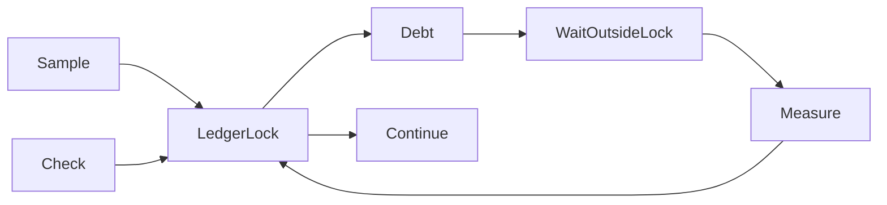

# Cooperative delay runtime

`CooperativeRuntime` is an internal managed adapter for the [delay ledger](delay-ledger.md).
It serializes ledger transitions with one lock. It releases that lock before waiting.
`DelayRuntimeTiming.real` uses `Stopwatch` ticks and cancellation-aware one-millisecond waits.
The adapter measures actual elapsed wait time, including scheduler overshoot.
Selected threads publish credit through `Check`. Other threads pay outstanding debt at their checks.

```fsharp
let runtime = CooperativeRuntime(DelayRuntimeTiming.real)
let thread = runtime.Register None |> Result.defaultWith failwith
runtime.Check(thread, CancellationToken.None) |> Result.defaultWith failwith
```

Each runtime permits one active registration per managed thread.
Checks, block transitions, and exit must run on the registered thread.
Sample credit can arrive from another thread. The ledger rejects credits while the target is blocked or delaying.
The runtime can own a [sample credit stream](sample-credits.md) for each registration.
Observation processing commits the converter state and ledger credit together, which prevents duplicate credit after a failed transition.
Parent registration inherits ledger credit or debt. Independent registration starts at the current global delay.
Expired and foreign handles fail through ledger validation.

Cancellation before a check leaves the thread runnable.
Cancellation during a wait records the elapsed partial wait before returning an error.
A later check must pay the remaining debt. Exit cannot discard debt or unpublished credit.
Errors from the wait operation also record elapsed time before returning an error.
The internal timing seam uses the same tick unit for timestamps and requested delays.



The four runtime checks cover live waiting, cancellation recovery, ownership, and concurrent sample updates during a wait.
The existing ledger tests cover accounting arithmetic and wake outcomes.
The 43 managed tests pass on Windows and Linux x64. See [portability evidence](../../reliability/features/cooperative-runtime/README.md).
The controlled instrumentation workload connects this adapter to an injected loop probe.
It converts a synthetic 40-millisecond CPU observation at zero or 50 percent after probe 10,000.
This produces zero credit or a known 20-millisecond credit.
The worker checks the ledger inside that probe, preserves its result, and settles before exit.
The controlled [Linux workload](linux-perf.md) connects real samples to this adapter through manual probes.
It records the adapter's timestamp interval separately from the inner wait-call duration.
The adapter remains separate from the public serial API.
It does not establish sampling accuracy, synchronization interception, or async support.
Managed allocation and lock overhead must be measured before this adapter can serve production probes.

See [runtime probes](runtime-probes.md), [the roadmap](../plans/roadmap.md), and [the index](../lode-map.md).
