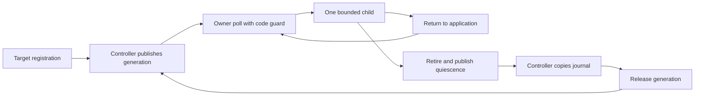

# Cooperative target transport

`CooperativeTarget` binds one site descriptor to the registering native thread and a distinct controller thread.
It composes the existing mailbox and target lease. A poll services at most one child.
No C ABI, production timing implementation, or .NET probe binding exists yet.

Controller-only submit, cancel, snapshot, and release preserve one outstanding generation.
The owner alone polls and retires. Recursive polling is rejected before taking the code guard.
Site identity remains supplied evidence. Actual probe provenance and CLR code lifetime need host integration.
The host must retire before owner exit and join before destroying storage. Abnormal exit and thread-ID reuse remain unsupported.

`CooperativeCodeLifetime` is shared across registrations for one code version.
Poll and submission hold a shared guard. `tryRevoke` uses an exclusive nonblocking guard.
Failed revocation leaves the scope active. Successful revocation prevents new work and cancels pending work at its next poll.
The host must keep code alive until revocation succeeds. This does not automatically pin CLR code.
Successful revocation excludes guarded transport work, not application frames executing outside a poll.

```cpp
auto code = std::make_shared<CooperativeCodeLifetime>(*site);
auto target = CooperativeTarget::registerCurrentThread(*site, code, controller, 128, timing);
auto outcome = target->poll(*site);
```

Terminal processing retires the lease, clears owner execution and announcement, then publishes mailbox quiescence as its final lease-storage action.
Release requires a copied retired snapshot. Storage reuse cannot race old execution or erase a newer announcement.
Invalid journals remain copyable for cleanup but do not imply valid ledger settlement.
Shutdown must retain owner polling until termination and controller release. There is no controller-only force close for a nonpolling owner.

The timing interface uses nonthrowing finite hooks in one monotonic nanosecond domain.
The controller and owner can read it concurrently. Wait operations execute only on the owner.
Hooks must not reenter transport or revocation operations. A nested poll is rejected.
Duration limits validate returned evidence. They cannot preempt a stuck hook.
A zero pre-wait clock reading prevents the wait and retains a failed child with zero payment.
`preWaitClockFailureRetainsEvidence` checks this boundary and requires a copied journal before release.



See [the reference](../../docsSrc/Reference/cooperative-target.md),
[contract evidence](../../reliability/features/native-signal/cooperative-target.md),
[lease admission](target-local-lease.md), and [the lifecycle plan](../plans/experiment-lifecycle.md).
