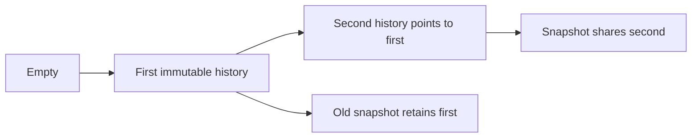

# Immutable counter history

`CpuCounterHistory` is an immutable append-only sequence of `CpuCounterTransition` values.
Each node contains one transition and its previous history. Constructors are private.
`CpuCounterJournal` appends a node after each recorded operation and shares that node in subsequent snapshots.
Old snapshots retain their original entries. The source still requires serialized control and counter reads.

```csharp
var first = CpuCounterHistory.Empty.Append(transition);
var second = first.Append(nextTransition);
```

`Freeze` preserves this concrete immutable sequence. Other lists are copied into read-only arrays.
`ExtendsByOne` requires exactly one additional entry.
A direct parent reference proves unchanged history without enumeration.
Other histories use a full value-prefix comparison, preserving acceptance of equivalent external snapshots.
`Same` accepts an unchanged shared sequence or compares all values.
Source identity, clock, epoch, CPU counter, and latest-transition checks remain in the session parser.



Snapshot creation and direct-parent admission do not copy prior transitions.
Enumeration creates an ordered array. Index access walks backward, except the latest entry which is immediate.
These costs remain relevant to final serialization and external-list fallback validation.
The journal retains its configured transition capacity and checks it before invoking a source operation.
Node allocation occurs after the source operation. Allocation failure can leave the effect unrecorded or replace the original exception.
Allocation-failure recovery is outside the current contract.
Closure checks reject shorter, longer, reordered, and changed histories while preserving valid closure after rejection.

The prior diagnostic measured history-dependent copying in the old implementation.
The replacement diagnostic retains 144 bytes per snapshot and 176 bytes per session advance at all four tested history sizes.
Its two-transition timing retains a large outlier; no uniform latency improvement or bound is established.
The live comparison passes both qualified treatments and one continuous treatment.
The other continuous treatment fails at 3,672,285 ns of selected debt against the unchanged 2 ms gate.
All twelve records pass replay without promoting that failure to success.
See [the retained measurements](../../reliability/features/native-signal/counter-history.md).
See [the session reference](../../docsSrc/Reference/bound-cpu-session.md), [counter evidence](../../docsSrc/Reference/cpu-counter-evidence.md), and [the index](../lode-map.md).
