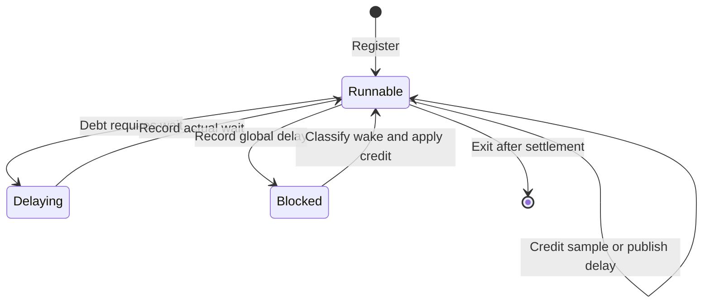

# Sampled delay accounting

`src/CozNet/DelayLedger.fs` defines an internal, immutable accounting model for a sampled experiment.
It does not sample threads, wait, rewrite IL, or connect to the public serial engine.
The runtime adapter must serialize transitions and keep the current ledger state.
The internal [cooperative runtime](cooperative-runtime.md) provides that lock and performs measured waits outside it.
This model is not a lock-free implementation for a profiler callback.

Each ledger represents one experiment with zero initial global delay.
Thread handles belong to that ledger and cannot identify later registrations.
Durations enter through `DelayTicks.tryCreate`. Negative ticks fail.
Overflow returns an error and leaves the previous state intact.
`globalDelay` exposes the typed duration for domain operations.
`globalTicks` exposes the same private counter for measurement without constructing a duration wrapper.
The adapter defines the tick unit. Signal accounting uses nanoseconds.
Neither accessor changes ledger state or accepts raw input.

```fsharp
let ledger = DelayLedger.create ()
let thread, ledger = DelayLedger.register None ledger |> Result.defaultWith failwith
let credit = DelayTicks.tryCreate 10L |> Result.defaultWith failwith
let ledger = DelayLedger.creditSample thread credit ledger |> Result.defaultWith failwith
let action, ledger = DelayLedger.catchUp thread ledger |> Result.defaultWith failwith
```

A selected CPU sample adds local credit. The adapter must exclude blocked time and profiler delay from samples.
`catchUp` publishes credit above global delay or requests payment of debt below global delay.
Equal overlapping local credits advance global delay once.
`completeDelay` records actual elapsed wait. Partial waits leave debt for the next check.
The model follows Linux Coz: overshoot can advance global delay on the next check.
It does not implement the macOS overshoot rule.

A blocked thread records global delay at block entry.
A dependency wake credits only the increase since block entry. Earlier debt remains.
A timeout or spurious wake credits nothing.
The adapter must settle the waking thread before it releases a dependency.
The ledger cannot infer that dependency from a thread identifier.

Children inherit their runnable parent's local delay.
Independent registrations start at current global delay.
A thread can exit only when runnable and exactly settled with global delay.
Effective experiment duration equals measured elapsed ticks minus global delay.
Zero and negative corrected durations fail.



The deterministic cases live in `tests/CozNet.Tests/DelayLedgerTests.fs`.
They cover overlap, wake outcomes, partial waits, overshoot, thread lifecycle, overflow, and duration correction.
They do not establish causal accuracy or validate live synchronization interception.
Two fixed-journal cases compare individual peer payments with aggregate completion of a reserved snapshot.
They preserve concurrent selected credit and terminal overshoot without changing ledger transitions.
The [native service proposal](../plans/native-debt-service.md) uses that arithmetic for an unsampled peer lease.
The [peer service accounting model](signal-service.md) implements lease ownership. Native service remains unimplemented.

See [the serial engine](summary.md), [the roadmap](../plans/roadmap.md), and [the port decision](../../docsSrc/Research/coz-port-and-il-rewriting.md).
