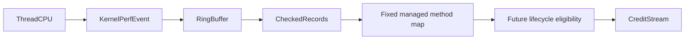

# Linux CPU-event feasibility

`tests/CozNet.LinuxPerf` exercises Linux x64 `perf_event_open` from a managed workload.
It opens `PERF_COUNT_SW_TASK_CLOCK` for the calling thread with a one-millisecond period of thread CPU time.
This clock includes user and kernel execution. Ticks in kernel mode produce no sample.
`representedCpuNanoseconds` sums emitted sample periods. It does not measure selected-method user CPU duration.
The ring records contain user instruction pointers, process/thread IDs, timestamps, and sample periods.
The reader checks record bounds, CPU mode, IDs, timestamp order, lost records, and throttling.
It supports records that cross the ring boundary and applies the documented memory barriers.
`IInstructionMap` separates address resolution from Linux record decoding.
`PerfMapSnapshot` reads the runtime perf map after workload warmup and before sampling starts.
The snapshot rejects incomplete entries and ambiguous address matches.
The controlled workload selects the exact symbol `int64 [CozNet.LinuxPerf] CpuWorkload::Run()[Optimized]`.
Tiered compilation and ReadyToRun are disabled. `DOTNET_PerfMapEnabled=3` enables the runtime perf map.

```powershell
dotnet run --project build/build.fsproj -- -t LinuxPerfVerify
```

The FAKE target builds the workload and runs two disposable Linux containers from an existing .NET SDK image.
Both containers have no network, no capabilities, a read-only root filesystem, and a read-only workload mount.
The default-policy result records whether Docker permits the syscall.
The second run disables the container syscall filter. It does not change the host kernel policy.
Both workload processes have a 30-second limit. Each phase lasts approximately 500 milliseconds.
Missing image, unsupported platform, invalid records, lost samples, throttling, and nonzero verification exits fail explicitly.

The current default Docker policy denies the syscall with `EPERM`.
With the filter disabled, the workload observes CPU samples during busy work and none during sleep.
This is a viable CPU-event source on the tested Linux kernel.
The Windows clock experiment cannot provide equivalent per-sample timing from its coarse cumulative clock.



This is a capability workload, not a connected profiler backend.
It drains events after disabling each phase. It does not yet deliver observations during an experiment.
It resolves instruction addresses to managed method symbols, but not source lines or IL offsets.
The fixed snapshot does not include code compiled after capture.
Code unload, address reuse, JIT version changes, and profiler CPU exclusion remain unsupported.
The exact symbol match is specific to this workload and runtime configuration.
Future integration must preserve event periods, timestamp provenance, and thread eligibility before creating credits.

The syscall ABI is Linux x64 only. The workload rejects other platforms before calling native APIs.
The shared library has no dependency on this executable or its Linux APIs.
Additional operating systems require event backends. Additional architectures require verified syscall numbers and ABI layouts.
The verification script uses PowerShell 7 and Docker. Only a Windows host with Linux x64 containers has been verified.

See [recorded evidence](../../reliability/features/linux-perf/README.md), [sample credits](sample-credits.md), and [the roadmap](../plans/roadmap.md).
