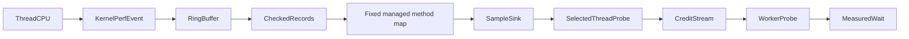

# Linux CPU-event feasibility

`tests/CozNet.LinuxPerf` exercises Linux x64 `perf_event_open` from a managed workload.
It opens `PERF_COUNT_SW_TASK_CLOCK` for the calling thread with a one-millisecond period of thread CPU time.
This clock includes user and kernel execution. Ticks in kernel mode produce no sample.
`representedCpuNanoseconds` sums emitted sample periods. It does not measure selected-method user CPU duration.
The ring records contain user instruction pointers, process/thread IDs, timestamps, and sample periods.
The reader checks record bounds, CPU mode, IDs, timestamp order, lost records, and throttling.
It supports records that cross the ring boundary and applies the documented memory barriers.
`IInstructionMap` separates address resolution from Linux record decoding.
`PerfMapSnapshot` reads the runtime perf map after workload warmup and before sampling starts.
The snapshot rejects incomplete entries and ambiguous address matches.
The controlled workload selects the exact symbol `int64 [CozNet.LinuxPerf] CpuWorkload::Run()[Optimized]`.
Tiered compilation and ReadyToRun are disabled. `DOTNET_PerfMapEnabled=3` enables the runtime perf map.

```powershell
dotnet run --project build/build.fsproj -- -t LinuxPerfVerify
```

The FAKE target builds the workload and runs three disposable Linux containers from an existing .NET SDK image.
All containers have no network, no capabilities, a read-only root filesystem, and a read-only workload mount.
The default-policy result records whether Docker permits the syscall.
The other runs disable the container syscall filter for 50-percent and zero-percent interventions.
They do not change the host kernel policy. Each process has a 30-second limit.
Each phase lasts approximately 500 milliseconds, plus final delay settlement.
Missing image, unsupported platform, invalid records, lost samples, throttling, and nonzero verification exits fail explicitly.

The current default Docker policy denies the syscall with `EPERM`.
With the filter disabled, the workload observes CPU samples during busy work and none during sleep.
This is a viable CPU-event source on the tested Linux kernel.
The Windows clock experiment cannot provide equivalent per-sample timing from its coarse cumulative clock.



This is a capability workload, not a connected profiler backend.
`LiveSampleCollector` drains events on a separate managed thread while the target runs.
Only that collector accesses the ring reader. It publishes cumulative immutable snapshots with volatile writes.
The target must observe a nonempty snapshot before it disables the busy-phase event.
After disabling the event, completion requests a final drain and joins the collector before unmapping the buffer.
Reader failures propagate through completion. Each phase starts from the prior phase's consumed ring position.
The collector uses portable .NET APIs. Its completion and failure checks run on Windows and Linux.
`ICpuSampleSink` receives each checked event on the collector thread.
Events retain process/thread IDs, kernel timestamps, periods, instruction addresses, and optional method symbols.
The bounded capture stores at most 10,000 events per phase. Reading its records requires collector completion.
Sink failures terminate collection and propagate through completion.
The controlled `SampledIntervention` queues events for a selected-thread probe.
That probe converts nominal selected sample periods to credits and publishes local delay through `CooperativeRuntime.Check`.
A second registered thread performs work and pays delay at manual cooperative probes.
`LinuxInjectedVerify` selects the optional `injected` mode through `COZNET_PROBE_MODE`.
The native profiler selects `CpuWorkload.Run` through `COZNET_PROBE_TARGET=linux-perf`.
It inserts calls to `CpuWorkload.Probe` at entry and backward branches.
Thread-local bindings route these calls to selected-thread or worker-thread checks.
The injected mode omits the manual probes after each batch.
Both threads must execute exactly 10,002 injected calls per completed batch.
Warmup checks native profiler status, one rewritten method, and the exact probe count before sampling starts.
This connection still uses a fixed method map and controlled lifecycle. Probe overhead remains a separate limit.
The retained injected control costs 101.5 times as much per batch as the manual control.
Only four of its 500 samples resolve to the work method. This path is not ready for useful prediction.
See [automatic-probe evidence](../../reliability/features/linux-perf/injected-probes.md).
The default cadence checks the ledger after 10 milliseconds of thread CPU time, matching native Coz's processing interval.
`IThreadCpuClock` supplies that clock. The current implementation uses Linux x64 `clock_gettime`.
`ProbeCadence` uses an injectable `TimeProvider` to skip CPU reads before enough elapsed time passes.
CPU time remains authoritative. The elapsed threshold rounds down and is cached after each CPU read.
The fast path uses a timestamp comparison. Deterministic checks use fake CPU and elapsed clocks.
`IWaitBackend` selects managed waits or Linux x64 `nanosleep`. Managed waits remain the default.
The native backend uses at most one-millisecond sleep requests and checks cancellation between calls.
It retries interrupted calls against the remaining monotonic duration. Other native errors fail the run.
The final queue flush and thread settlement bypass the cadence.
Both threads settle before unregistering. The runner checks 50-percent and zero-percent cases.
The treatment must apply samples, create credit, and complete worker waits before sampling stops.
Final settlement alone cannot satisfy this check. An isolated missing-probe mutation fails the assertion.
The zero-percent case must produce zero credit, zero global delay, and zero measured worker waits.

This bridge uses cumulative emitted periods as an estimate of represented CPU time, not a direct CPU-clock measurement.
Only the fixed synchronous method earns credit. Probe code, waits, and unmapped addresses earn none.
The bridge uses a fixed eligibility epoch under this controlled method restriction.
General lifecycle eligibility, GC transitions, and blocking inside selected methods remain unimplemented.
The wrapper records requested duration, backend-call duration, and the ledger's timestamp interval separately.
The ledger interval includes time outside the backend call. Only that interval determines settled delay.
A one-millisecond warmup precedes registration and is excluded from experiment records.
`LinuxWaitCompare` compares both wait backends at zero and 10-millisecond CPU cadence.
CPU batching sharply reduces overshoot propagation. The workload does not establish prediction accuracy.
`LinuxPredictionVerify` compares zero and 50-percent profiles with unprofiled baseline and optimized work.
Eight randomized blocks use seed `20261013`. Each case runs in a separate container.
The physical optimization replaces half the additions with an equivalent constant sum.
`MeasurementWindow` parses 500 or 2000 milliseconds before measurement starts. The prediction target defaults to 2000.
The experiment boundary precedes sampler shutdown. Prediction subtracts live global delay from that interval.
Final settlement delay remains diagnostic and does not enter the prediction formula.
Acceptance requires the complete 95-percent paired-error interval to fit within two percentage points.
Failed runs remain evidence. Successful accounting checks do not imply accurate predictions.
The physical modes and portable checks run before the Linux platform guard.
See [prediction evidence](../../reliability/features/linux-perf/prediction.md).
See [wait comparison](../../reliability/features/linux-perf/wait-comparison.md) for raw records and remaining timing limits.
It resolves instruction addresses to managed method symbols, but not source lines or IL offsets.
The fixed snapshot does not include code compiled after capture.
Code unload, address reuse, JIT version changes, and profiler CPU exclusion remain unsupported.
The exact symbol match is specific to this workload and runtime configuration.
Future integration must preserve event periods, timestamp provenance, and thread eligibility before creating credits.

The syscall ABI is Linux x64 only. The workload rejects other platforms before calling native APIs.
The shared library has no dependency on this executable or its Linux APIs.
Additional operating systems require event backends. Additional architectures require verified syscall numbers and ABI layouts.
The verification script uses PowerShell 7 and Docker. Only a Windows host with Linux x64 containers has been verified.

See [recorded evidence](../../reliability/features/linux-perf/README.md), [sample credits](sample-credits.md), and [the roadmap](../plans/roadmap.md).
