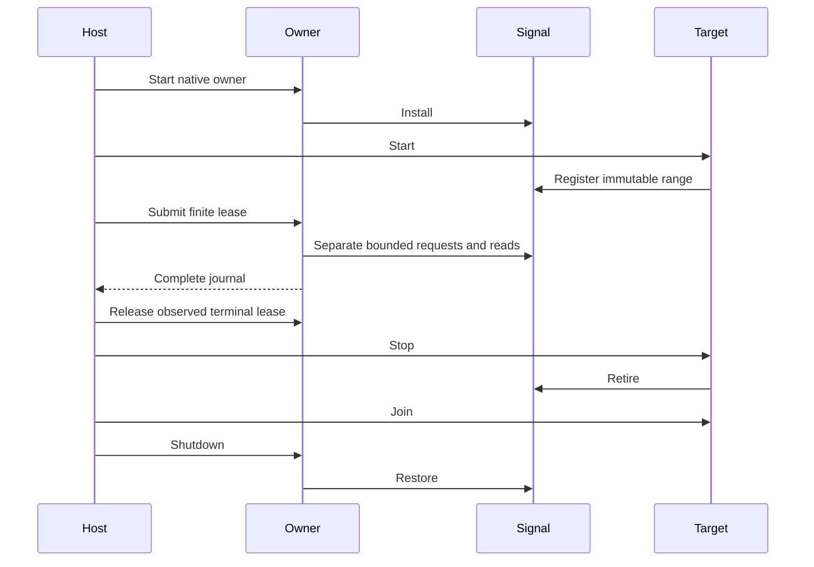

# Linux service transport

`native/service/SignalTransport.Linux.cpp` connects the [native owner](native-service-owner.md) to the existing [signal backend](signal-intervention.md).
It requires Linux x64 and remains separate from the public serial engine.
The [first live run](../../reliability/features/native-signal/service-owner/README.md) passes all 12 CTest cases on Linux x64.
Windows still passes the five portable owner cases with the Linux transport disabled.

## Boundary

`InstructionRange` rejects zero addresses, empty ranges, and address overflow.
The transport uses the same immutable range for both target registrations and acknowledgment eligibility.
The wait mode is immutable and rejects unknown enum values.

```cpp
LinuxSignalTransport transport(InstructionRange(begin, size), SignalWaitMode::spin);
Owner owner(transport);
```

The owner thread performs installation, submission, timed reads, and restoration.
`registerTarget` and `retireTarget` must run on the target thread.
The host keeps each target alive through pending service.
It releases the terminal lease, retires the target, and joins the target before shutdown.
The transport does not manage target threads.



## Result mapping

The current signal API returns submission errors only before successful queue delivery.
The transport maps these errors to guaranteed rejection.
A future backend with ambiguous delivery must return `SendState::ambiguous` instead.
`EAGAIN` from a timed read means pending.
Other read errors fail the session without releasing ownership.
Successful reads preserve all native result and timing fields.
The owner validates the acknowledgment before counting its measured wait.

The transport clock uses `CLOCK_MONOTONIC`, as the signal timestamps do.
Clock errors and invalid or overflowing times return zero and fail the owner clock check.
Native receipt still does not establish first managed receipt.

## Live checks

`SignalServiceChecks.cpp` uses isolated processes with a 30-second CTest watchdog.
The controlled x64 assembly loop exposes exact instruction boundaries and uses lock-free 32-bit flags.
It supplies selected and peer targets without CLR activity.
Peer cases exercise sleep and spin modes with a 110,000 ns budget.
The pending-cancellation case blocks signal delivery after registration and checks refusal of premature retirement.
Other cases check live-target restoration refusal, occupied signal preservation, and parsed input bounds.
Completed or timed-out observations retain their child journals in per-case TSV files.
These checks cannot establish CLR safety, the 2 ms sampled debt gate, or physical prediction accuracy.
The spin peer journal contains three separate requests and preserves 103 ns of snapshot overshoot.
The sleep journal preserves its full 111,301 ns measured wait after one 50,000 ns request.
Pending cancellation retains ownership until a deferred acknowledgment resolves delivery.

See [the build](../build/summary.md), [the native debt plan](../plans/native-debt-service.md), and [the index](../lode-map.md).
