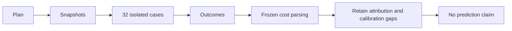

# Matched prediction diagnostics

`VerifyMatchedPrediction.ps1` saves eight four-case blocks before execution and runs each case once in isolation.
The modes are profile-zero, profile-half, physical-baseline, and physical-optimized.
The saved Fisher-Yates seed is `20261014`. Each case retains its exit, log, and result presence.
Setup failure preserves explicit unexecuted rows. Workload failures do not stop later isolated cases.
The runner snapshots source, binaries, calibration inputs, and image identities before measurement.

```powershell
$env:COZNET_CALIBRATION_DIRECTORY = '/absolute/path/to/calibration'
./build.cmd LinuxMatchedPrediction
```

`AnalyzeMatchedPrediction.py` parses frozen endpoints into a `WindowCost`.
It uses selected progress and the global-delay delta, never shutdown progress or summed waits.
Timestamp brackets bound duration. `[N-1,N+1]` bounds batch quantization.
The analyzer rejects malformed boundaries, failed cases, and changed snapshots.
It requires treatment credit and confirmed payment inside the frozen window, not merely in shutdown totals.
The shared calibration parser reconciles all 2,700 segments, the plan, journal, result, and statistics before the runner creates a run directory.
Profile-half costs remain conditional because sample-period and native-journal tails have no verified attribution bounds.
Calibration clock, overhead, and local-speedup uncertainty also prevent the final accuracy gate.
No validated block prediction, subset inference, or series accuracy result is published.
The target deliberately returns failure after retaining diagnostics.

The first matrix ran all 32 cases. Treatments in blocks 1, 4, 5, 6, and 7 failed unchanged capacity or debt gates.
All 24 zero-intervention cases and three treatments completed. All treatment predictions remain ineligible.
Independent reconciliation checked 172 hashes and 27 frozen costs. Sixteen analyzer checks passed on Windows and Linux.
See [the retained run](../../reliability/features/native-signal/matched-prediction.md) for the post-capture analyzer boundary.



The remaining work is source-time alignment, bounded sample/journal tails, and conservative propagation into paired prediction-error intervals.

`timerPrefixDiagnostics` reconciles profile endpoint inventory and accepted waits before comparison eligibility.
Invalid prefix evidence suppresses the affected block. Physical cases remain exempt.
Workload failures retain prefix diagnostics without becoming eligible.
The runner snapshots `AnalyzeTimerPrefixes.py` and `TimerPrefixChecks.py` and runs the checks before timed cases.
Both source hashes are required. Reconciliation does not establish a native-tail bound.
`AnalyzeCpuCounters.py` parses raw evidence into immutable capture values before computing diagnostics.
It reconciles counters, transition state, samples, totals, and final disabled counts.
The final snapshot can equal disabled `endAfter`.
Disabled counts must remain stable in the same epoch.
It reports frozen counter prefixes and suffixes plus outward-rounded disabled elapsed ranges.
It preserves workload failures and closure state. All CPU-attribution and accuracy claims remain false.
The matched analyzer computes these diagnostics before workload eligibility checks.
It also computes `sampleCreditDiagnostics` by replaying nominal periods and declared eligibility epochs.
Invalid credit evidence rejects profile eligibility and suppresses the block's conditional comparison.
The replay preserves failed-workload diagnostics and does not establish native eligibility or CPU attribution.
`sampleMembershipDiagnostics` requires the observed clock policy and reconciled credit before partitioning samples.
Its groups separate source membership, receipt membership, producer acceptance, and selected status.
Invalid membership suppresses the case's conditional comparison. Physical cases have no membership diagnostic.
Failed workload diagnostics remain available. Recorded credit ranges do not establish missing-credit or native-journal bounds.
The runner snapshots both membership Python files and runs the portable checks before timed cases.
The analyzer requires their hashes and rejects non-finite JSON constants and overflowing exponents at file input.
Missing or invalid counter evidence rejects profile eligibility, including legacy captures.
Physical cases do not require it. New runner snapshots include both counter Python files and run their checks.
`conditional_comparison` consumes parsed `WindowCost` values and computes within-block cost ratios with exact fractions.
Output bounds round outward. Negative reductions remain visible.
Each complete block can retain a conditional predicted reduction, physical reduction, and signed nominal difference.
Failed cases or invalid counters suppress their block. Snapshot and runner errors suppress every comparison.
These ranges cover endpoint and progress uncertainty only. They do not establish sampling, journal-tail, clock, or calibration bounds.
No subset aggregate is computed. All validated prediction fields and accuracy flags remain unchanged.
The Coz sampling approximation needs physical validation, not deterministic assignment of every CPU interval to one sampled IP.
See [the reference](../../docsSrc/Reference/matched-prediction.md), [matched workers](matched-physical.md), and [boundaries](measurement-boundaries.md).
