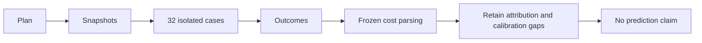

# Matched prediction diagnostics

`VerifyMatchedPrediction.ps1` saves eight four-case blocks before execution and runs each case once in isolation.
The modes are profile-zero, profile-half, physical-baseline, and physical-optimized.
The saved Fisher-Yates seed is `20261014`. Each case retains its exit, log, and result presence.
Setup failure preserves explicit unexecuted rows. Workload failures do not stop later isolated cases.
The runner snapshots source, binaries, calibration inputs, and image identities before measurement.

```powershell
$env:COZNET_CALIBRATION_DIRECTORY = '/absolute/path/to/calibration'
./build.cmd LinuxMatchedPrediction
```

`AnalyzeMatchedPrediction.py` parses frozen endpoints into a `WindowCost`.
It uses selected progress and the global-delay delta, never shutdown progress or summed waits.
Timestamp brackets bound duration. `[N-1,N+1]` bounds batch quantization.
The analyzer rejects malformed boundaries, failed cases, and changed snapshots.
It requires treatment credit and confirmed payment inside the frozen window, not merely in shutdown totals.
The shared calibration parser reconciles all 2,700 segments, the plan, journal, result, and statistics before the runner creates a run directory.
Profile-half costs remain conditional because sample-period and native-journal tails have no verified attribution bounds.
Calibration clock, overhead, and local-speedup uncertainty also prevent the final accuracy gate.
No block prediction, subset inference, or series accuracy result is published.
The target deliberately returns failure after retaining diagnostics.

The first matrix ran all 32 cases. Treatments in blocks 1, 4, 5, 6, and 7 failed unchanged capacity or debt gates.
All 24 zero-intervention cases and three treatments completed. All treatment predictions remain ineligible.
Independent reconciliation checked 172 hashes and 27 frozen costs. Sixteen analyzer checks passed on Windows and Linux.
See [the retained run](../../reliability/features/native-signal/matched-prediction.md) for the post-capture analyzer boundary.



The remaining work is source-time alignment, bounded sample/journal tails, and conservative propagation into paired prediction-error intervals.
See [the reference](../../docsSrc/Reference/matched-prediction.md), [matched workers](matched-physical.md), and [boundaries](measurement-boundaries.md).
