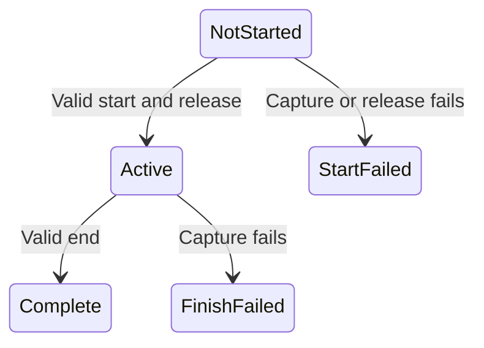

# Measurement boundary capture

`MeasurementWindowCapture` in the portable capability workload owns immutable start and end records.
`Begin` validates readings before the release callback, and brackets that callback with its clock readings.
`Finish` freezes one endpoint before shutdown. It does not retry after success or failure.
This prevents shutdown progress or ledger settlement from replacing measurement state.
Negative counters, invalid pending ownership, backward clocks, and decreasing cumulative counters fail capture.
Active prefix wait can decrease after release. Native generation zero retains ambiguous submission identity.

```csharp
var measurement = new MeasurementWindowCapture(TimeProvider.System);
measurement.Begin(ReadMeasurement, ReleaseWorkers);
measurement.Finish(ReadMeasurement);
```



The sampled timer workload uses this contract for `measurementCapture` and its legacy progress fields.
It closes sample acceptance and disables resume before endpoint capture, then performs shutdown separately.
The capture copies pending identities and global delay, reads selected then peer counters, and retains sample sequence and epoch.
These are controller-accounted values, not an atomic view of native work.
Unreceived sample and journal tails still need uncertainty accounting before prediction analysis.
The [matched physical harness](matched-physical.md) uses the same boundary contract.
Speedup calibration and prediction analysis remain unimplemented.

Seven portable checks cover frozen data, release ordering, failure retention, invalid readings, clock ordering, capture transitions, and cumulative counters.
`--verify-measurement-boundaries` runs these checks alone. `--verify-timer-layout` includes them.
The [retained live evidence](../../reliability/features/native-signal/measurement-boundaries.md) verifies frozen pending identities and progress across cleanup.
The duration clock starts inside worker release, so capture setup does not shorten the requested window.
The corrected zero-percent run lasts approximately two seconds. Treatment still fails the unchanged debt gate.

See [the human-readable contract](../../docsSrc/Reference/measurement-boundaries.md), [sampled timers](timer-sampled.md), and [the index](../lode-map.md).
