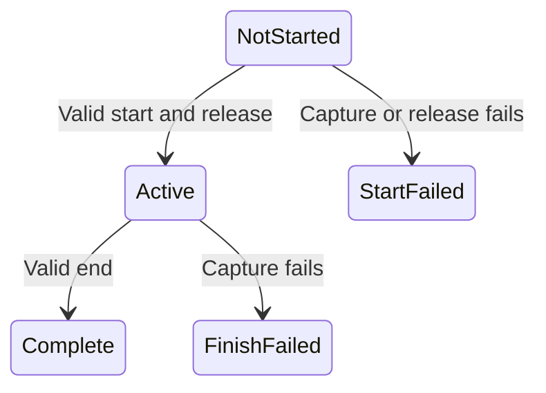

# Measurement boundary capture

`MeasurementWindowCapture` in the portable capability workload owns immutable start and end records.
`Begin` validates readings before the release callback, and brackets that callback with its clock readings.
`Finish` freezes one endpoint before shutdown. It does not retry after success or failure.
This prevents shutdown progress or ledger settlement from replacing measurement state.
Negative counters, invalid pending ownership, backward clocks, and decreasing cumulative counters fail capture.
Active prefix wait can decrease after release. Native generation zero retains ambiguous submission identity.

```csharp
var measurement = new MeasurementWindowCapture(TimeProvider.System);
measurement.Begin(ReadMeasurement, ReleaseWorkers);
measurement.Finish(ReadMeasurement);
```



The sampled timer workload uses this contract for `measurementCapture` and its legacy progress fields.
Each sampled worker includes a `MeasurementLedgerReading` from `SignalAccounting.captureThread`.
It preserves settled local and global credit plus the separate unsettled service prefix.
Capture reconciles service identity, child count, wait, and settlement with the controller snapshot.
Settled-but-unreleased native ownership contributes zero unsettled ledger wait.
Both worker observations must be present together and retain thread identity across endpoints.
Physical producers and historical captures can omit this capability.
The producer rejects blocked and individual-request accounting states.
These values do not replace global delay or bound unknown native suffixes.
The [live ledger capture](../../reliability/features/native-signal/ledger-boundaries.md) retains both worker readings at both endpoints.
Zero percent closes successfully. Treatment rejects a 9.684 ms wait and retains one unclosed selected journal.
The failed result cannot qualify a conditional completion range or a prediction claim.
The timer runner hashes `MeasurementLedgerReading.cs`.
The matched runner captures it with the workload source directory.
It closes sample acceptance and disables resume before endpoint capture, then performs shutdown separately.
The capture copies controller accounting and global delay, reads selected then peer counters, and retains sample sequence and epoch.
These are controller-accounted values, not an atomic view of native work.
`Readings.Timer` retains an immutable `TimerServiceController.AccountingSnapshot` for sampled timer producers.
It includes the released-journal prefix count and per-slot released wait and pending accepted-prefix evidence.
The producer derives worker totals and identities from this same snapshot.
Boundary capture rejects mismatched totals or identities. End capture rejects journal count regression or changed snapshot presence.
Later controller release cannot change the frozen child count, confirmed wait, capture timestamp, or ownership flags.
The snapshot performs no native read and does not determine unreceived native tails.
Legacy captures without this field cannot supply the exact accepted prefix at the frozen endpoint.
Unreceived sample and journal tails still need uncertainty accounting before prediction analysis.
The [matched physical harness](matched-physical.md) uses the same boundary contract.
[CPU calibration](physical-calibration.md) retains paired measurements. [Matched diagnostics](matched-prediction.md) parse costs but reject unbounded attribution.

Nine portable checks cover frozen data, release ordering, failure retention, invalid readings, clock ordering, capture transitions, cumulative counters, and timer-prefix consistency.
`--verify-measurement-boundaries` runs these checks alone. `--verify-timer-layout` includes them.
The [retained live evidence](../../reliability/features/native-signal/measurement-boundaries.md) verifies frozen pending identities and progress across cleanup.
The duration clock starts inside worker release, so capture setup does not shorten the requested window.
The corrected zero-percent run lasts approximately two seconds. Treatment still fails the unchanged debt gate.

See [the human-readable contract](../../docsSrc/Reference/measurement-boundaries.md), [sampled timers](timer-sampled.md), and [the index](../lode-map.md).
