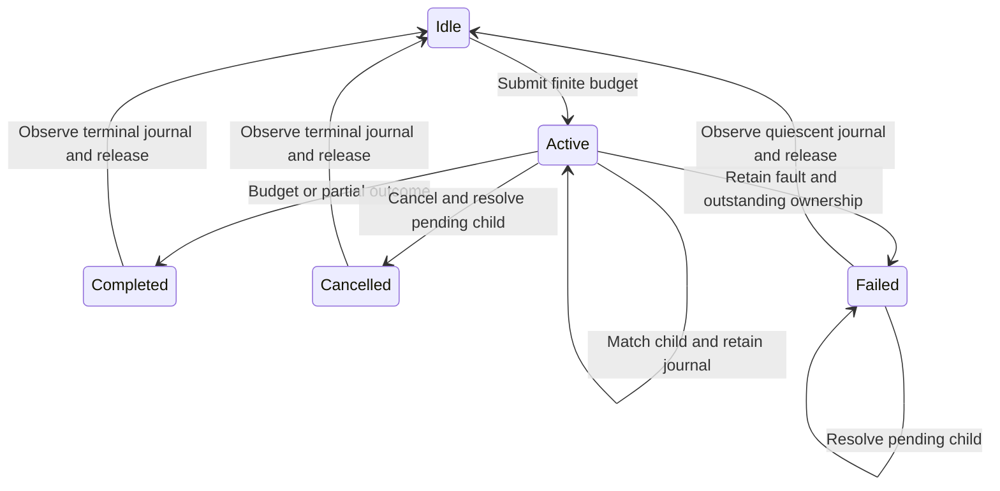

# Native service owner

`native/service/ServiceOwner.cpp` implements a portable C++20 coordinator behind `Transport`.
The coordinator has no Linux or CLR calls.
The [Linux transport](linux-service-transport.md) connects the coordinator to the bounded signal library.
The [C ABI and managed client](service-interop.md) pass controlled receipt and lifetime checks.
The ledger adapter and sampled workload integration remain unimplemented.
The [peer accounting model](signal-service.md) defines the managed reservation and settlement boundary.

## Ownership and service

One native thread calls transport installation, request submission, acknowledgment reads, and restoration.
Slot 0 sends one selected request of at most 50,000 ns.
Slot 1 services a fixed peer budget of at most 2,000,000 ns through separate requests.
Each child requests the lesser of 50,000 ns and the unpaid snapshot budget.
The owner retains measured overshoot and stops on deferred or interrupted acknowledgment.
Each slot permits one outstanding child.
The next child requires a matching acknowledgment.

```cpp
coz::service::Owner owner(transport);
const int installed = owner.start();
```

An installation failure starts no service and joins the native thread.
Successful installation requires explicit successful `shutdown()` before owner destruction.
Destroying an owner with a joinable thread terminates the process through `std::thread`.
The host must use an isolated-process watchdog when unresolved delivery prevents shutdown.
The transport must outlive the owner.



## Failure and lifetime

Cancellation retains pending ownership until the matching child resolves.
Timeouts and clock failures also retain pending ownership.
A late valid acknowledgment remains in the journal without clearing the failure.
Invalid records remain raw evidence and do not contribute measured wait.
Mismatched sequences enter a separate rejected journal with the same fixed capacity as the child journal.
The owner stops reading if that journal fills and retains outstanding ownership.
Zero or reused send sequences remain quarantined, including ambiguous submissions.
Ambiguous sequence ownership can remain unresolved indefinitely.
The owner does not infer that failed observation means stopped delivery.

Any service failure prevents new submissions for that owner.
A failed restoration also prevents new submissions but permits another restoration attempt.
Release requires an observed terminal snapshot with no outstanding child and the complete journal.
Shutdown requires both slots to be released.
Target registration, retirement, and joins remain the host's responsibility.
The host must keep targets alive through outstanding requests and join retired targets before restoration.

The owner copies snapshots under its mutex.
Snapshot overhead and effects on service latency remain unmeasured.
Native observation does not establish first managed receipt.
The adapter must preserve the existing 100 ms bound through that receipt.

## Current checks

`OwnerChecks.cpp` uses a fake transport with controlled acknowledgments and an atomic clock.
It checks owner-thread calls, child bounds, cancellation, partial outcomes, overshoot, journal exhaustion, send rejection, and installation failure.
`failedClockRetainsPendingChild` checks zero time, clock regression, and timeout while delivery remains pending.
`failedRestoreRejectsNewWork` checks failed restoration, submission rejection, and successful restoration retry.
`invalidAcknowledgmentRetainsRawChild` covers eight invalid timing, outcome, and address cases without crediting their waits.
`mismatchedAcknowledgmentRetainsEvidence` preserves a foreign record while awaiting the matching child.
`selectedSlotStopsAfterOneChild` checks selected service with a partial measured wait.
`sessionFaultCancelsPendingPeer` checks a selected send failure while peer service is pending.
`ambiguousDeliveryResolvesOnlyMatchingChild` retains the failure after a matching acknowledgment resolves delivery.
Separate process cases check invalid send sequences and rejected journal exhaustion.
Those cases assert retained ownership, then exit without destroying the quarantined owner.
These checks pass with Clang on Linux and MSVC on Windows.
They do not establish native signal safety, service capacity, or physical prediction accuracy.

See [the native debt plan](../plans/native-debt-service.md) and [the project index](../lode-map.md).
