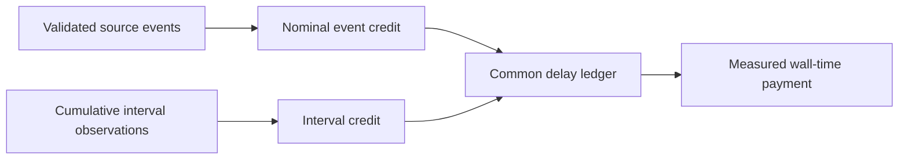

# Nominal event credit

`NominalSampleObservation` and `NominalSampleCreditStream` separate event weights from cumulative interval observations.
The fixed positive period is part of stream identity. An observation with a different period rejects.
Every admitted runnable selected event earns period times speedup, including initial and resumed events.
Fractional ledger ticks survive epoch changes and excluded events.
Sequences must be contiguous. Epochs must be positive and cannot decrease.
Empty epochs can produce epoch jumps. The producer must separately prove source transition continuity.

```fsharp
let selected, state =
    SignalAccounting.registerNominal 50 1000000UL (SignalAccounting.create ())
    |> Result.defaultWith failwith
```

Signal accounting tags interval and nominal streams. Using the wrong observation API rejects before ledger mutation.
Both paths share pending-request exclusion, required epochs, and atomic ledger credit.
The interval API retains its existing first-observation exclusion.
Nominal credit is statistical event attribution, not proof of exact selected CPU between observations.
It does not repair source loss, CLR invalidation, measurement membership, or native ownership.
Measured wall-time payment and all existing bounds remain authoritative.

The bound workload selects nominal events with `COZNET_SAMPLE_CREDIT=nominal-event` or runner switch `-NominalSampleCredit`.
Default `interval` behavior remains. The source period is fixed at 1,000,000 ns and every source event must match it.
The record binds `sampleCreditPolicy=nominal-event-v1` and `nominalSamplePeriodNanoseconds=1000000`.
Nominal qualified cadence admits one check after the first current-epoch event, even at zero speedup.
Interval cadence retains its two-event requirement. Resume clears both policies' readiness.
Both sampled runners bind requested policy to result metadata. Four-arm plans add `sampleCreditEvidenceVersion=1`.
Legacy records and plans remain interval-only. A mismatched sampled arm suppresses comparison without discarding the other arms.
See [the human reference](../../docsSrc/Reference/nominal-event-credit.md) and [the source comparison](../../docsSrc/Explanations/nominal-event-credit.md).

The [Linux evidence](../../reliability/features/native-signal/nominal-event-credit.md) passes all three diagnostic outcomes and full replay.
The four-arm comparison completes with no invalid arms or integrity errors but remains unqualified.
It estimates a 0.9–1.3% slowdown against about 53.9% physical elapsed reduction.
The treatment records 50 selected pauses. Their cost is not isolated by this block.
Upstream event-rule compatibility does not establish prediction accuracy. Keep the policy opt-in.



See [interval credit](sample-credits.md), [eligibility prefixes](epoch-prefix-evidence.md), and [the index](../lode-map.md).
