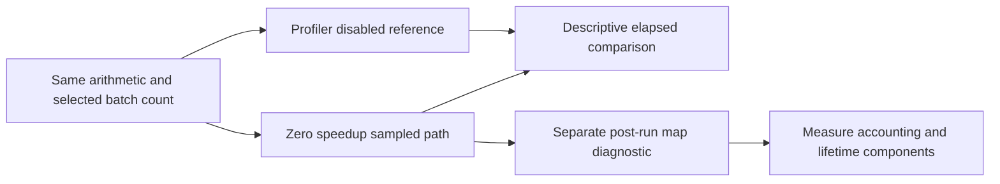

# Bound observer overhead

The bound selected workload performs sampling, probe checks, and accounting at zero speedup.
The fixed-work reference uses the existing arithmetic and dedicated worker but a separate scratch outer loop.
It calls arithmetic through a compiled delegate, with profiling disabled.
The sampled path rewrites the same source method before JIT compilation. Its generated code differs from the reference.
It is a diagnostic reference, not a public profiling backend or an exact overhead control.

```powershell
Get-Content artifacts/fixed-work-observer/20261015T180943553/analysis.json
```

Eight shuffled balanced pairs retain all 16 outcomes, matching checksums, joined workers, and unchanged input hashes.
Selected work uses 5,000 batches. The median profile/reference elapsed ratio is 7.37.
Reference times span 15.3–16.3 ms. Seven profile cases span 113.5–118.5 ms, and one retains 204.5 ms.
The shuffled order groups reference-first pairs before profile-first pairs, leaving time-drift confounding.
All profile cases have zero payments and pauses.
Selected-work brackets exclude setup and cleanup. Peer totals span different lifetimes and cannot normalize those brackets.

A separate runtime-map capture resolves 279 of 471 source samples, including 80 at `CpuWorkload.Run`.
The other 192 are unresolved. All post-run labels are diagnostic only.
They do not establish code lifetime, component-exclusive CPU, or prediction accuracy.
All samples, including final-drain records, remain represented.



The workload uses [immutable accounting reuse](accounting-reuse.md) after component measurements identified repeated-state allocation.
The latest zero-speedup reference capture retains a median ratio of 2.95 with all 16 records valid.
Its reference timings differ from the earlier capture, so their ratios do not isolate the change's exact effect.
Probe lifetime checks remain a measurement candidate, not a proven dominant cost.
These optimizations do not establish low profiler overhead or prediction accuracy.
See [the retained evidence](../../reliability/features/native-signal/fixed-work-observer.md),
[the explanation](../../docsSrc/Explanations/bound-observer-overhead.md),
[counter history](counter-history.md), and [the index](../lode-map.md).
