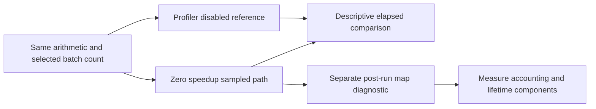

# Bound observer overhead

The bound selected workload performs sampling, probe checks, and accounting at zero speedup.
The fixed-work reference uses the existing arithmetic and dedicated worker but a separate scratch outer loop.
It calls arithmetic through a compiled delegate, with profiling disabled.
The sampled path rewrites the same source method before JIT compilation. Its generated code differs from the reference.
It is a diagnostic reference, not a public profiling backend or an exact overhead control.

```powershell
Get-Content artifacts/fixed-work-observer/20261015T180943553/analysis.json
```

Eight shuffled balanced pairs retain all 16 outcomes, matching checksums, joined workers, and unchanged input hashes.
Selected work uses 5,000 batches. The median profile/reference elapsed ratio is 7.37.
Reference times span 15.3–16.3 ms. Seven profile cases span 113.5–118.5 ms, and one retains 204.5 ms.
The shuffled order groups reference-first pairs before profile-first pairs, leaving time-drift confounding.
All profile cases have zero payments and pauses.
Selected-work brackets exclude setup and cleanup. Peer totals span different lifetimes and cannot normalize those brackets.

A separate runtime-map capture resolves 279 of 471 source samples, including 80 at `CpuWorkload.Run`.
The other 192 are unresolved. All post-run labels are diagnostic only.
They do not establish code lifetime, component-exclusive CPU, or prediction accuracy.
All samples, including final-drain records, remain represented.



The workload uses [immutable accounting reuse](accounting-reuse.md) after component measurements identified repeated-state allocation.
The latest zero-speedup reference capture retains a median ratio of 2.95 with all 16 records valid.
Its reference timings differ from the earlier capture, so their ratios do not isolate the change's exact effect.
Probe lifetime checks remain a measurement candidate, not a proven dominant cost.
These optimizations do not establish low profiler overhead or prediction accuracy.
See [the retained evidence](../../reliability/features/native-signal/fixed-work-observer.md),
[the explanation](../../docsSrc/Explanations/bound-observer-overhead.md),
[counter history](counter-history.md), and [the index](../lode-map.md).

## Probe component diagnostic

The separate Linux diagnostic retains 32 valid cases in `artifacts/bound-probe-cost/20261015T190639232`.
Eight shuffled blocks compare baseline, probes without callback, CLR lifetime checks, and idle native polling.
Every case completes 50,000 batches. Injected cases execute 500,000 probes.
Median times are 160.570, 180.592, 202.562, and 221.784 ms respectively.
Calling-thread allocation is zero in every measured case.
All outliers remain. Individual within-block differences include negative values.
The callbacks differ and include diagnostic checks, so differences do not isolate exact component costs.
The workload excludes sampling, accounting, and payment.
Lifetime query optimization still requires admission and concurrency proof.
See [the evidence](../../reliability/features/native-signal/bound-probe-cost.md).

The scratch lifetime candidate performs full identity admission once, then queries the immutable native record on each guarded operation.
Capture `artifacts/bound-lifetime-cost/20261015T191144500` retains sixteen valid cases and duplicate-module rejection after every measurement.
The median paired saving is 15.615 ms across 500,000 probes, with zero measured calling-thread allocation in both paths.
One pair favors the existing guard. All outliers remain.
A direct query replacement is invalid for arbitrary parsed bindings because module, function, and method are not query arguments.
The two-step candidate depends on immutable identity after Ready and permanent invalidation.
The runtime retains full checks. Full-workload benefit and concurrent candidate admission remain unverified.
The next investigation should prioritize sample coverage and physical prediction over this small component saving.

## Coverage after longer selected work

The twelve-case replay in `artifacts/bound-coverage/20261015T191528612` partitions mapped and unmapped observations by epoch baseline status.
The continuous treatments have more than 96% empty enabled epochs. Qualified treatments have none, but credit only 9 and 15 mapped intervals.
The 50,000-batch qualified capture `artifacts/bound-qualified-long/20261015T191601502-17f1035a` passes all three cases and unchanged bounds.
Its treatment credits 125 mapped intervals and retains 62 mapped baselines without credit.
Its 124 pause intervals total 60.507 ms, while recorded selected payment totals 0.166 ms.
The first pause is the longest at 26.117 ms. All observations remain retained.
Counter totals span the source session and cannot establish application CPU coverage within selected work.
Optional phase timing now covers producer stop, final-drain acknowledgment, payment, and resume.
It must retain the first pause and separate phase duration from any causal attribution to JIT or scheduling.
See [coverage evidence](../../reliability/features/native-signal/bound-coverage.md).

## Optional pause phase timing

`VerifyBoundSampledPayment.ps1 -SelectedPayment -PauseTiming` enables `COZNET_PAUSE_TIMING=1` for child workloads.
The default is disabled. Other non-null values except `0` reject the workload.
Each pause owns a fresh `BoundPauseTiming`. All timestamps use `Stopwatch` and the result's timestamp frequency.
Completed boundaries retain timestamps. Unreached boundaries remain null after failure.
The timing object does not authorize source, payment, or cleanup transitions.
The collection records producer stop, disabled-counter acceptance, drain acknowledgment, batch validation, snapshot construction,
callback return, source enable, enabled-counter acceptance, collector resume, and final lifetime acceptance.
The workload also records completion of drained-sample publication within its callback.
The optional fields extend schema 3/4 diagnostics without changing existing accounting fields.
These measurements include clock and recording overhead. They cannot identify execution versus descheduling.

The first timed capture `artifacts/bound-pause-phases/20261015T192347082-e5e8a957` retains a treatment failure at 2,499,880 ns peer debt.
All three records pass replay, which preserves that failure. Zero speedup and expected invalidation pass.
The first pause lasts 42.733 ms. Drain acknowledgment through batch validation occupies 35.567 ms.
That interval includes admission closure, a lifetime check, snapshot construction, and validation.
The next diagnostic should isolate first-use validation without weakening its accounting checks.
No phase duration proves CPU ownership, JIT activity, or descheduling.
The runner checks that recorded timing activation matches its requested setting.

Collection startup prepares the existing batch validator before source creation, under the initial lifetime guard.
The private setup uses a local read-only sample list with mapped, unmapped, and duplicate-IP cases.
It does not publish to the capture sink, open an epoch, read the event counter, or create ledger credit.
Every real paused and final batch still runs the unchanged complete validator.
The setup moves first-use work outside source lifetime. It does not bound all future JIT or validation cost.
The controlled final-drain check requires zero captured samples and zero event count before first enable.

The isolated 47-record validator capture `artifacts/batch-validation-cost/20261015T192940590` retains eight valid processes.
First-call validation spans 18.4–35.5 ms; repeated calls average 3.15–4.26 microseconds with 4,480 bytes per call.
Prepared live capture `artifacts/bound-pause-prepared/20261015T193222031-90cbc6a8` reduces the first drain-to-validation interval to 0.400 ms.
It still fails a later selected child at 6.292 ms against the unchanged 5 ms handler bound.
All three records pass replay. Zero speedup and expected invalidation pass.
Preparation does not establish stable capacity or prediction accuracy.
See [preparation evidence](../../reliability/features/native-signal/validation-preparation.md).

## Native wait contention diagnostic

The isolated real-spin capture `artifacts/cooperative-wait-cpu/20261015T195655436` retains four two-mode blocks and 80,000 wait observations.
All diagnostic consistency checks pass. The contended cases retain 204 waits above 5 ms; the cases alone retain none.
Every long observation bracket records an involuntary context switch. Long-wait CPU deltas include a 10.265 ms outlier.
The CPU and switch brackets include diagnostic work, and all contended cases ran first within their blocks.
This establishes neither calibrated clocks nor the cause of the earlier managed failure.
The next integration needs bounded per-child observations through the existing timing seam, with explicit unsupported and failure states.
Payment semantics and all bounds remain unchanged.
See [native wait evidence](../../reliability/features/native-signal/cooperative-wait-cpu.md).


The [single-CPU cooperative capture](../../reliability/features/native-signal/cooperative-single-cpu.md) fails the 2 ms peer debt gate.
Replay verifies the failure. No retained child exceeds the handler bound.
One peer wait records 939001 ns wall time and 35700 ns CPU advance.
A later request has no recorded child at a native snapshot 11365728 ns after arming.
Its first child starts after 13098192 ns. Cleanup payment does not repair the failed experiment.
The CPU-set restriction also changes runtime processor availability.
Target scheduling and buffered credit publication remain separate unresolved causes of the capacity gap.

The final four credits add exactly 2000000 ns to the pending 71535 ns request budget.
Their source timestamps precede native arming under the shared configured CLOCK_MONOTONIC contract.
Per-drain and publication times are not retained, so backlog attribution remains incomplete.
A proposed owner-driven draining comparison would remove one collector scheduling dependency without relaxing the debt gate.
