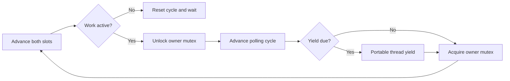

# Native owner polling policy

`OwnerPollSchedule` supplies two portable, finite schedules through private-constructor factories.
`yielding()` yields after every active iteration. `bounded()` yields after 64 active iterations.
The schedule has no OS calls. `Owner::run` uses `std::this_thread::yield` only when the schedule requests it.
The owner unlocks its mutex between every active iteration, including iterations without a yield.
Entering the inactive condition-variable wait resets the cycle.
The owner constructor resets a supplied schedule so prior use cannot shorten the first cycle.

```cpp
Owner owner(transport, 100000, OwnerPollSchedule::bounded());
```



This tests the unconditional-yield dependency identified by [the upstream comparison](../../docsSrc/Research/native-owner-scheduling.md).
It does not establish a fix for the observed owner scheduling gap.
The iteration budget is not a time bound and cannot prevent OS preemption.
Both schedules retain the same debt, request, handler, receipt, and ownership contracts.
Idle service does not spin.

`boundedPollingPreservesSettlement` checks the exact cycle, reset, three bounded children, measured overshoot, release, and shutdown.
Portable owner checks pass on Windows and Linux.
`coz_service_open_with_polling` accepts 0 for yield and 1 for bounded polling. Other values return `EINVAL`.
The legacy open entry point preserves yielding.
`OwnerPollingPolicy` parses `yield` and `poll-64` before native startup.
Sampled service commands accept one optional final policy argument and default to `yield`.
`LinuxServiceOwnerPolling` runs both policies at zero and 50 percent with both initialization stages,
submission timing, four scheduler streams, and unchanged limits.
The runner retains all outcomes, CPU observations, analyses, and source/binary hashes.
Its fixed policy-major order is a diagnostic comparison, not a randomized accuracy experiment.
The [retained comparison](../../reliability/features/native-signal/service-submission/owner-polling.md) fails both treatments in warmup.
Poll-64 retains a 10.54 ms last-handler-clock-to-owner-observation interval with 10.54 ms owner switch-out overlap.
All four scheduler analyses pass integrity. Targets join and sessions restore.
Neither policy establishes capacity or physical prediction accuracy. Keep yielding as the default.

See [native ownership](native-service-owner.md), [the timing reference](../../docsSrc/Reference/native-service-accounting.md),
and [owner scheduling evidence](../../reliability/features/native-signal/service-submission/owner-scheduler.md).
