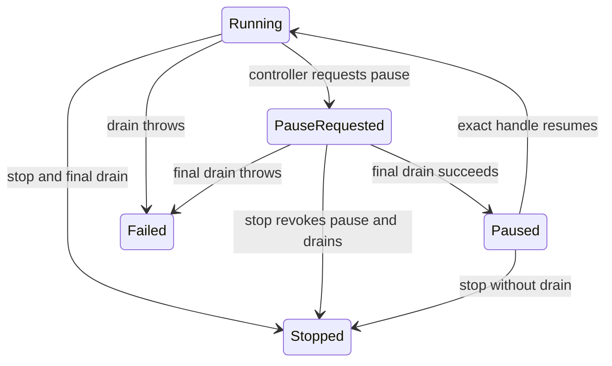
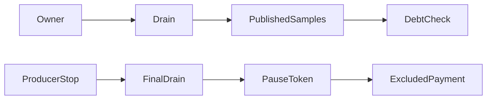

# Acknowledged collector pause

`PausableSampleCollector` separates drain ownership from source enable/disable ownership.
The constructing controller thread owns transitions. One worker owns every drain.
Pause acknowledges only after the in-flight drain and a final drain complete.
The current pause handle is checked by reference identity. Stop revokes a pending handle and prevents resume.

```csharp
collection.StartPausable(CreateOwnerStoppedSource);
collection.ExecuteExcluded(records => ProcessOldRecordsAndPay(records));
```

`BoundSampleCollection.StartPausable` requires an `IOwnerStoppedCpuEventSession` backend.
`ExecuteExcluded` disables the producer, awaits the final drain, closes admission, and checks cumulative accounting before its callback.
After callback return and a CLR lifetime check, it opens the next admission epoch, enables the source, and resumes collection.
`BoundEpochSample` retains its epoch at admission. `ReadEpochProvisional` returns immutable copies.
`EpochDiagnostics` preserves the labels after cleanup, including failure cleanup.
Callback failure or observed invalidation prevents resume and permanently rejects collection.
The default `Start` path retains `BoundCpuEpoch` and `LiveSampleCollector`.
The legacy sampled payment command uses that default path.
The selected-payment commands use the pausable path and preserve original sample epochs through payment.
`LinuxCpuEventSession.DisableAndStopProducer` requires its creating OS thread and disables its dedicated task-clock source.
Producer-stop acknowledgement is separate from counter validation. Failed-enable recovery still issues disable and marks unrecorded cleanup.
`DisableSucceeded` records the stop acknowledgement. Counter failure belongs to the `counters` cleanup stage.
The [selected payment callback](selected-owner-payment.md) stops the producer and processes the acknowledged final drain before reserving a lease.

`BoundCpuSession` separately parses repeated enable and disable evidence into immutable session values.
It preserves source identity, the previous journal prefix, and cumulative CPU across source epochs.
It requires exactly one successful transition for each advance and a matching disabled counter for closure.
The collection consumes these values at each source transition and at final closure.

The restricted task-clock source analysis supports disable followed by a final drain for old sample ownership.
Deferred loss records can still describe pre-pause overflow after resume.
Loss accounting must remain cumulative. Later loss rejects the whole experiment without reversing physical waits.
Resume preserves the partial timer period, so the first sample in a new eligibility epoch earns no credit.



A drain failure faults pause and completion with the same exception. Failed or stopped collectors cannot resume.
Completion joins the worker before it disposes the wake event. A stuck drain still requires an outer process watchdog.
The controlled queue prototype demonstrates why switching admission before pause acknowledgement mislabels queued samples.
It does not prove timing capacity or source-disable behavior.

Portable integration checks cover queued old records, callback-return ordering, disable/resume failure, invalidation, late loss, and inconsistent pause accounting.
These checks use a fake source. They do not establish a live backend's producer-stop contract or selected payment capacity.
The live `pause` mode runs two excluded callbacks with real task-clock samples and requires three source and eligibility epochs.
It checks a stable disabled event counter during deliberate owner CPU work, plus final cumulative accounting.
The source research constrains the Linux hook. A passing workload does not generalize its contract to other perf event types.
Failure diagnostics can retain only a prefix, especially when enable succeeds before its counter check fails while collection remains paused.
`Latest` retains raw cumulative diagnostics, including rejected loss. It is not acceptance evidence.
See [retained pause evidence](../../reliability/features/bound-samples/pausable-collection.md) for the live case and portable contracts.

See [the reference](../../docsSrc/Reference/pausable-sample-collector.md),
[source sessions](../../docsSrc/Reference/bound-cpu-session.md),
[perf ownership](../../docsSrc/Research/perf-pause-ownership.md),
[sample eligibility](../../docsSrc/Research/cooperative-sample-eligibility.md), and [the lifecycle plan](../plans/experiment-lifecycle.md).

## Owner-driven mode

`StartOwnerPausable` selects a separate `OwnerSampleCollector` through `IPausableSampleCollector`.
The source never has a background reader in this mode.
`DrainOnOwner` rejects excluded execution, cleanup, and foreign threads.
The collector rejects recursive control and retains the first drain failure.
Collection cleanup and excluded execution reject reentry from an active owner drain before they change the source.
Pause drains synchronously after producer stop. Completion drains only a running collector.
`CollectorJoined` means drain ownership has ended, including when no worker exists.

```csharp
collection.StartOwnerPausable(CreateOwnerStoppedSource);
collection.DrainOnOwner();
var samples = collection.ReadEpochProvisional(0);
```

The workload enables this mode with `COZNET_OWNER_DRAIN=1` and an explicit selected cadence.
It drains before selected-probe sample counts and after selected batches.
The runner exposes `-OwnerDrain`. The first ordinary-CPU-set owner run passes all three cases. Its paired background treatment fails selected debt. Stable capacity remains unverified.
Owner drain CPU can enter selected sample periods. The credit rule is unchanged, but observer CPU is not excluded.
The Linux reader captures one ring head per drain. It does not chase a moving producer.



See [the first owner comparison](../../docsSrc/Research/native-owner-scheduling.md#first-owner-driven-drain-comparison) for retained failures and the single-pair overhead limit.

## One-CPU capacity limit

The [declared ABBA comparison](../../reliability/features/native-signal/owner-drain-single-cpu.md) fails all four treatments.
Zero-speedup and expected-invalidation cases pass. Replay verifies all twelve records.
One owner failure receives new selected credits after peer arming, before the first peer child executes.
The other rejects a managed receipt interval whose exact endpoint is not retained.
Owner draining does not remove these capacity limits.
The [receipt capture](cooperative-managed.md#rejected-managed-receipt-intervals) now retains rejected parser arguments without changing the 100 ms gate.
Its first constrained run fails peer debt before reaching a receipt rejection.
Native Coz applies a full captured batch before its delay check; this workload still services peer receipts between samples.
See [the explanation](../../docsSrc/Explanations/owner-drain-capacity.md).
