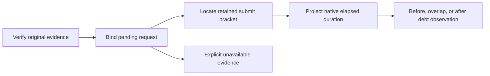

# Peer progress from retained brackets

`AnalyzeCooperativePeerProgress.py` replays selected-payment evidence before projecting the first child timestamps.
It binds the failure boundary, pending reservation, native header, first child, and unique retained peer submit.
The native first-child `Armed` timestamp comes from `CooperativeTarget::submit` inside the controller action.
Later child arming timestamps cannot anchor this projection.

```python
lower = submit_started + native_elapsed
upper = submit_finished + native_elapsed
```

The actual implementation converts clock units with integers and rounds endpoints outwards.
It assumes comparable elapsed-time rates, not equal clock epochs or calibrated physical accuracy.
The model uses equal reported rates after unit conversion and has no independent clock-error bound.
The first child's `Started` is admission, not exact spin entry. `Finished` is not mailbox quiescence.
The comparison uses the last debt observation, not a measured first crossing of the debt limit.
Missing or failed observations remain unavailable. Duplicate submit commands reject the input.
Existing workload failure stays failed even when diagnostic evidence verifies.
The selected-payment runner copies and hashes the analyzer and executes its checks from the source snapshot.



The retained direct trial 03 places first-child admission 4.293347 through 6.017391 ms after debt observation under this model.
Its later retired failure capture does not demonstrate already-paid debt at the gate.
Direct trial 02 has no published child. The two controller trials lack retained submit brackets.
Both direct invalidation cases also place first admission after debt, but fail before the intended invalidation scenario.
The 128-entry history can evict submits during header polling, preventing a complete comparison between modes.
Zero published children can include an executing child. Final peer counters include later work.
Do not infer peer scheduling from either observation.

Next measurement: generation-bound probe and child phases at submission and the debt gate, paired with complete scheduler evidence.
Native Coz's application-thread delay checks do not include this managed receipt handoff.
Keep the debt, child, receipt, and prediction gates unchanged.

See [the user reference](../../docsSrc/Reference/cooperative-peer-progress.md), [receipt readiness](receipt-readiness.md),
[retained evidence](../../reliability/features/native-signal/peer-progress.md), and [the index](../lode-map.md).
