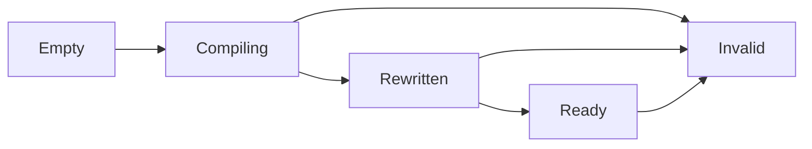

# CLR probe identity boundary

`COZNET_PROBE_IDENTITY=bound` rewrites the controlled `CpuWorkload.Run` target to call `ProbeBound` with literal generation and site arguments.
Generation 1 belongs to one process-lifetime `ProbeLifetime` record. Entry is site 1 and the controlled loop is site 2.
The record retains scalar module/function/token identities. It does not retain managed objects or pin native code.
The legacy mode remains separate.

```cpp
coz::ProbeBinding binding{};
if (lifetime.read(binding)) {
    const bool admitted = lifetime.current(binding.generation, 2);
}
```

Only a completed rewrite followed by successful JIT completion and one valid native range can publish Ready.
Duplicate selected compilation, module unload, and shutdown permanently invalidate the record.
An invalidated record cannot publish Ready again. The first reason wins.
Callbacks use lock-free atomics and never drain cooperative ownership.
Queries establish only a point-in-time observation.
The [bound cooperative client](bound-cooperative.md) checks the record before and after payment and receipt operations, and again at completion.



Bound mode disables tiering, precompiled images, and process-wide inlining through the startup event mask.
It captures one whole-method native range through `GetCodeInfo2`. `CozStartSampling` still rejects bound mode.
Range publication rejects failed queries, extra extents, zero values, and address overflow.
The single-writer publication guard prevents repeated completion from replacing the range.
`CozGetProbeCodeRange` requires all binding fields and checks Ready before and after copying.
`ClrBoundInstructionMap` parses the interval and guards capture and resolution through `ClrProbeLifetime`.
Invalidation rejects unmatched addresses as well as addresses inside the former extent.
Real sample admission still requires a collection epoch after capture and final lifetime checks.
Synthetic boundary checks do not establish CPU sample provenance.
The live workload checks literals, collectible unload, and a second matching module at all four intervals.
The portable native check covers rejection and competing publication/invalidation.
FAKE target runs pass on Windows (`artifacts/cooperative-interop/20261015T111945678-89fdca72`) and Linux (`artifacts/cooperative-interop/20261015T112159374-f3295eef`).
Both pass all twelve lifetime/range cases with unchanged inputs and current source hashes.
Both also pass twelve native checks, including competing publication, and the managed range, lifetime, and receipt checks.
The earlier host run `20261015T095911895-2cc7f637` is rejected because source changed during execution, despite all case outcomes passing.
The repeat-rewrite guard preserves the original admitted site count.
Live repeated compilation of the same FunctionID and invalidation during a native wait remain unverified.
Legacy injected-payment regressions pass on Windows (`20261015T100551483-147b59d8`) and Linux (`20261015T100657145-65b9f4d2`).
The Windows legacy profiler verification at interval 1024 passes baseline, rewrite, sampling, and intervention cases in `artifacts/probe-identity-legacy-sampling`.

See [reference](../../docsSrc/Reference/probe-identity.md), [procedure](../../docsSrc/How_Tos/verify-probe-identity.md), [research](../../docsSrc/Research/cooperative-clr-lifetime.md), and [cooperative receipts](cooperative-managed.md).
