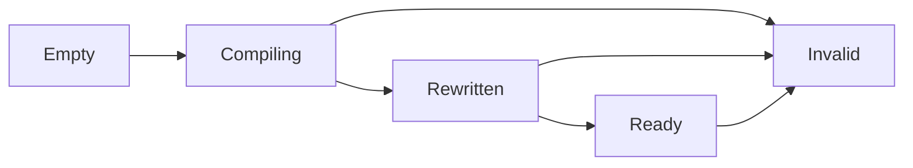

# CLR probe identity boundary

`COZNET_PROBE_IDENTITY=bound` rewrites the controlled `CpuWorkload.Run` target to call `ProbeBound` with literal generation and site arguments.
Generation 1 belongs to one process-lifetime `ProbeLifetime` record. Entry is site 1 and the controlled loop is site 2.
The record retains scalar module/function/token identities. It does not retain managed objects or pin native code.
The legacy mode remains separate.

```cpp
coz::ProbeBinding binding{};
if (lifetime.read(binding)) {
    const bool admitted = lifetime.current(binding.generation, 2);
}
```

Only a completed rewrite followed by successful JIT completion can publish Ready.
Duplicate selected compilation, module unload, and shutdown permanently invalidate the record.
An invalidated record cannot publish Ready again. The first reason wins.
Callbacks use lock-free atomics and never drain cooperative ownership.
Queries establish only a point-in-time observation.
The [bound cooperative client](bound-cooperative.md) checks the record before and after payment and receipt operations, and again at completion.



Bound mode disables tiering, precompiled images, and process-wide inlining through the startup event mask.
It does not prepare native sampling maps. `CozStartSampling` rejects bound mode.
The live workload checks literals, collectible unload, and a second matching module at all four intervals.
The portable native check covers rejection and competing publication/invalidation.
FAKE target runs pass on Windows (`artifacts/cooperative-interop/20261015T101255091-197a515e`) and Linux (`artifacts/cooperative-interop/20261015T101431712-a432135e`).
Both pass all twelve lifetime cases with unchanged inputs. The later build-file edit changes formatting only.
Both also pass twelve native checks and the managed receipt checks.
The earlier host run `20261015T095911895-2cc7f637` is rejected because source changed during execution, despite all case outcomes passing.
The repeat-rewrite guard preserves the original admitted site count.
Live repeated compilation of the same FunctionID and invalidation during a native wait remain unverified.
Legacy injected-payment regressions pass on Windows (`20261015T100551483-147b59d8`) and Linux (`20261015T100657145-65b9f4d2`).
The Windows legacy profiler verification at interval 1024 passes baseline, rewrite, sampling, and intervention cases in `artifacts/probe-identity-legacy-sampling`.

See [reference](../../docsSrc/Reference/probe-identity.md), [procedure](../../docsSrc/How_Tos/verify-probe-identity.md), [research](../../docsSrc/Research/cooperative-clr-lifetime.md), and [cooperative receipts](cooperative-managed.md).
