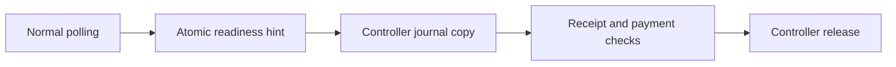

# Direct receipt readiness

`COZNET_DIRECT_RECEIPT_READY=1` selects direct readiness observation for the two normal polling paths in the selected-payment workload.
Absent input or `0` preserves controller header polling. Other inputs fail parsing.
`BoundReceiptReadiness` selects one delegate, preserves its result and exception, and counts attempted direct queries.
Cleanup still uses controller snapshots.

```csharp
var readiness = BoundReceiptReadiness.Parse("1");
bool ready = readiness.Ready(slot, client.ReceiptReady, ReadControllerHeader);
```

The native query holds the shared API lifetime guard and reads only atomic target ownership and mailbox state.
It rejects generation width before narrowing and avoids non-atomic `Slot::generation`.
It does not copy journals or set either retired-copy authorization flag.
Quiescent failed and cancelled journals are ready too. Readiness does not imply accepted payment.
Full copying, receipt timing, validation, accounting, and release retain controller ownership.
The 2 ms debt, 50 microsecond child request, 5 ms measured child, and 100 ms receipt limits remain unchanged.



The runner binds `-DirectReceiptReady` to recorded activation.
`receiptReadyCalls` counts attempts, including failures. Disabled mode must record zero.
Replay rejects retained normal header dispatches when both direct readiness and dispatch timing are enabled.
It cannot inspect evicted calls or independently bind every query to its slot.
The shared query uses portable C++ state. The sampled source remains Linux-only.
Native contract checks pass on Windows and Linux. Capacity and overhead benefits remain unverified.

The unrestricted three-case run passes. The one-CPU controller/direct/direct/controller comparison fails all four treatments.
Direct treatments fail peer debt after 1,905 and 1,275 batches, with 10 and 7 controller dispatches.
Controller treatments reach 22,093 and 12,505 batches before journal or debt failure.
Both direct invalidation cases fail debt before their intended scenario. All twelve records pass evidence replay.
These observations do not isolate overhead or establish a scheduling cause. Keep direct readiness opt-in.
Direct treatments complete one and zero peer payments, versus 138 and 73 in the controller trials.
Accepted diagnostic limits include an extra poll before mailbox quiescence and different direct/controller exception wrappers.
The managed import has live coverage, not isolated native-error fixtures.
Managed generation storage requires serialized submit/query/release operations. Native any-thread observation does not change that requirement.
Both full replay entry points check readiness activation. Query races with close or release/resubmit have source review, not forced-race checks.
See [the retained comparison](../../reliability/features/native-signal/receipt-readiness.md).

See [native interop](cooperative-interop.md), [dispatch timing](controller-dispatch.md),
[the user reference](../../docsSrc/Reference/cooperative-managed.md#optional-direct-receipt-readiness), and [the index](../lode-map.md).
