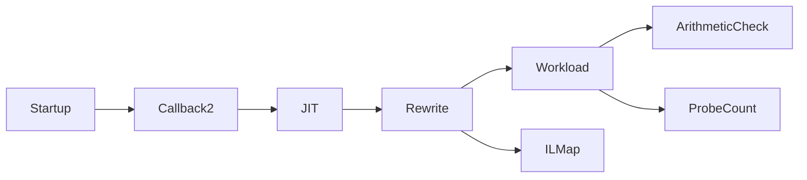

# CLR probe prototype

The Windows x64 and Linux x64 startup profiler rewrites one controlled method before its first JIT compilation.
The target is `CozNet.Instrumentation.Workload.Work` in `CozNet.Instrumentation.dll`.
`COZNET_PROBE_TARGET=linux-perf` selects `CpuWorkload.Run` in `CozNet.LinuxPerf.dll` instead.
An absent value or `instrumentation` selects the original target. Other values fail initialization with `E_INVALIDARG`.
It inserts `Probe()` calls at entry and either calls or conditional countdown gates before backward branches.
It redirects branch targets when an inserted probe precedes the target instruction.
Exception handlers and switch instructions are unsupported.

The native profiler and the Instrumentation and LinuxPerf workload parsers accept `COZNET_PROBE_INTERVAL` values `1`, `64`, `256`, `1024`, or `8192`. An absent value selects `1`.
NativeMap and the older perf, prediction, and cooperative-interop runners retain their existing interval sets.
Interval `1` retains dense probes. Other values inject one `int32` local and a countdown at each backward branch.
The positive-count path calls no helper. Expiration calls `Probe` and resets the counter.
Method entry initializes the counter and always calls `Probe`. Original branches cannot reenter this initialization.
This prevents repeated short calls from losing entry service. The interval bounds executed poll sites, not time.
Both controlled targets accept countdown probes. The Linux perf workload checks each thread's exact helper count.

Interval 8192 is an opt-in lower-density experiment. The checksum batch has one entry callback and one loop callback.
The bound payment runner accepts `-ProbeInterval 1024` or `8192`, with 1024 unchanged as its default.
It binds the numeric `probeInterval` result field to the requested value before accepting a case.
Offline replay rejects malformed or unsupported interval metadata but retains legacy records without the field.
The Linux 8192 countdown capture passes baseline, profiled, intervention, and unsupported-sampling checks.
The Linux bound capture passes zero, 50-percent, and expected-invalidation cases with unchanged inputs and bounds.
New Windows runtime coverage for 8192 remains unverified.
See [the sparse-interval evidence](../../reliability/features/native-signal/sparse-probe-interval.md).

The pinned local-signature helper returns zero for both failure and a valid first local.
The prototype therefore rejects methods without existing locals rather than accepting an ambiguous result.
`NativeCountdownVerify` and `NativeLinuxCountdownVerify` enumerate intervals 64, 256, 1024, and 8192.
Existing evidence covers 64, 256, and 1024 on Windows and Linux x64. New 8192 evidence currently covers Linux x64 only.
They check exact counts before, at, and after expiration, 100 short calls, and intervention during a million-iteration call.
Linux x64 disassembly at interval 256 contains a decrement and branch on the fast path.
The [Linux comparison](../../reliability/features/linux-perf/countdown-probes.md) measures countdown cost in the sampled workload.
See [countdown evidence](../../reliability/features/runtime-probes/countdown.md) for native coverage checks.
See [probe-overhead research](../../docsSrc/Research/probe-overhead-options.md) for the inline attribution limit.

The CLR requires `ICorProfilerCallback2` during startup activation.
The generated callback base implements the original 69 callbacks and eight callback2 methods.
The profiler records a monotonic original-to-rewritten IL map through `SetILInstrumentedCodeMap`.
`JITCompilationFinished` caches native code ranges and the CLR IL-to-native map.
The CLR returns original IL offsets for this non-dynamic method after applying the instrumentation map.
The sampler resolves selected-frame addresses against that cached map.
The sampler retains counts for each mapped IL location.
The workload resolves observed IL offsets through its portable PDB and requires at least one loop source sample.
It checks that all location counts sum to the mapped sample count.
Valid entry and return samples do not erase earlier loop observations.
Debugger output remains unverified.
The registered instrumentation map can collapse injected and original IL boundaries into one original-offset range.
It does not establish exact ownership of inline countdown instructions.
`COZNET_IL_MAP_MODE=raw-diagnostic` omits registration for the whole process and exposes rewritten-IL/native ranges.
It rejects sampling with `E_NOTIMPL`. The normal sampler requires original IL offsets.
`NativeMapVerify` and `NativeLinuxMapVerify` compare both modes for both controlled methods at interval 1024.
The diagnostic records IL bytes, the private map, native bytes, CLR ranges, and JIT disassembly.
Every native range remains `unverified`. A mapped IL origin is not a native ownership guarantee.
`COZNET_PROBE_PLACEMENT=empty-stack-diagnostic` moves countdown gates before the loop-comparison operands.
Its restricted stack analysis rejects unsupported opcodes, inconsistent joins, and incoming branches inside the moved span.
It rejects interval 1. The default placement remains `branch`.
Both placements preserve the checksum and exact helper count on Windows and Linux x64.
The default placement mixes original and injected instructions in CLR ranges.
Empty-stack placement separates the inspected loop ranges on these two methods and runtimes.
This is diagnostic evidence, not a general ownership rule or debugger-stepping claim.
See [mapping evidence](../../reliability/features/runtime-probes/native-mapping.md).
See [injected CPU attribution research](../../docsSrc/Research/injected-cpu-attribution.md).

```powershell
./native/Build.ps1
dotnet build tests/CozNet.Instrumentation -c Release
./native/Verify.ps1
```

The workload checks counts 0, 1, and 1,000,000 against the arithmetic-series formula.
The original process executes zero probes.
The dense instrumented process executes `count + 2` probes.
The countdown process executes `1 + floor((count + 1) / interval)` probes in this loop.
The loop evaluates its backward conditional branch once more than its body runs.
The entry probe accounts for the remaining call.
Each child process has a 30-second limit.
The runner disables tiered compilation and ReadyToRun in these child processes.
It does not change the parent process environment.

The legacy prototype has one selected method and one shared code map.
It does not handle multiple modules, ReJIT, concurrent probe counters, or module unload.
The opt-in [bound identity path](probe-identity.md) uses literals, permanent module-unload invalidation, and one copied native method range.
Its guarded range resolver is separate from the legacy stack sampler and IL map.
The sampler uses standard C++ threading and a platform-specific `SnapshotBackend` interface.
The Windows backend uses `DoStackSnapshot` from a native worker thread.
The controlled workload verifies selected-method frames during a 500-millisecond run.
It records failed walks separately. Stack callbacks do not allocate or acquire application locks.
These are wall-clock samples. CPU-time attribution remains unverified.
The backend also exposes cumulative target-thread CPU time in nanoseconds.
The factory must run on the target thread before the sampler worker starts.
The Windows backend owns a duplicate thread handle and reads kernel plus user time with `GetThreadTimes`.
CPU values must be monotonic. Read errors remain separate from stack-walk errors.
The workload compares a busy phase with a sleep phase and verifies sampler restart.
The retained runs have a maximum CPU delta of 15.625 milliseconds despite the API's 100-nanosecond units.
These coarse observations do not supply per-snapshot CPU attribution or causal credits.
Selected frames include callers of the currently executing method. They do not establish exclusive CPU attribution.
Only one native code region is supported. Recompilation during sampling is rejected.
The `intervention` workload connects the injected probe to the managed cooperative runtime.
It verifies zero credit and a known 20-millisecond credit inside a million-iteration loop.
The trigger is probe 10,000 for dense probes and probe 10 for countdown probes.
The controller waits for that probe before publishing credit. Method entry alone cannot satisfy this reach check.
The worker records actual wait time and Linux-style overshoot in the ledger.
This is a known-credit intervention test. Sampled CPU observations do not generate credits.
This known-credit test does not measure probe overhead.
`NativeLinuxVerify` builds the shared profiler and verifies startup activation, exact loop-probe counts, IL maps, and known-credit intervention.
It uses UTF-16 comparisons, PAL compatibility headers, and `minipal` from the pinned .NET 10 runtime sources.
Standard C++ headers precede PAL headers to avoid annotation-macro conflicts with libstdc++.
Its snapshot adapter explicitly returns `E_NOTIMPL`. The runner checks this result with `sampling-unavailable` mode.
`LinuxInjectedVerify` joins Linux CPU events to injected probes in a separate controlled workload.
The retained comparison shows excessive probe cost. macOS still needs build, backend, and launch adapters.
See [native platform boundaries](../../native/README.md) and [Linux build research](../../docsSrc/Research/linux-profiler-build.md).
The [delay ledger](delay-ledger.md) remains separate.



See [the roadmap](../plans/roadmap.md) and [runtime evidence](../../reliability/features/runtime-probes/README.md).
