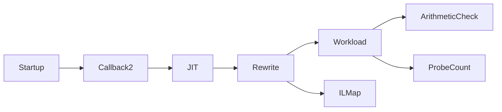

# CLR probe prototype

The Windows x64 startup profiler rewrites one controlled method before its first JIT compilation.
The target is `CozNet.Instrumentation.Workload.Work` in `CozNet.Instrumentation.dll`.
It inserts `Probe()` calls at entry and before backward branch instructions.
It redirects branch targets when an inserted probe precedes the target instruction.
Exception handlers and switch instructions are unsupported.

The CLR requires `ICorProfilerCallback2` during startup activation.
The generated callback base implements the original 69 callbacks and eight callback2 methods.
The profiler records a monotonic original-to-rewritten IL map through `SetILInstrumentedCodeMap`.
`JITCompilationFinished` caches native code ranges and the CLR IL-to-native map.
The CLR returns original IL offsets for this non-dynamic method after applying the instrumentation map.
The sampler resolves selected-frame addresses against that cached map.
The sampler retains counts for each mapped IL location.
The workload resolves observed IL offsets through its portable PDB and requires at least one loop source sample.
It checks that all location counts sum to the mapped sample count.
Valid entry and return samples do not erase earlier loop observations.
Debugger output remains unverified.

```powershell
./native/Build.ps1
dotnet build tests/CozNet.Instrumentation -c Release
./native/Verify.ps1
```

The workload checks counts 0, 1, and 1,000,000 against the arithmetic-series formula.
The original process executes zero probes.
The instrumented process executes `count + 2` probes.
The loop evaluates its backward conditional branch once more than its body runs.
The entry probe accounts for the remaining call.
Each child process has a 30-second limit.
The runner disables tiered compilation and ReadyToRun in these child processes.
It does not change the parent process environment.

The prototype has one selected method and one shared code map.
It does not handle multiple modules, ReJIT, concurrent probe counters, or module unload.
The sampler uses standard C++ threading and a platform-specific `SnapshotBackend` interface.
The Windows backend uses `DoStackSnapshot` from a native worker thread.
The controlled workload verifies selected-method frames during a 500-millisecond run.
It records failed walks separately. Stack callbacks do not allocate or acquire application locks.
These are wall-clock samples. CPU-time attribution remains unverified.
Selected frames include callers of the currently executing method. They do not establish exclusive CPU attribution.
Only one native code region is supported. Recompilation during sampling is rejected.
It does not apply delay credits or measure probe overhead.
Linux and macOS need backend, build, and launch adapters. See [native platform boundaries](../../native/README.md).
The [delay ledger](delay-ledger.md) remains separate.



See [the roadmap](../plans/roadmap.md) and [runtime evidence](../../reliability/features/runtime-probes/README.md).
