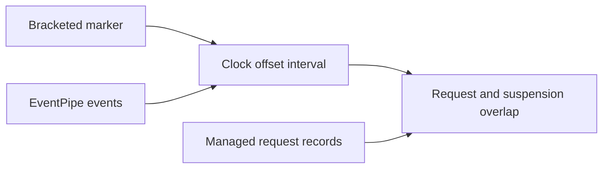

# Runtime suspension trace

The explicit `--sampled-signal-trace` route adds EventSource clock anchors to the sampled signal workload.
Ordinary sampled runs do not create the marker source or emit markers.
The marker provider is `CozNet-SampledSignals`, at informational level.
An unavailable provider fails the traced workload and retains the failure in its JSON output.

Each anchor records an ID, phase, and `Stopwatch` timestamps before and after event emission.
Run, warmup, and measurement boundaries provide anchors.
The output includes `diagnosticTrace`, `traceAnchors`, and the existing `stopwatchFrequency`.
The first anchor can include EventSource initialization cost. It precedes the measured stages.
Trace overhead remains part of the diagnostic run. Diagnostic success does not replace retained capacity failures.

The workload records `run-abort` after an exception and its failure snapshot.
`traceAbort` identifies the marker, failed stage, and snapshot timestamp.
The trace still closes with `run-end` after cleanup.
Abort-marker failure adds a workload failure and does not invent an anchor.
The analyzer accepts an aborted trace only with a matching failed workload and an ordered prefix of the normal markers.
The abort timestamp must follow the last prefix marker and precede its own marker bracket.
An abort does not excuse missing events, event loss, inconsistent clock alignment, or incomplete suspension episodes.
When measurement completion is absent, the analyzer also checks collection counters at the failure snapshot.
Correlation output reports workload success and abort status separately from correlation validity.
`AbortTraceChecks.py` checks startup, warmup, measurement, and settlement aborts plus missing-evidence rejection.
`SampledSignalAbortChecks` injects a controller clock failure into the real workload with deterministic backend and sampler fixtures.
It verifies failed output, the marker sequence, and target cleanup for warmup and measurement failures.
Those checks pass on Windows and through Linux EventPipe capture and correlation.
The fixture uses no native signal delivery and establishes no handler safety.
`LinuxAbortTraceVerify` runs the Linux fixtures and requires valid correlation with failed workload status.

```text
dotnet CozNet.LinuxPerf.dll --sampled-signal-trace workload.json 50 qualified-sample warm spin gc
```

Run this command under a collector that enables the marker provider and `Microsoft-Windows-DotNETRuntime:0x1:4`.
The collector must preserve the child exit code and retain failed measurements.
Only the Linux backend currently supports this workload. The marker implementation uses portable .NET APIs.



The first local capture contains all six expected markers and reports zero lost events.
Their offset intervals intersect within 9,295 nanoseconds.
This establishes a usable clock alignment for that capture only.
The capture passes protocol and capacity checks. It does not reproduce the earlier forced-GC failures.
`native/ExportRuntimeTrace.ps1` decodes the trace with the locally installed dotnet-trace assemblies.
The decoder uses the public TraceEvent `TimeStampRelativeMSec` property and records the decoder version.
`native/AnalyzeRuntimeSuspension.py` parses marker alignment and pairs suspension events by CLR instance.
It retains incomplete, interrupted, unsupported, and ambiguous sequences. Any such sequence fails correlation validity.
It rejects event loss, missing markers, inconsistent offsets, and mixed marker processes.
Each recorded forced collection requires a distinct GC suspension episode with possible overlap.
An increased measurement collection count also requires GC suspension evidence inside the counter interval.
Missing runtime evidence fails correlation instead of producing an empty overlap result.
It reports conservative overlap bounds for acquisition, the suspended core, restart, and the broad envelope.
Decimal arithmetic preserves precision when converting trace time into large absolute clock values.
Decimal values use JSON strings in the correlation output.
Only events within the run markers participate in correlation.
Traced requests also record controller thread CPU readings before submission and after acknowledgment observation.
Each CPU reading has its own `Stopwatch` bracket. Ordinary runs do not read this diagnostic clock.
`ControllerCpuSnapshot` uses `IThreadCpuClock`. The current workload supplies the Linux thread CPU clock.
The request record survives a failed completion-clock read, with a missing end snapshot and a failed workload.
`native/AnalyzeControllerCpu.py` rejects missing, reversed, decreasing, or physically inconsistent observed intervals.
It bounds CPU time inside each request by allowing all uncertain time outside the request to contain CPU work.
The remaining elapsed-time bounds describe time off CPU. They do not identify scheduling, suspension, or blocking as its cause.
Concurrent pending requests have overlapping controller CPU intervals. Do not sum them as total controller CPU usage.
The analyzer covers completed requests only and keeps warmup separate from measurement ranking.
The [CPU comparison](../../reliability/features/native-signal/controller-cpu.md) retains two capacity failures.
One request spends 12.97 ms before the first handler clock reading while the controller remains active, without suspension overlap.
The handler prefix precedes that reading. Prefix execution or descheduling remains unresolved alongside target scheduling and signal delivery.
The first capture contains 104 complete episodes inside those markers and no pairing anomalies.
Fifty-three measurement requests overlap an envelope. Neither peak-debt service interval overlaps one.
`--verify-signal-trace` checks provider rejection, ordered payloads, clock brackets, and provider disablement after listener disposal.
These checks pass on Windows and Linux. They do not test EventPipe timestamp alignment in process.
`LinuxRuntimeTraceCollect` collects three seeded blocks with zero and 50 percent, with and without forced GC.
The twelve-case comparison retains four failed treatments. One also fails a handler bound and lacks its measurement-end marker.
The analyzer rejects that incomplete trace. Eleven cases have valid alignment and event pairing.
The longest request in one failed no-GC case lasts 17.41 ms without a suspension overlap.
It spends 17.35 ms after the last handler clock reading. Remaining handler execution, result publication, controller work, and scheduling remain unresolved.
Full sampled prediction remains unverified. No runtime-suspension correction is justified by these records.
Raw traces and decoded events remain under ignored `artifacts/runtime-suspension/`.

See [event semantics](../../docsSrc/Research/runtime-suspension-events.md),
[the first correlation](../../reliability/features/native-signal/runtime-suspension.md),
[sampled signals](sampled-signals.md), and [the index](../lode-map.md).
