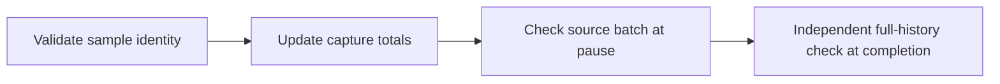
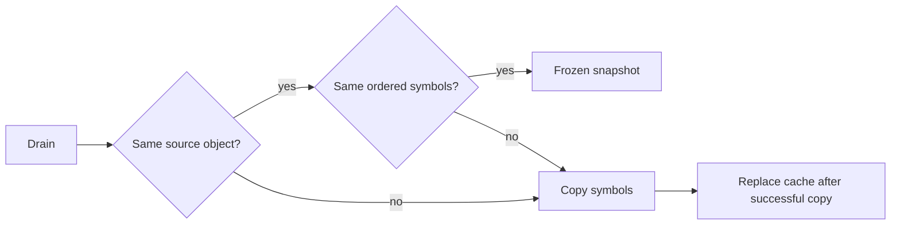

# Sample batch snapshot reuse

## Pause accounting

`BoundSampleAggregate` updates counts, represented CPU, maximum cumulative CPU, distinct pointers, and symbols when a sample is admitted.
`Capture` serializes admission and pause validation with its existing gate.
Only pausable capture creates and maintains an aggregate. Non-pausable collection keeps its full final validator without aggregate setup or admission work.
Pause validation compares the source batch with those totals and retains loss and throttle rejection.
It no longer copies and rescans all samples for this comparison.
Full-history validation still runs independently at final completion.
Epoch snapshots and the callback's frozen prefix remain unchanged.
Checked aggregate overflow rejects sample admission before totals change.
Setup exercises the aggregate on the same private validation fixture before source creation.
This preparation does not publish samples, create epochs, or alter live accounting.
`PauseAcceptsMatchingAggregate` verifies the same source fixture used by invalid-batch checks can call payment, resume, and pass final audit.
`FullValidatorParity` compares both validators directly on mixed symbols, duplicate pointers, absent counters, and a regressed counter.
Both validators ignore absent counters and enforce the maximum present counter. Admission still rejects absent or regressed counters and foreign symbols.
The collection remains terminal after collector failure. Recovery from allocation failure is not supported.
Host and Linux source/pausable checks pass, including ten inconsistent pause batches that must fail before payment or resume.
The [component capture](../../reliability/features/native-signal/incremental-pause-validation.md) measures about 0.11 µs per aggregate check at 1,500 samples, versus 92–100 µs for full validation.
This excludes per-sample aggregate updates and does not establish total-workload savings.
The three-case 50,000-batch integration passes with unchanged inputs.
The final reviewed capture `artifacts/aggregate-reviewed-live/20261016T101942535-8eb7ee48` also passes all cases and Linux preflight with unchanged inputs.
All four 500,000-batch comparison arms complete, but prediction remains unqualified with a shortfall of about 15.9 percentage points.
The preceding long treatment failed peer debt. One later success does not prove stable capacity or attribute the earlier failure to validation.

```csharp
aggregate.Add(accepted);
aggregate.Validate(batch, cpuNanoseconds);
```



`SampleBatchSnapshotCache` freezes the symbol collection for a pausable source drain.
It reuses the previous frozen snapshot only when the source batch is the same object and every symbol still matches in order.
Scalar `SampleBatch` properties are immutable after initialization. The source symbol list can change between drains.
Changed values or lengths create a fresh copy. Existing published snapshots retain their original symbols.
A different source batch always creates a fresh snapshot, including changed loss and throttle counters.
Comparison or copy failures preserve the previous successful cache entry and propagate the original exception.
The cache belongs to the serialized collector drain. It does not support concurrent source-list mutation during capture.

```csharp
var frozen = snapshots.Capture(source.Drain());
```



Every source drain, CLR lifetime check, loss check, and pause boundary still executes.
Only repeated snapshot allocation is removed. Final completion keeps its existing defensive copy.
The helper checks cover empty and nonempty allocation-free reuse, mutable symbols, metadata changes, and failure retention.
An owner-collector check verifies reuse through the actual drain path and preserves final delivery and cleanup.
Order and case checks require fresh snapshots and preserve earlier contents.
The [retained comparison](../../reliability/features/native-signal/sample-batch-snapshots.md) completes four arms but remains unqualified.
Its descriptive sampled reduction is 3.31%–3.38%, versus 50.46%–50.47% physically.
The single block does not isolate cache performance. Full-workload overhead and prediction accuracy remain unverified.
See [the collector](pausable-collector.md), [observer overhead](observer-overhead.md), and [the index](../lode-map.md).
