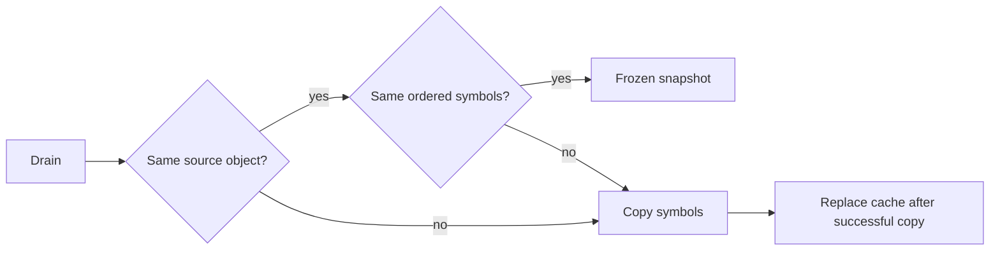

# Sample batch snapshot reuse

`SampleBatchSnapshotCache` freezes the symbol collection for a pausable source drain.
It reuses the previous frozen snapshot only when the source batch is the same object and every symbol still matches in order.
Scalar `SampleBatch` properties are immutable after initialization. The source symbol list can change between drains.
Changed values or lengths create a fresh copy. Existing published snapshots retain their original symbols.
A different source batch always creates a fresh snapshot, including changed loss and throttle counters.
Comparison or copy failures preserve the previous successful cache entry and propagate the original exception.
The cache belongs to the serialized collector drain. It does not support concurrent source-list mutation during capture.

```csharp
var frozen = snapshots.Capture(source.Drain());
```



Every source drain, CLR lifetime check, loss check, and pause boundary still executes.
Only repeated snapshot allocation is removed. Final completion keeps its existing defensive copy.
The helper checks cover empty and nonempty allocation-free reuse, mutable symbols, metadata changes, and failure retention.
An owner-collector check verifies reuse through the actual drain path and preserves final delivery and cleanup.
Order and case checks require fresh snapshots and preserve earlier contents.
The [retained comparison](../../reliability/features/native-signal/sample-batch-snapshots.md) completes four arms but remains unqualified.
Its descriptive sampled reduction is 3.31%–3.38%, versus 50.46%–50.47% physically.
The single block does not isolate cache performance. Full-workload overhead and prediction accuracy remain unverified.
See [the collector](pausable-collector.md), [observer overhead](observer-overhead.md), and [the index](../lode-map.md).
