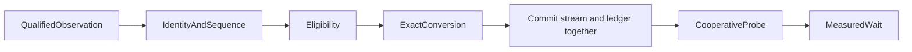

# Sample credit conversion

This page describes interval observations. The separate [nominal-event estimator](nominal-event-credit.md) does not require a same-epoch baseline.

`SampleCreditStream` converts qualified selected CPU observations to ledger ticks.
Its integer percentage uses native Coz semantics: `credit = selected CPU duration × speedup`.
This differs from the public serial engine's proportional slowdown formula.
Percentages range from zero through 100. The ledger rejects a nonpositive corrected experiment duration separately.

```fsharp
let stream =
    SampleCreditStream.tryCreate 1000L 50 0UL 0UL SampleThreadState.Runnable
    |> Result.defaultWith failwith
```

At 1,000 ledger ticks per second, 100 milliseconds of qualified selected CPU time earns 50 ticks at 50 percent.
The converter uses integer arithmetic and retains fractional ticks between observations.
It rejects overflow instead of wrapping or saturating.

Observations carry a stream identity, sequence, cumulative CPU nanoseconds, eligibility epoch, thread state, and sampled location.
Sequence numbers start at one. Duplicate, stale, foreign, and decreasing-clock observations fail without changing the stream.
Eligibility epochs cannot decrease.
Missing observations discard the affected interval and establish a new baseline.
Credit requires consecutive observations, an unchanged epoch, runnable states at both ends, and a selected location.
Blocked, delaying, unavailable, and unmapped intervals do not earn credit.
Previously earned fractional credit survives excluded intervals.

The producer must increment the eligibility epoch for every blocked or delaying transition, including a transition between snapshots.
This contract cannot infer an unreported transition from two runnable observations.
The producer must also supply a valid CPU sampling and attribution method.
The coarse Windows CPU-clock observations do not yet satisfy that attribution requirement.

`CooperativeRuntime.AttachSamples` attaches one stream to a registered runnable thread.
The stream uses the runtime timing source's frequency.
`CreditObservation` commits the new stream state and ledger credit under the same lock.
A rejected ledger transition consumes neither the observation nor its fractional credit.
Unregistering a thread removes its stream.



The controlled intervention workload supplies a synthetic 40-millisecond observation at zero or 50 percent.
The resulting zero or 20-millisecond credit reaches the injected probe and its real wait.
The Linux capability workload now feeds nominal selected event periods through this interface at manual probes.
The sampled timer producer also feeds nominal periods and records each credited amount.
`analyze_sample_credits` in `native/AnalyzeCpuCounters.py` replays accepted records under their declared eligibility epochs.
It checks each credit, the final total, and frozen endpoint credit after counter reconciliation.
Its nanosecond calculation retains a remainder in hundredths of a nanosecond through excluded samples.
Only accepted records advance the replay baseline. The first accepted record in each epoch is excluded.
The matched analyzer requires this replay before producing a conditional block comparison.
The replay does not verify native ownership transitions or sampled CPU accuracy.
See [the replay reference](../../docsSrc/Reference/cpu-counter-evidence.md).
Its fixed-method eligibility assumption does not provide general lifecycle qualification.
See [Linux sampling](linux-perf.md) for its measured wait overshoot and support limits.
See [cooperative runtime](cooperative-runtime.md), [delay ledger](delay-ledger.md), and [runtime probes](runtime-probes.md).
