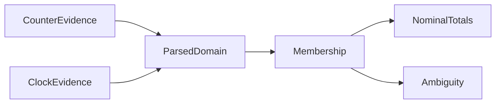

# Observed sample membership

`AnalyzeSampleMembership.py` parses counter and clock evidence into `ObservedMembership` before classification.
Policy `linux-monotonic-observed-membership-v1` uses identity conversion for the current Linux perf and .NET 10.0.0 X64 clock path.
It requires nanosecond units, stable zero-offset namespace context, enclosing clock readings, and ordered frozen endpoints.
The shared counter parser checks sample identity, ordering, and loss. The policy rejects source times after receipt.
The metadata remains a declaration, not binary attestation.

```powershell
python native/AnalyzeSampleMembership.py capture.json membership.json
python native/SampleMembershipChecks.py
```

The half-open window excludes exact end equality and includes exact zero-width start equality.
Endpoint uncertainty produces `BoundaryAmbiguous` observations.
Inside observations contribute to lower and upper totals. Ambiguous observations contribute only to upper totals.
Totals cover sample counts and nominal weights, including selected observations separately.
They do not bound exact CPU attribution. Late receipt does not replace source membership.
The report preserves raw clock, endpoint, and sample evidence, workload failure, and provenance hashes.
The CLI refuses to replace existing output. Malformed JSON creates a rejected report when the output path is writable.
JSON parsing rejects non-finite constants and overflowing floating-point exponents before retaining raw evidence.

The explicit model assumption excludes unobserved fast-timekeeper anomalies that alter membership.
Observed consistency does not prove this assumption, physical-clock accuracy, or exact event ordering.
Prediction accuracy remains false. Matched-prediction eligibility and credit replay do not consume this diagnostic yet.



See [the reference](../../docsSrc/Reference/sample-membership.md), [measurement boundaries](measurement-boundaries.md), and [sample credits](sample-credits.md).
