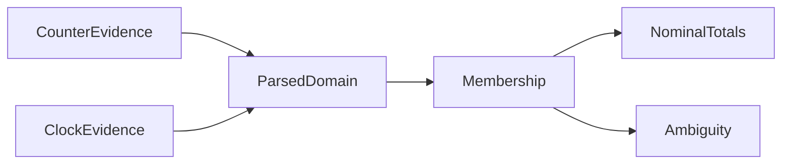
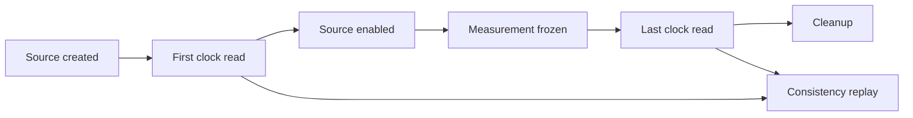
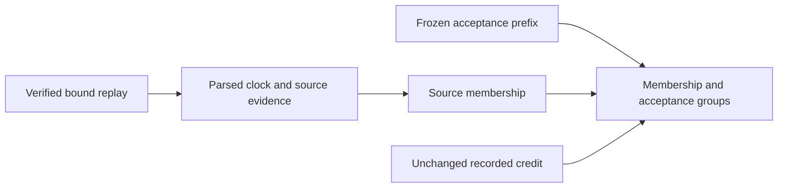
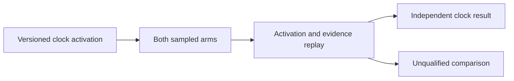

# Observed sample membership

`AnalyzeSampleMembership.py` parses counter and clock evidence into `ObservedMembership` before classification.
Policy `linux-monotonic-observed-membership-v1` uses identity conversion for the current Linux perf and .NET 10.0.0 X64 clock path.
It requires nanosecond units, stable zero-offset namespace context, enclosing clock readings, and ordered frozen endpoints.
The shared counter parser checks sample identity, ordering, and loss. The policy rejects source times after receipt.
The metadata remains a declaration, not binary attestation.

```powershell
python native/AnalyzeSampleMembership.py capture.json membership.json
python native/SampleMembershipChecks.py
```

The half-open window excludes exact end equality and includes exact zero-width start equality.
Endpoint uncertainty produces `BoundaryAmbiguous` observations.
Inside observations contribute to lower and upper totals. Ambiguous observations contribute only to upper totals.
Totals cover sample counts and nominal weights, including selected observations separately.
They do not bound exact CPU attribution. Late receipt does not replace source membership.
The report preserves raw clock, endpoint, and sample evidence, workload failure, and provenance hashes.
The CLI refuses to replace existing output. Malformed JSON creates a rejected report when the output path is writable.
JSON parsing rejects non-finite constants and overflowing floating-point exponents before retaining raw evidence.

The explicit model assumption excludes unobserved fast-timekeeper anomalies that alter membership.
Observed consistency does not prove this assumption, physical-clock accuracy, or exact event ordering.
Prediction accuracy remains false.
The optional `--sample-credits` mode requires nominal credit reconciliation before partitioning recorded credit.
`RecordedCreditMembership` keeps the parsed membership, immutable replay result, and recorded credit values together.
Groups retain source membership, receipt membership, producer acceptance, selected status, counts, nominal periods, and recorded credit.
Source-inside rejection with an inside receipt remains separate from a source-inside sample received after the endpoint.
The recorded-credit window range includes ambiguous credit only in its upper limit.
No unaccepted sample earns credit. This range does not bound hypothetical missing credit, native payment, or exact selected CPU.



See [the reference](../../docsSrc/Reference/sample-membership.md), [measurement boundaries](measurement-boundaries.md), and [sample credits](sample-credits.md).

## Bound sampled capture

`BoundSampleClockCapture` owns optional evidence for the finite bound workload.
Its source factory wrapper reads after source creation and before enable.
Completion reads after measurement freeze and before cleanup.
The portable `ISampleClockEvidenceSource` hook supplies both reads.
Wrapper ownership and state checks precede source creation.
Empty backend errors remain diagnostic rejections. Backend exceptions remain terminal evidence. Repeated completion does not retry.
Unavailable providers and incomplete setup remain distinct states.

```powershell
pwsh -NoProfile -File native/VerifyBoundSampledPayment.ps1 -SelectedPayment -OwnerDrain -SelectedCadence qualified-sample -FiniteMeasurement -BoundSampleClock
python native/BoundSampleClockEvidenceChecks.py
```

`BoundSampleClockEvidence.py` replays raw consistency in both bound analyzers.
Legacy records remain readable. Partial declarations and false consistency claims fail replay.
Diagnostic rejection does not change workload outcome, payment, credit, or qualification.
The final read can add diagnostic source-tail samples after the frozen endpoint.
Consistent brackets do not establish source membership or exact CPU attribution.



See [the clock reference](../../docsSrc/Reference/cpu-sample-clock.md#bound-sampled-evidence) and [bound sampled payment](bound-sampled-payment.md).

The first read runs under the existing CLR lifetime guard, outside measurement.
This fixed setup cost is accepted for the opt-in diagnostic.
See [the Linux capture](../../reliability/features/native-signal/bound-sample-clock.md).

## Bound source membership

`AnalyzeBoundSampleMembership.py` parses full replay, clock policy, and closed source evidence before classification.
The policy uses the existing half-open source-time rules and keeps ambiguous endpoints explicit.
It partitions recorded credit without changing it. Frozen-prefix acceptance substitutes for unavailable receipt timestamps.
Source checks also apply to failed workloads. Failed outcome and rejected comparison remain distinct.
Arithmetic replay failures retain rejection reports.
The command assumes stable analysis files. Its file hashes do not attest loaded Python code.

```powershell
python native/AnalyzeBoundSampleMembership.py capture/50.json membership.json
python native/BoundSampleMembershipChecks.py
```



The [first capture](../../reliability/features/native-signal/bound-sample-membership.md) retains unmapped samples before start and inside-window samples outside acceptance.
All recorded selected credit is inside. This short diagnostic does not explain the earlier matched prediction gap.
The [upstream comparison](../../docsSrc/Research/sample-boundary-semantics.md) gates credit by processing-time state, not strict source-time membership.
Do not add retrospective credit or weaken qualification from these observations.
See [the reference](../../docsSrc/Reference/bound-sample-membership.md).

## Matched comparison activation

`VerifyCooperativeComparison.ps1 -BoundSampleClock` declares version 1 and enables capture only in sampled arms.
Full comparison replay binds both sampled activation fields to the plan and requires the helper snapshot.
Physical arms keep their uninstrumented path. Legacy plans permit only disabled capture.
Valid diagnostic rejection does not invalidate otherwise completed work.

```powershell
pwsh -NoProfile -File native/VerifyCooperativeComparison.ps1 -ProbeInterval 8192 -PrepareReceipts -OwnerController -NominalSampleCredit -SelectedCpu -BoundSampleClock
```



See [the comparison reference](../../docsSrc/Reference/cooperative-comparison.md#bound-sample-clock-contract).

The [matched block](../../reliability/features/native-signal/matched-sample-membership.md) places all 2,068 selected treatment observations inside the source window and frozen prefix.
All 1.034 seconds of recorded treatment credit is source-inside. Observed boundary differences are unmapped and carry no credit.
This does not bound missing observations or exact CPU attribution. Extra treatment CPU and the prediction gap remain unresolved.
