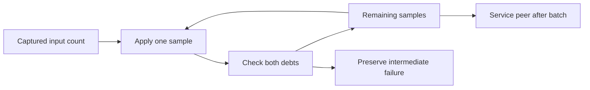

# Sample publication and peer service

`BoundSamplePublication` separates sample processing from peer service cadence.
The default calls peer service after each successful sample.
`COZNET_BATCH_SERVICE=1` calls peer service once after a nonempty published batch.
Both paths freeze the input count before processing and preserve the input order and offset.
The helper does not copy elements. Callers must preserve existing elements for the duration of publication.

```csharp
var publication = BoundSamplePublication.Parse("1");
publication.Publish(samples, offset, Process, Service);
```

`BoundSampledPaymentWorkload.Process` still checks both debts after each sample.
A sample failure stops before peer service or later samples. The original exception escapes unchanged.
Service failure stops publication without retry. Empty prefixes do not call service.
The experiment does not defer or weaken the 2 ms debt gate.
Source pause, selected payment, receipt parsing, and cleanup retain their existing rules.
Probe and outer-loop service calls remain independent of publication cadence.



The runner's `-BatchService` option binds the requested mode to the recorded Boolean.
`sampleServiceCalls` counts attempted publication-triggered service calls, including a failed call.
It excludes probe, outer-loop, and final settlement service calls.
It does not count controller dispatches or establish isolated handoff cost.
Replay checks type and count bounds. Legacy records without both fields remain readable.
It does not reconstruct exact batch history or verify the count independently.

Controlled checks cover mode parsing, order, offsets, frozen prefixes, and failures.
The one-CPU comparison fails both batch treatments and one of two per-sample treatments.
All twelve records replay. All zero-speedup and expected-invalidation cases pass.
This does not establish stable capacity or prediction accuracy.
An unrestricted batch treatment also retains a native child above the 5 ms limit.
See [retained evidence](../../reliability/features/native-signal/sample-publication.md).
Native Coz processes a captured ring batch before its delay check.
This experiment retains CozNet's intermediate debt checks and is not an exact copy of that scheduling rule.
See [capacity](../../docsSrc/Explanations/owner-drain-capacity.md), [peer payment](bound-sampled-payment.md), and [the index](../lode-map.md).
