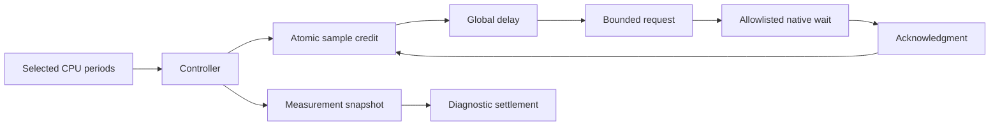

# Sampled signal controller

`SampledSignalWorkload` connects `ICpuEventSession` to `SignalAccounting` and `IBoundedInterventionBackend`.
Platform calls stay behind those interfaces and `IThreadCpuClock`.
Only the Linux x64 adapters currently supply the required operations.
The controller runs on the OS thread that installs the native signal backend.
It alone owns the accounting state and reads the perf ring.
The selected worker creates its event session and transfers ownership through the readiness event.

```powershell
dotnet run --project build/build.fsproj -- -t LinuxSampledSignalsVerify
```

The runner compares zero and 50 percent in separate isolated processes.
Each process measures two arithmetic workers for two seconds.
Only one worker supplies CPU samples.
The controller continuously drains events and services both signal slots.
It records raw samples, requests, acknowledgments, periodic boundaries, and controller CPU time.

Before a selected-thread request, the controller disables sampling and discards records that remain after reservation.
It resumes sampling only after the matching acknowledgment.
The first observation in the new epoch earns no credit.
This conservative exclusion can discard eligible CPU periods.
An acknowledgment does not prove handler return, and nominal perf periods do not prove exact selected-method CPU duration.
The experiment therefore records exclusions and makes no prediction claim.

The observed unpaid-debt limit is 2,000,000 nanoseconds per thread.
This limit was selected before the first run. It equals 0.1 percent of the two-second window.
The controller checks debt after each service iteration and at the measurement boundary.
This is an observed capacity limit, not a continuous bound or an accuracy proof.
The first run fails this limit despite completing its protocol checks.
The selected worker repeatedly pays overshoot and pauses sampling.
The largest peer backlog occurs during startup. Controller warmup remains incomplete.
Investigate startup cost, wait overshoot, and sampling exclusions before prediction tests.
See [the retained failed runs](../../reliability/features/native-signal/sampled.md).

The measurement boundary precedes sampler shutdown and diagnostic settlement.
Final settlement retires the selected ledger handle first, then its peer.
Retired ledger handles owe no later global delay.
Native targets remain alive until the controller stops delivery.
Target retirement, thread join, and signal restoration retain their required order.
An ambiguous native request keeps native ownership unresolved and fails the isolated process.



Forced-GC, matched baseline, zero-delay signal overhead, debt-age analysis, and physical-change comparisons remain incomplete.
The two-percentage-point prediction gate remains unchanged.
See [accounting](signal-accounting.md), [signal lifetime](signal-intervention.md), [Linux sampling](linux-perf.md), and [the roadmap](../plans/roadmap.md).
