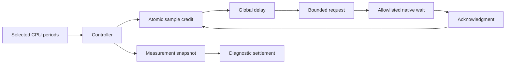

# Sampled signal controller

`SampledSignalWorkload` connects `ICpuEventSession` to `SignalAccounting` and `IBoundedInterventionBackend`.
Platform calls stay behind those interfaces and `IThreadCpuClock`.
Only the Linux x64 adapters currently supply the required operations.
The controller runs on the OS thread that installs the native signal backend.
It alone owns the accounting state and reads the perf ring.
The selected worker creates its event session and transfers ownership through the readiness event.

```powershell
dotnet run --project build/build.fsproj -- -t LinuxSampledSignalsVerify
```

The runner compares zero and 50 percent in separate isolated processes.
Each process measures two arithmetic workers for two seconds.
Only one worker supplies CPU samples.
The controller continuously drains events and services both signal slots.
The ring reader reuses an immutable counter snapshot when no new records are available.
It still reads and validates the ring head on every drain. New sample, lost, or throttle records replace the snapshot.
Empty drains perform no managed allocation after the first snapshot.
It records raw samples, requests, acknowledgments, periodic boundaries, and controller CPU time.
`continuous` preserves the original selected-thread check on each controller iteration.
`qualified-sample` checks the selected thread once after a drained batch contains a complete interval in the current eligibility epoch.
The first sample after an epoch change cannot trigger another selected pause.
Qualified zero-credit intervals still permit checks. Zero-percent runs use the same rule.
The peer continues bounded debt settlement independently.
`PeerSignalCadence` permits peer preparation only when the immutable accounting state changes.
It caches the resulting state after preparation and request submission, including a preparation skipped for a pending request.
Matching acknowledgments and new sample observations create new accounting states and permit another check.
The controller polls both acknowledgment slots on every iteration, including iterations that skip peer preparation.
Settlement calls preparation directly. Measurement starts with a fresh cadence instance after warmup.
Warmup and measurement record separate `peerChecks` and `peerCheckSkips` counters.
`peerChecks` counts preparation attempts without a pending request. Pending-request skips do not increment either counter.
The seven `--verify-peer-cadence` checks pass on Windows and Linux.
The [peer-cadence run](../../reliability/features/native-signal/peer-cadence.md) reduces controller allocation in completed cases but fails all three 50-percent cases.
One fails the handler bound during warmup. Two complete their protocols but exceed the observed debt limit.

`LinuxSampleCadenceVerify` runs the sample-cadence mode without warmup.
`LinuxWarmSampleCadenceVerify` adds a 250 ms warmup to both percentages.
It runs three fixed blocks in zero-then-50-percent order and retains every outcome.
Warmup uses the same registered native targets and the same controller paths.
After warmup, the controller disables sampling, drains requests, and retires the warmup ledger handles.
It creates a fresh ledger and sample stream while the native targets remain registered.
The first measurement sample establishes a fresh epoch baseline because perf enable does not reset the remaining sample period.
Raw records label warmup, warmup settlement, measurement, and final settlement separately.
Measurement batch counters subtract their warmup baselines.

Request records include start and completion timestamps from `Stopwatch`, plus both stage labels.
Samples and boundary snapshots also record `Stopwatch` timestamps. The output records its frequency.
These timestamps share one process clock. Perf sample timestamps use a separate clock contract.
Each phase retains its longest interval between completed controller service iterations and one peak-debt snapshot per thread.
Peak snapshots include pending request sequences, request start times, and the last acknowledged sequence for each thread.
Sample indices identify observations consumed during the associated service iteration.
The first interval starts before worker release. Later intervals include diagnostics from the preceding iteration.
These observations add controller overhead. They do not measure native handler entry time or prove scheduler causation.
Linux acknowledgments also contain parsed native phase timing and identify its separate monotonic clock in `backendDetails`.
The native phases separate time before the first handler clock observation, the measured handler interval, and time before native result observation.
The first phase includes queue submission and scheduling. The last includes result publication and controller polling.
Queue syscall duration can overlap handler execution. It is a separate diagnostic, not an additional phase to sum.
The records do not equate native time with process `Stopwatch` timestamps or perf timestamps.

Each phase records initial runtime counters before enabling samples.
Periodic, peak-debt, measurement, settlement, and failure boundaries also record runtime counters.
`ControllerAllocatedBytes` measures cumulative managed allocation on the controller thread. It excludes native allocation and worker allocation.
Generation collection counts and `GcPauseTicks` are cumulative process values. Pause ticks use `TimeSpan` units of 100 ns.
Each counter snapshot has a `Stopwatch` interval because its fields are read sequentially, not atomically.
Warmup and measurement retain separate starting counters. Counter windows include sample enablement and boundary diagnostics.
The output records server-GC mode, latency mode, and available processor count after teardown.
Counter changes can show GC activity between observations. They cannot assign a GC pause to a specific signal request.

Before a selected-thread request, the controller disables sampling and discards records that remain after reservation.
It resumes sampling only after the matching acknowledgment.
The first observation in the new epoch earns no credit.
This conservative exclusion can discard eligible CPU periods.
An acknowledgment does not prove handler return, and nominal perf periods do not prove exact selected-method CPU duration.
The experiment therefore records exclusions and makes no prediction claim.

The observed unpaid-debt limit is 2,000,000 nanoseconds per thread.
This limit was selected before the first run. It equals 0.1 percent of the two-second window.
The controller checks debt after each service iteration and at the measurement boundary.
This is an observed capacity limit, not a continuous bound or an accuracy proof.
The first run fails this limit despite completing its protocol checks.
The selected worker repeatedly pays overshoot and pauses sampling.
The cold sample-cadence run recovers most sample credit but still fails the startup debt limit.
The first warm sample-cadence run fails the handler-duration limit after startup backlog is removed from its early snapshots.
The three-block warm comparison without native phase timing passes all protocol checks and all zero-percent capacity checks.
One 50-percent case passes capacity. The other two exceed the unchanged 2 ms observed debt limit.
Their peak peer debts are 0.933666, 2.020031, and 2.748001 ms.
These mixed results do not establish stable capacity or prediction accuracy.
The [service timing run](../../reliability/features/native-signal/service-timing.md) links one selected debt peak to a 3.743108 ms peer wait.
Another peer peak occurs while a request remains pending for 6.980643 ms and later completes with zero wait.
The long pending request performs no native sleep. The effect of another actuator remains untested.
The [native phase run](../../reliability/features/native-signal/phase-timing.md) passes two of three 50-percent capacity cases and all protocol checks.
Its failed block retains a deferred request with 8.773081 ms before the first handler clock reading and 0.038099 ms after the last reading.
Scheduling, delivery, and handler entry checks remain unresolved within that first phase.
Inspect target scheduling and CLR suspension before selecting a delivery or wait-actuator change.
Keep wait overshoot and service stability unresolved before prediction tests.
See [the retained failed runs](../../reliability/features/native-signal/sampled.md).
See [the primary-source cadence comparison](../../docsSrc/Research/signal-sample-cadence.md).

The measurement boundary precedes sampler shutdown and diagnostic settlement.
Final settlement retires the selected ledger handle first, then its peer.
Retired ledger handles owe no later global delay.
Native targets remain alive until the controller stops delivery.
Target retirement, thread join, and signal restoration retain their required order.
An ambiguous native request keeps native ownership unresolved and fails the isolated process.



Forced-GC, matched baseline, zero-delay signal overhead, debt-age analysis, and physical-change comparisons remain incomplete.
The two-percentage-point prediction gate remains unchanged.
See [accounting](signal-accounting.md), [signal lifetime](signal-intervention.md), [Linux sampling](linux-perf.md), and [the roadmap](../plans/roadmap.md).
