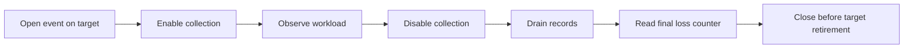

# Scheduler observations

A standalone Linux x64 capability probe captures per-thread `PERF_RECORD_SWITCH` records.
The optional `--sampled-signal-scheduler` route connects a Linux backend to the sampled signal controller.
The [retained evidence](../../reliability/features/native-signal/switch-probe.md) includes a normal run and deliberate ring overflow.
The normal run has 102 complete observed switched-out intervals and zero final loss.
The overflow run has 7,832 lost records but no emitted loss record.
This kernel supports `PERF_FORMAT_LOST` despite its 5.15 version prefix.

The collector must disable the event, drain its ring, and read the final loss counter.
Zero decoded loss records do not establish complete coverage.
Pair switch-out with the next switch-in. Reset pairing after loss.
Keep unmatched boundaries censored. Do not invent records at enable or disable.

```cpp
attr.context_switch = 1;
attr.sample_id_all = 1;
attr.sample_type = PERF_SAMPLE_TID | PERF_SAMPLE_TIME;
attr.use_clockid = 1;
attr.clockid = CLOCK_MONOTONIC;
```



Observed switched-out intervals cannot separate blocked time from runnable waiting.
They do not prove the cause of signal delay or identify exact handler entry.
Off-CPU time does not grant causal credit or forgive debt.
The current diagnostic requires explicit container syscall access. It does not change host policy.
Shared accounting and signal handlers remain unchanged.

A separate concurrent run captures 8,000 records with zero loss through a 4 KiB ring.
It copies 31 wrapped records across 2,762 nonempty drains while the target remains alive.
The collector joins before the final drain, loss read, and unmapping.
`ISchedulerEventSession` keeps platform calls outside shared accounting.
Each owner opens its event. A dedicated collector drains each ring into bounded storage.
The workload captures the controller first, then both registered targets.
It stops capture before releasing the target retirement barrier.
If capture termination throws, the workload holds that barrier and reports incomplete teardown.
It disposes the barrier only after all targets join.
The process watchdog remains required for failed isolated workloads.
The cost workload joins only successfully started workers and retains startup failure records.
It retains all worker synchronization objects if any started worker fails to join.
Deterministic fixtures cover failure at both worker starts on Windows and Linux.
Runner gates verify snapshot hashes, child outcomes, record presence, and analysis before reporting success.

The [managed capture](../../reliability/features/native-signal/scheduler-capture.md) has zero loss in all twelve thread streams.
The GC treatment still fails the unchanged debt bound.
Its long pre-handler intervals overlap observed target switch-out intervals.
This does not identify the blocking cause or establish an accounting change.
Deterministic Windows and Linux fixtures cover creation failure, reported loss, normal cleanup, and thrown termination failure.
The live parser rejects malformed envelopes, wrong identity, decreasing timestamps, and invalid switch flags.
Python checks verify pairing, censoring, and overlap without assigning a blocking cause.
A [fixed-work comparison](../../reliability/features/native-signal/scheduler-cost.md) runs eight enabled/disabled pairs.
Its elapsed and process-CPU intervals include zero. It does not bound cost during signal handling or forced GC.
Real kernel collector failures, lifecycle races, and general application support remain unverified.
Keep Linux APIs behind a backend when integrating this capability.
See [Linux perf](linux-perf.md), [signal accounting](signal-accounting.md), and [the index](../lode-map.md).
