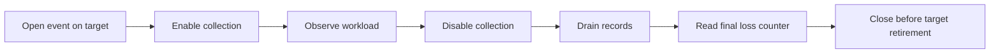

# Scheduler observations

`LinuxFastTimerSchedulerNoGc` uses the existing timer workload scheduler backend without forced GC.
The runner requires prepared short-interval capacity mode and passes an explicit `no-gc` argument.
Ordinary runtime collections remain possible. Native timing and debt gates stay unchanged.
Use the three thread streams to compare observed switch-outs with retained timer handler intervals.
Loss, censored boundaries, and guest-versus-host scheduling limit any inference.
The [no-forced-GC timer capture](../../reliability/features/native-signal/timer-scheduler-no-gc.md) retains a 2,444,062 ns peer-debt failure.
All streams report zero loss. The three longest handlers have no observed target switch-out overlap.
Command 460 has a 3,378,738 ns submission-to-first-handler interval without observed switch-out overlap on any captured thread.
Only one child completed before the violating checkpoint. Later shutdown payment cannot remove that earlier violation.
The previous 9.684 ms invalid wait did not recur. Its cause remains unresolved.

`LinuxServiceSchedulerTiming` connects the existing scheduler backend to the initialized native-service workload with submission timing.
`AnalyzeServiceSnapshotLag.py --scheduler` requires stopped, loss-free captures with distinct thread identities in one process.
Current service runs contain four streams: controller, selected target, peer target, and native owner.
The fourth identity must match `backendDetails.nativeOwnerThreadId` from the native ABI.
Legacy three-stream records remain readable without an owner attribution claim.
`IServiceOwnerSchedulerBackend` isolates owner capture behind a backend interface.
The Linux implementation opens the event for the native owner ID. All captures stop before target retirement and owner restoration.
`OwnerSchedulerShutdown` checks normal teardown and failed owner-capture termination on the shared workload.
It correlates delayed snapshot lower bounds and first managed receipt intervals with controller switch-out pairs.
All compared intervals use native monotonic nanoseconds and must fit assured capture boundaries.
The runner snapshots and hashes both analyzers and their checks. Analysis preserves workload failure and does not assign a scheduling cause.
The [native service capture](../../reliability/features/native-signal/service-submission/scheduler.md) fails at 2,049,444 ns peer debt with zero reported loss.
Its final command has a 2,413,347 ns interval from the last handler clock reading to owner observation.
Controller and target switch-out overlap cover 96,694 ns and 30,061 ns respectively.
That earlier run has no owner stream. Native owner lock acquisition remains unresolved.
The [four-thread capture](../../reliability/features/native-signal/service-submission/owner-scheduler.md) fails during warmup at 2,999,973 ns peer debt.
Command 19 child 8 has a 6,239,753 ns post-handler observation interval with 6,236,648 ns of owner switch-out overlap.
The owner switch-out is marked preemption. Controller and target overlap are zero in that interval.
This run establishes an owner scheduling gap. Its cause and the general viability of centralized child dispatch remain unresolved.

A standalone Linux x64 capability probe captures per-thread `PERF_RECORD_SWITCH` records.
The optional `--sampled-signal-scheduler` route connects a Linux backend to the sampled signal controller.
`--sampled-signal-scheduler-trace` also emits EventPipe clock anchors for runtime suspension correlation.
`LinuxSchedulerTraceCollect` records one fixed-seed block with zero and 50 percent, with and without forced GC.
It uses the existing trace collector and preserves failures before returning a failed target result.
The combined analyzer joins runtime overlap by both slot and sequence after scheduler sorting.
It requires the aligned EventPipe process to match every scheduler capture process.
`SchedulerRuntimeChecks.py` exercises identity matching, duplicate rejection, process mismatch rejection, incomplete correlation, scheduler loss, and retained workload failure.
Its command-line check requires an invalid case to fail analysis without discarding valid cases.
Runtime overlap applies to the enclosing managed request. It does not identify overlap within a native phase or switched-out interval.
The [combined trace](../../reliability/features/native-signal/scheduler-runtime.md) retains a forced-GC capacity failure with valid correlation and zero reported loss.
One long peer request has no enclosing runtime suspension overlap.
The executing product's source manifest verifies that runtime restart releases barriers without waiting for each worker to execute.
Runtime restart cannot establish target service or clear intervention debt.
The [retained evidence](../../reliability/features/native-signal/switch-probe.md) includes a normal run and deliberate ring overflow.
The normal run has 102 complete observed switched-out intervals and zero final loss.
The overflow run has 7,832 lost records but no emitted loss record.
This kernel supports `PERF_FORMAT_LOST` despite its 5.15 version prefix.

The collector must disable the event, drain its ring, and read the final loss counter.
Zero decoded loss records do not establish complete coverage.
Pair switch-out with the next switch-in. Reset pairing after loss.
Keep unmatched boundaries censored. Do not invent records at enable or disable.

```cpp
attr.context_switch = 1;
attr.sample_id_all = 1;
attr.sample_type = PERF_SAMPLE_TID | PERF_SAMPLE_TIME;
attr.use_clockid = 1;
attr.clockid = CLOCK_MONOTONIC;
```



Observed switched-out intervals cannot separate blocked time from runnable waiting.
They do not prove the cause of signal delay or identify exact handler entry.
Off-CPU time does not grant causal credit or forgive debt.
The current diagnostic requires explicit container syscall access. It does not change host policy.
Shared accounting and signal handlers remain unchanged.

A separate concurrent run captures 8,000 records with zero loss through a 4 KiB ring.
It copies 31 wrapped records across 2,762 nonempty drains while the target remains alive.
The collector joins before the final drain, loss read, and unmapping.
`ISchedulerEventSession` keeps platform calls outside shared accounting.
Each owner opens its event. A dedicated collector drains each ring into bounded storage.
The workload captures the controller first, then both registered targets.
It stops capture before releasing the target retirement barrier.
If capture termination throws, the workload holds that barrier and reports incomplete teardown.
It disposes the barrier only after all targets join.
The process watchdog remains required for failed isolated workloads.
The cost workload joins only successfully started workers and retains startup failure records.
It retains all worker synchronization objects if any started worker fails to join.
Deterministic fixtures cover failure at both worker starts on Windows and Linux.
Runner gates verify snapshot hashes, child outcomes, record presence, and analysis before reporting success.

The [managed capture](../../reliability/features/native-signal/scheduler-capture.md) has zero loss in all twelve thread streams.
The GC treatment still fails the unchanged debt bound.
Its long pre-handler intervals overlap observed target switch-out intervals.
This does not identify the blocking cause or establish an accounting change.
Deterministic Windows and Linux fixtures cover creation failure, reported loss, normal cleanup, and thrown termination failure.
The live parser rejects malformed envelopes, wrong identity, decreasing timestamps, and invalid switch flags.
Python checks verify pairing, censoring, and overlap without assigning a blocking cause.
A [fixed-work comparison](../../reliability/features/native-signal/scheduler-cost.md) runs eight enabled/disabled pairs.
Its elapsed and process-CPU intervals include zero. It does not bound cost during signal handling or forced GC.
Real kernel collector failures, lifecycle races, and general application support remain unverified.
Keep Linux APIs behind a backend when integrating this capability.
See [Linux perf](linux-perf.md), [signal accounting](signal-accounting.md), and [the index](../lode-map.md).
