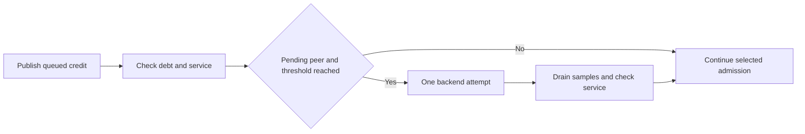

# Selected scheduling handoff

`BoundSelectedHandoff` parses the opt-in setting and counts attempted backend calls.
The selected owner calls it after publishing queued credit and checking peer service.
Admission requires pending peer service and at least 500,000 ns of peer debt.
One admission makes at most one backend call. It never waits for peer completion.

```csharp
handoff.TryHandoff(ObserveDebt().Peer, pending is not null);
```

The workload drains samples and checks service again after an attempted handoff.
All earned credit and per-sample debt gates remain authoritative.
No epoch, payment, global delay, or application batch is synthesized by the helper.
Unavailable platforms fail explicitly through `ISelectedHandoffBackend`.



This is an experimental scheduling policy, not an upstream Coz accounting rule.
Its treatment-dependent overhead can bias prediction even if capacity improves.
The retained scheduler failure motivates the experiment; it does not prove the policy correct.
The [first controlled comparison](../../reliability/features/native-signal/selected-handoff.md) fails the CPU 0 handoff treatment after 52 attempts.
Its child requests 50,000 ns but spans 8,244,485 ns, so the journal is rejected.
The control passes in both CPU configurations. No capacity improvement is established.
The policy remains disabled by default. Physical prediction remains unverified.
The [coverage limits](../../reliability/features/native-signal/selected-handoff.md#coverage-and-limits) are accepted for this experiment.
Portable checks cover the policy helper, not workload refresh ordering or backend failure capture through cleanup.

See [the reference](../../docsSrc/Reference/selected-handoff.md), [scheduler evidence](../../reliability/features/native-signal/bound-scheduler.md),
and [the index](../lode-map.md).
