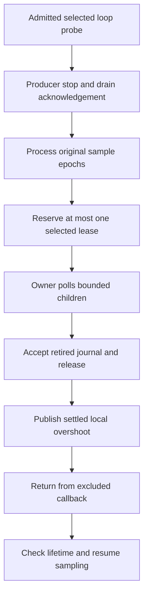

# Selected-owner payment

The opt-in `--sampled-bound-selected-cooperative` draft uses `BoundSampledPaymentWorkload` with a pausable source factory.
The legacy command retains its one-shot source and peer-only payment.
The peer owns slot 0. The selected owner owns slot 1 on the collection thread.
The native controller runs on a dedicated worker. Native registration forbids the controller from becoming a payment target.
Session creation, submission, snapshots, receipt acceptance, cancellation, release, and close run on that controller.
Registration, probe polling, cleanup polling, and retirement stay on each target owner.
The selected thread retains source control and ledger mutation. Synchronous controller dispatch does not transfer source ownership.

```csharp
collection.StartPausable(selectedPaymentSource);
selectedCallback = InjectedProbes.BindBound(PaySelected);
```

An admitted loop probe with selected debt pauses the source and awaits the final drain.
The excluded callback processes old records with their original eligibility epochs before reserving selected service.
It reserves at most one lease per pause. Repeated owner polls pay bounded children until retirement.
It accepts the retired journal, releases the native copy, and publishes local overshoot only when local delay covers global delay.
This catch-up must not reserve another lease. Resume follows callback return and the CLR lifetime check.



Sample credit excludes the first observation in each eligibility epoch without discarding the fractional remainder.
Debt gates use local and global ledger snapshots. Final peer settlement can leave bounded selected debt.
The 2 ms observed debt, 50 µs child, 5 ms handler, and 100 ms receipt bounds remain unchanged.

Failure capture reads both slots before formatting exceptions. These reads are separate observations, not atomic state.
Cleanup disposes the selected probe binding and stops peer application work before cancellation.
Each slot retains owner-side cleanup polling, retired copy, release, and retirement.
Native close requires peer join and selected retirement. The controller joins after native close.
`BoundCooperativeClient.BeginCleanup` attempts cancellation for every slot and then reports aggregate failures.

Version 3 evidence retains selected payments, local ledger values, source eligibility epochs, pause boundaries, and both failure captures.
It adds an explicit managed clock frequency and parsed receipt intervals. The workload checks the 100 ms interval before applying settlement.
Release completion is a later boundary and is not the receipt deadline endpoint.
The legacy analyzer accepts version 1. `AnalyzeBoundSelectedPayment.py` checks version 3 records.
Earlier version 2 runs retain their own analyzers. Their missing clock and interval fields cannot satisfy the new checks.
Version 3 target run `20261015T163547073-6612a57a` passes all three live cases, three managed groups, native checks, and both Python suites.
The peer-only comparison `20261015T163853102-5a1873fe` passes zero speedup and invalidation but retains a 2,499,909 ns peer-debt failure.
Its version 1 analysis verifies the partial evidence without promoting the runtime failure.
It verifies sample epoch ownership, fractional credit, selected and peer receipts, local debt arithmetic, and managed pause/counter boundaries.
It checks native receipt clocks separately. It does not infer a managed/native clock mapping or replay every ledger transition.
Its corruption checks preserve failed runtime results even when retained diagnostic evidence is internally consistent.
Signed transport errors remain raw diagnostics. Integer fields reject JSON booleans.
Final cleanup must match the latest recorded release, allowing ties when timestamps cannot distinguish their order.
`LinuxBoundSelectedPayment` runs the three live cases through the shared runner's `-SelectedPayment` mode.
The runner retains source copies and executes the matching analyzer from that snapshot.
Run `20261015T154345170-cd2378f6` retains the original controller/target registration rejection before sampling.
Its three cases did not reach payment. The corrected draft uses a separate controller instead of weakening the native role contract.
Run `20261015T154641258-aac1c426` passes the two managed groups in Linux and all three live runtime cases.
Its treatment settles 2,727 selected leases over 2,728 pauses, earns 1 ms credit, and ends with 94 ns selected debt.
Its invalidation case retains one selected payment, rejects resume, and closes both targets and controller.
The full `LinuxBoundSelectedPayment` target passes in `20261015T160430592-62810d5f` with source and binary hashes unchanged.
It runs twelve native checks, three managed groups, both eighteen-test Python suites, and version 2 analysis of all three live cases.
Its treatment ends with 129 ns selected debt and zero peer debt. Independent replay does not establish prediction accuracy.
The subsequent initial-counter ordering check passes the selected suite and offline replay of those retained records.
These facts establish a bounded ownership path, not acceptable overhead, stable capacity, or prediction accuracy.
Run `3723a32f` credits only one selected interval. A run with no eligible selected interval must fail the reach condition.
This sensitivity remains an accepted limitation of the ownership diagnostic and must be measured before prediction work.
`SelectedPaymentPreservesEpochRemainder` verifies old-epoch rejection, one required-epoch advance, baseline exclusion, and retained fractional credit.
Portable cancellation checks cover failures at pending lookup, visibility read, and cancellation, with independent slot progress.
They also cover original error retention, delayed polling permission, retired-slot omission, retry recovery, and retained prior cancellation.
Live native cancellation/release failures remain outside the current evidence. Commit review remains required.

See [retained evidence](../../reliability/features/native-signal/bound-selected-payment.md).

See [the reference](../../docsSrc/Reference/bound-sampled-payment.md), [pausable collection](pausable-collector.md),
[debt observations](cooperative-debt.md), and [the index](../lode-map.md).
