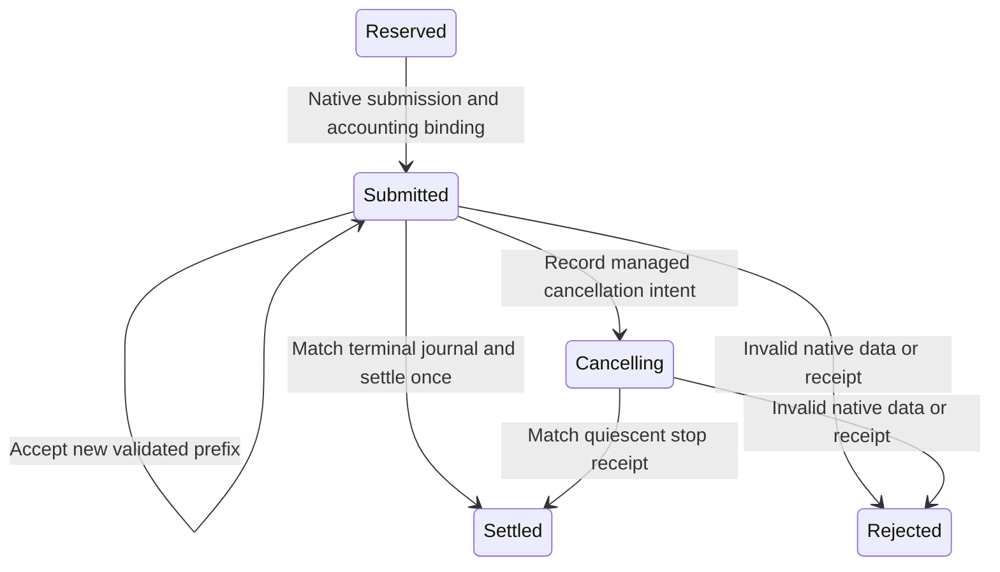

# Service accounting adapter

`ServiceAccountingAdapter.cs` connects [native observations](service-interop.md) to the immutable [service accounting model](signal-service.md).
Its [pure checks](../../reliability/features/native-signal/service-accounting/README.md) pass on Windows and Linux.
Controlled live Linux journals also pass through the adapter into the ledger.
It does not yet replace the sampled workload controller.

## Cursor and state

The adapter retains a lease, command, immutable accepted prefix, confirmed wait, cancellation intent, and terminal status.
Each call receives the latest accounting state, including selected credit that arrived during native service.
The adapter rejects a missing lease or accounting progress that differs from its cursor.
Progress includes child count, final native sequence, and measured wait.
A zero-wait child still advances the journal position.
Observation and cancellation both require matching accounting progress.
Previously accepted child records and first receipt bounds must remain unchanged.
Repeated snapshots do not reapply accepted children.

```csharp
var applied = adapter.Accept(observation, state);
adapter = applied.Adapter;
state = applied.State;
```

The adapter checks identity, command, budget, counts, native failure fields, and lifetime flags before transitions.
New children require ordered native timing, valid backend outcome codes, eligible addresses, and bounded first managed receipt.
The backend supplies outcome and address rules. The portable adapter contains no OS error constants.
The accounting model checks ordinal, native sequence, remaining request budget, and exact measured wait.
An invalid suffix publishes neither a partial cursor nor a partial accounting state.
The caller retains the raw observation on failure.



## Settlement and cancellation

An active native journal cannot contain a terminal child.
Normal completion requires a terminal child and no outstanding request.
The complete measured sum settles the ledger once, including overshoot.
New selected credit remains outside the original lease budget.
The settled cursor rejects replay.

Cancellation requires managed intent before a cancelled native result can settle.
The stop receipt matches identity, accepted count, last sequence, measured total, and zero outstanding children.
An empty cancellation pays no debt.
Native failures and late receipts do not become successful accounting completion.

The live interop fixture now passes its actual native journal to this adapter.
It reserves 110,000 ns from a synthetic selected sample and binds the same identity to the native command.
Its late-receipt fixture must retain the ledger reservation while native quiescence permits process teardown.
That fixture cannot produce an accepted profiling observation.

The [cost workload](service-accounting-cost.md) measures fixed journal processing and accepted-array copying.

See [the native debt plan](../plans/native-debt-service.md) and [the index](../lode-map.md).
