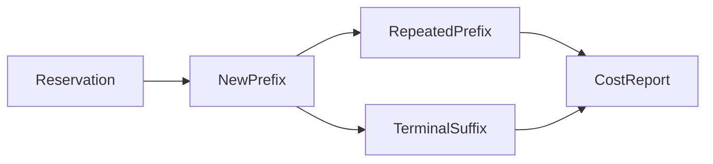

# Service accounting costs

`ServiceAccountingCosts.cs` measures the real adapter with fixed synthetic journals.
`ServiceAccountingCost` builds the workload and writes a unique JSON report under `artifacts/service-accounting-cost/`.

```powershell
dotnet run --project build -t ServiceAccountingCost
```

Each case starts from a real 110,000 ns accounting reservation.
Prefixes contain 1, 8, 32, or 64 measured children.
Each child contributes 1,000 ns and preserves the 50,000 ns request cap.
The terminal case appends one deferred child with zero wait.
New-prefix cases parse the complete prefix from the original state.
Repeated-prefix cases validate and copy an already accepted prefix.
Terminal-suffix cases parse the final child and settle the aggregate.

Each operation checks accepted count, measured total, terminal status, and pending reservation count.
Setup and report serialization stay outside the measured interval.
Measurements include the operation checks and loop overhead.
Each case uses 256 warmup calls and five batches of 2,000 calls.
Batch order rotates through the three operations.
The report retains elapsed ticks, clock frequency, thread allocations, collection counts, checksums, and failures.
No timing threshold determines success.



These cases measure adapter processing and its accepted-array copy.
The [retained Windows and Linux runs](../../reliability/features/native-signal/service-accounting-cost/README.md) each complete 60 batches.
Repeated 64-child prefixes allocate 776 bytes per call in each platform's first batch.
They do not measure native snapshot copying, signal service, or sampled capacity.
Synthetic timestamps validate journal parsing but do not represent live receipt latency.
See [the adapter](service-accounting-adapter.md) and [the native service plan](../plans/native-debt-service.md).
