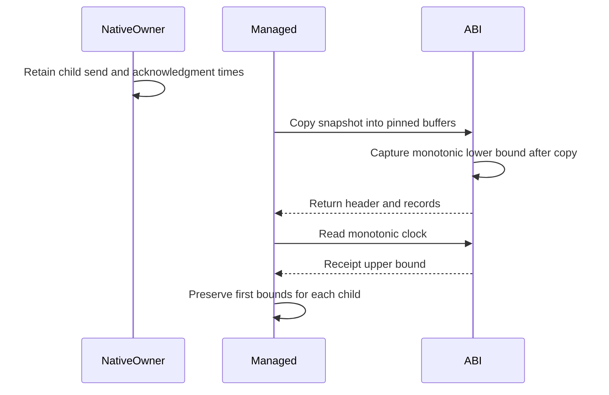

# Service interop

`native/service/ServiceApi.h` defines the fixed-width C ABI for the native service prototype.
`ServiceApi.Linux.cpp` connects that ABI to the Linux transport.
`NativeServiceClient.cs` consumes it through source-generated `LibraryImport` calls.
The [retained runs](../../reliability/features/native-signal/service-interop/README.md) pass native ABI and controlled managed receipt checks on Linux x64.
The receipt parser also passes on Windows.
The sampled workload and ledger adapter do not use this path yet.

## Memory and controller ownership

One process can own one successfully installed service session.
The opening OS thread owns submission, cancellation, snapshots, clock reads, release, and close.
The host must keep that controller thread alive until close.
The separate native owner thread still owns signal installation, request submission, acknowledgment reads, and restoration.
Registration and retirement must run on each target thread.

The native session owns its transport, owner, and cached snapshots.
The caller owns output buffers. Native calls do not retain their pointers.
The ABI uses 88-byte acknowledgments, 104-byte children, and 104-byte snapshot headers.
Both sides check those layouts.
Unknown handles and stale handles fail before native session access.
C++ exceptions become error codes at the ABI boundary.

A snapshot with insufficient buffers returns required counts and `ENOBUFS`.
It does not authorize release, even if the internal owner has observed a terminal journal.
Release requires a complete successful copy with no outstanding child.
Close requires release, target retirement, and host-side joins.
The host remains responsible for proving those joins.

`ServiceSessionHandle` uses `SafeHandle` to keep calls alive across native access.
The host must call `CloseAfterThreadJoin` on the opening thread.
A finalizer cannot prove target joins or satisfy controller affinity.
Its failed close retains process-owned native state instead of freeing an active owner.
An isolated-process watchdog remains mandatory for unresolved ownership.

```csharp
var client = new NativeServiceClient(begin, size, SignalWaitMode.Spin);
client.Submit(1, leaseIdentity, command, budget);
var observation = client.Read(1, leaseIdentity);
```

## First managed receipt

The client reads the native monotonic clock after the snapshot call returns to managed code.
That clock reading is an upper bound for first managed receipt.
The snapshot's final native clock reading is a lower bound.
Both readings use the same clock domain as each child's native send time.
This path needs no offset assumption between `Stopwatch` and the native clock.



`ServiceReceiptTiming.Parse` requires ordered nonzero timing and a successful clock read.
The upper bound minus the child's send time must not exceed 100,000,000 ns.
The client preserves each child's first receipt bounds across later snapshots.
It does not restart the timeout at lease completion or repeated observation.
An excessive upper bound fails the conservative gate. It does not prove the exact managed receipt time exceeded the limit.
Raw observations remain available before receipt parsing.

The current client copies retained journal arrays when it returns an observation.
Allocation cost and snapshot-copy overhead remain unmeasured.
Do not connect this client to a capacity comparison without measuring those costs.

## Checks

`ApiChecks.cpp` checks controller affinity, buffer rejection, guarded copies, stale handles, and close ownership.
`ServiceReceiptTimingChecks` checks exact limits, clock order, failed clocks, and large absolute timestamps.
`ServiceInteropChecks` uses a registered managed target with an ineligible instruction range.
The normal fixture checks a deferred child and stable first receipt bounds after another 150 ms.
The late fixture delays its first read by 150 ms and requires receipt rejection.
Both fixtures retain the raw observation and teardown result.
Neither fixture establishes sampled capacity or physical prediction accuracy.

See [native ownership](native-service-owner.md), [Linux transport](linux-service-transport.md), and [the debt plan](../plans/native-debt-service.md).
