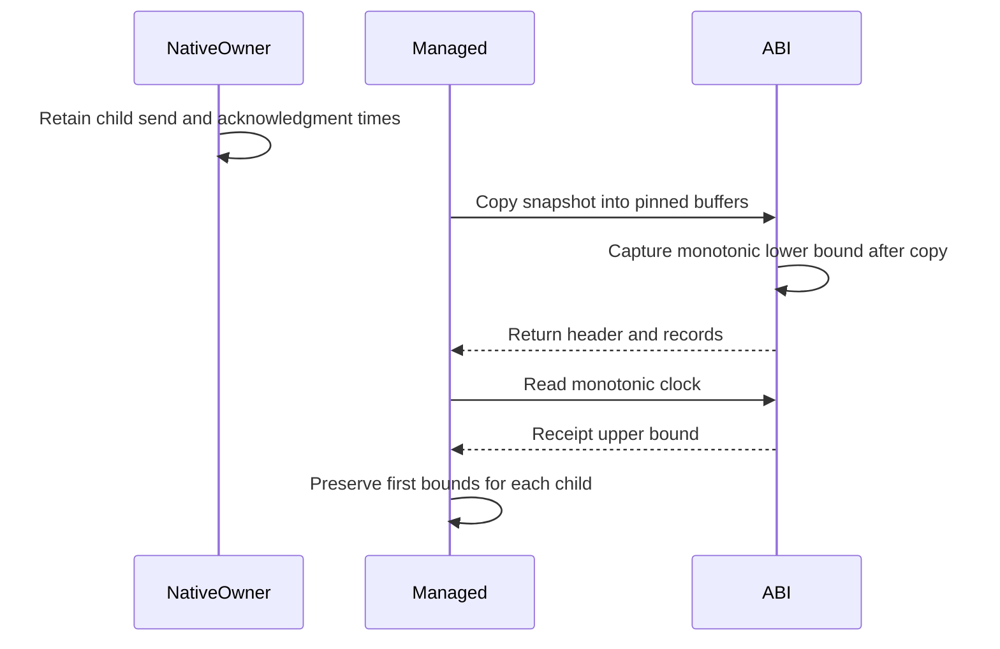
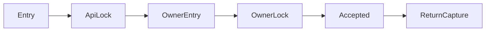

# Service interop

`native/service/ServiceApi.h` defines the fixed-width C ABI for the native service prototype.
`ServiceApi.Linux.cpp` connects that ABI to the Linux transport.
`NativeServiceClient.cs` consumes it through source-generated `LibraryImport` calls.
The [retained runs](../../reliability/features/native-signal/service-interop/README.md) pass native ABI and controlled managed receipt checks on Linux x64.
The receipt parser also passes on Windows.
The [ledger adapter](service-accounting-adapter.md) passes pure checks and controlled live journal checks.
The optional `--sampled-service` workload uses this path. Its first treatment fails the lease capacity bound during warmup.

## Memory and controller ownership

One process can own one successfully installed service session.
The opening OS thread owns submission, cancellation, snapshots, clock reads, release, and close.
The host must keep that controller thread alive until close.
The separate native owner thread still owns signal installation, request submission, acknowledgment reads, and restoration.
Registration and retirement must run on each target thread.

`coz_service_owner_thread` returns the signed 32-bit Linux ID of the installing native owner.
The getter requires controller affinity and an active session. Rejection clears the caller's output to zero.
Transport installation publishes the ID before `Owner::start` returns through its mutex-protected readiness handshake.
The ID remains immutable until close. Optional scheduler capture stops before owner shutdown.
Native ABI checks cover identity stability, distinct controller identity, output guards, null output, wrong-thread access, and stale handles.

The native session owns its transport, owner, and cached snapshots.
The caller owns output buffers. Native calls do not retain their pointers.
The ABI uses 88-byte acknowledgments, 104-byte children, and 104-byte snapshot headers.
Both sides check those layouts.
Unknown handles and stale handles fail before native session access.
C++ exceptions become error codes at the ABI boundary.

A snapshot with insufficient buffers returns required counts and `ENOBUFS`.
It does not authorize release, even if the internal owner has observed a terminal journal.
Release requires a complete successful copy with no outstanding child.
Close requires release, target retirement, and host-side joins.
The host remains responsible for proving those joins.

`ServiceSessionHandle` uses `SafeHandle` to keep calls alive across native access.
The host must call `CloseAfterThreadJoin` on the opening thread.
A finalizer cannot prove target joins or satisfy controller affinity.
Its failed close retains process-owned native state instead of freeing an active owner.
An isolated-process watchdog remains mandatory for unresolved ownership.

```csharp
var client = new NativeServiceClient(begin, size, SignalWaitMode.Spin);
client.Submit(1, leaseIdentity, command, budget);
var observation = client.Read(1, leaseIdentity);
```

## First managed receipt

The client reads the native monotonic clock after the snapshot call returns to managed code.
That clock reading is an upper bound for first managed receipt.
The snapshot's final native clock reading is a lower bound.
Both readings use the same clock domain as each child's native send time.
This path needs no offset assumption between `Stopwatch` and the native clock.



`ServiceReceiptTiming.Parse` requires ordered nonzero timing and a successful clock read.
The upper bound minus the child's send time must not exceed 100,000,000 ns.
The client preserves each child's first receipt bounds across later snapshots.
It does not restart the timeout at lease completion or repeated observation.
An excessive upper bound fails the conservative gate. It does not prove the exact managed receipt time exceeded the limit.
Raw observations remain available before receipt parsing.

The current client copies retained journal arrays when it returns an observation.
The [snapshot cost workload](service-snapshot-cost.md) measures the combined copy, clock, cache, and managed-copy path.
Those fixed costs do not establish sampled workload capacity.

## Optional submission timing

`coz_service_submit_timed` writes a 48-byte `CozServiceSubmissionTiming` record.
Its six native monotonic timestamps bracket API acquisition, owner acquisition, and accepted submission.
`returned` precedes the actual managed return. It is not a managed receipt timestamp.
Null output rejects before submission. Rejected calls retain reached timestamps and clear unreached fields.
Clock failure does not replace the native submission result or release accepted ownership.
Ordinary submissions do not request the additional clock reads.
`NativeServiceClient` optionally captures raw native timing and bracketed managed timestamps.
Native success updates client ownership before timing parsing.
`NativeServiceController` retains raw capture in `finally`, then parses accepted timing into `ServiceSubmissionTiming`.
Submission exceptions and timing rejection retain pending ownership and prohibit slot reuse.
`LinuxServiceSubmissionTiming` runs this diagnostic with both initialization stages.
Managed ticks and native nanoseconds remain separate clock domains.
The [retained submission diagnostic](../../reliability/features/native-signal/service-submission/README.md) fails during measurement at 2,999,990 ns peer debt.
Its largest live managed submission bracket is 61,469 ns.
The final command has a 5,696,617 ns gap from final native child observation to the first managed receipt upper bound.
Submission timing does not explain that gap.
`AnalyzeServiceSnapshotLag.py` matches boundary prefixes to later native journals without crossing clock domains.
The empty prefix for command 1025 establishes a 6,081,358 ns lower bound after owner copying and before ABI capture.
Owner copying and acknowledgment reads share the owner mutex. An absent child's observation must follow the earlier prefix copy.
Surrounding collection counters do not change. Controller scheduling during native snapshot publication remains unresolved.

```cpp
CozServiceSubmissionTiming timing{};
const auto result = coz_service_submit_timed(session, 1, 1, 2, 1, 50000, &timing);
```



`ApiChecks.cpp` verifies record layout, buffer guards, ordering, null output, invalid slot, controller affinity, and stale-handle rejection.
`optionalSubmissionTiming` verifies portable timing reset and unchanged journal settlement.
Elapsed intervals do not establish a scheduling or contention cause.
See [the timing reference](../../docsSrc/Reference/native-service-accounting.md#native-submission-timing).

## Receipt checks

`ApiChecks.cpp` checks controller affinity, buffer rejection, guarded copies, stale handles, and close ownership.
`ServiceReceiptTimingChecks` checks exact limits, clock order, failed clocks, and large absolute timestamps.
`ServiceInteropChecks` uses a registered managed target with an ineligible instruction range.
The normal fixture checks a deferred child and stable first receipt bounds after another 150 ms.
The late fixture delays its first read by 150 ms and requires receipt rejection.
Both fixtures retain the raw observation and teardown result.
Neither fixture establishes sampled capacity or physical prediction accuracy.

See [native ownership](native-service-owner.md), [Linux transport](linux-service-transport.md), and [the debt plan](../plans/native-debt-service.md).
