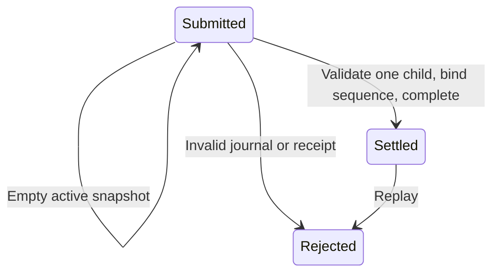

# Selected native service adapter

`ServiceSelectedAdapter` translates slot 0 observations into bounded `SignalAccounting` request completion.
It requires the exact request to be submitted and awaiting a native sequence.
Reserved, already bound, stale, and settled states cannot replace that submission.

```csharp
var result = adapter.Accept(observation, latestAccountingState);
adapter = result.Adapter;
latestAccountingState = result.State;
```

An active journal must contain no children and no measured wait.
It returns the unchanged cursor and accounting state, with no acknowledgment.
A completed journal must contain exactly one child and no outstanding delivery.
That child must match the request identity, command, budget, ordinal, and measured aggregate.
Backend outcome and address delegates keep platform constants outside the adapter.
The adapter parses native phase timing, first managed receipt, and the shared bounded-child domain value.
It then binds the actual native sequence and settles the measured wait in local immutable states.
Only the final state returns to the caller.

Selected service stops after one child even when its measured wait is below the requested budget.
The remainder stays unpaid for a later selected sampling check.
Measured overshoot remains intact.
Deferred children pay zero. Interrupted children retain their measured partial wait.
Cancellation, rejected records, native faults, and invalid receipts retain accounting ownership.
The settled cursor rejects replay.



`ServiceAccountingVerify` runs both peer and selected adapter checks.
The selected checks exercise partial waits, deferred and interrupted outcomes, overshoot, stale states, invalid headers, and late receipts.
`LinuxSelectedServiceInteropVerify` uses the real native owner and slot 0.
Synthetic peer overshoot establishes 30,000 ns of selected debt before native submission.
An ineligible target returns a deferred child and leaves that debt unpaid.
The deliberately late case must reject accounting and retain an unbound submitted request.
Quiescent native teardown does not make a rejected receipt valid.
The [retained checks](../../reliability/features/native-signal/selected-service/README.md) pass on Windows and Linux for pure parsing and on Linux for live slot 0 delivery.
The optional sampled native service path uses this adapter through `NativeServiceController`.
The first live treatment fails during peer warmup before exercising a selected request.
See [request ownership](signal-accounting.md), [peer accounting](service-accounting-adapter.md), and [the native service plan](../plans/native-debt-service.md).
