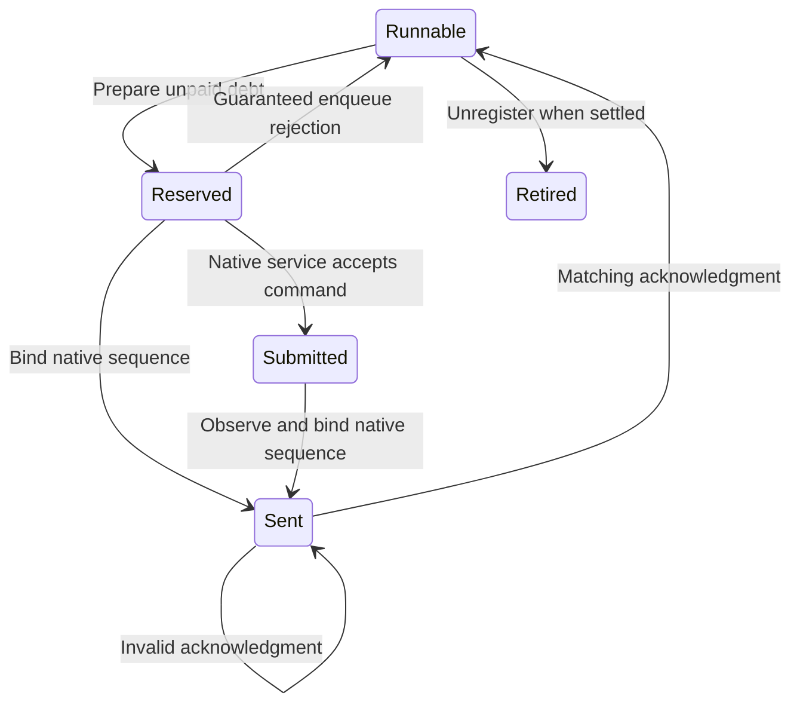

# Signal delay accounting

`src/CozNet/SignalAccounting.fs` connects sample credit to bounded delay requests through the existing immutable ledger.
It performs no sampling, native calls, or waits.
One controller must serialize transitions and retain the latest state.
The ledger clock uses nanoseconds.
An alternative [peer service model](signal-service.md) reserves finite debt snapshots and accepts separate bounded child acknowledgments.
It shares this ledger and blocks individual requests while a lease owns the peer.
The live workload does not use that path yet.

Register sampled threads with `Some percent` and unsampled threads with `None`.
Each sampled registration owns an independent `SampleCreditStream`.
An observation commits its stream transition and local ledger credit together.
`prepare` publishes local credit or reserves a request for unpaid debt.
Each request asks for at most 50,000 nanoseconds.
Other runnable threads can publish credit while a request remains pending.

```fsharp
let state = SignalAccounting.create ()
let selected, state = SignalAccounting.register (Some 50) state |> Result.defaultWith failwith
let peer, state = SignalAccounting.register None state |> Result.defaultWith failwith
let identity = SignalAccounting.sampleIdentity selected state |> Result.defaultWith failwith
let observation =
    CpuSampleObservation.tryCreate identity 1UL 100000UL 0UL SampleThreadState.Runnable SampleLocation.Selected
    |> Result.defaultWith failwith
let _, state = SignalAccounting.observe selected observation state |> Result.defaultWith failwith
let _, state = SignalAccounting.prepare selected state |> Result.defaultWith failwith
let request, state = SignalAccounting.prepare peer state |> Result.defaultWith failwith
```

## Request ownership

`sent` binds a reserved request to a positive, increasing native sequence for that registration.
`submitted` retains ownership when the native service accepts a request before its sequence is available.
It requires a reserved request and rejects duplicate submission.
`sent` can later bind that submitted request to the acknowledged native sequence.
The request identity supplies the native command correlation token.
`isAwaitingSequence` lets the [selected service adapter](service-selected-adapter.md) reject stale reserved or bound states before interpreting a snapshot.
`complete` requires both the request token and its bound sequence.
Duplicate, foreign, stale, and mismatched acknowledgments fail without a state transition.
`rejectedBeforeSend` releases a reservation with zero settlement only before submission or sequence binding.
The adapter must call it only after an enqueue rejection that guarantees no delivery.
An ambiguous native result must retain ownership and fail the isolated run.

`SignalSettlement.Deferred` settles zero delay.
`SignalSettlement.Measured` settles the measured wait, including a partial wait or overshoot.
The adapter must exclude request latency and handler overhead from this duration.
It must reject native errors before it constructs a settlement.
Linux overshoot can advance global delay at the next check.
The selected thread can then owe delay.



## Sampling boundary

A sampled thread cannot earn credit while its request remains pending.
Each reservation advances its required eligibility epoch.
Observations from earlier epochs fail without consuming their sequence or fractional credit.
The first observation in a new epoch establishes a baseline and earns no interval credit.
Epoch overflow prevents reservation.

The adapter must stop sampling around selected-thread intervention and preserve the epoch assigned when each observation was produced.
It must not assign a new epoch to queued observations to bypass this check.
The accounting layer cannot prove that sampling stopped or that an instruction address is eligible.
It does not infer blocking, dependency wakes, or operating-system thread lifetime.

The deterministic checks in `SignalAccountingTests.fs` verify accounting transitions.
Submission cases pass on Windows and Linux with the 73-test library suite.
They cover selected sampling exclusion, registration ownership, delayed sequence binding, and credit arriving during submission.
They do not prove service capacity, native integration, or prediction accuracy.
The [sampled signal workload](sampled-signals.md) connects the live sampler and signal controller through this model.
Its first capacity run fails the observed debt limit.
Investigate repeated overshoot settlement and sampling exclusions before prediction measurements.
Keep final settlement outside the prediction window and retain the two-percentage-point accuracy gate.

See [sample credits](sample-credits.md), [delay ledger](delay-ledger.md), [signal intervention](signal-intervention.md), and [the roadmap](../plans/roadmap.md).
