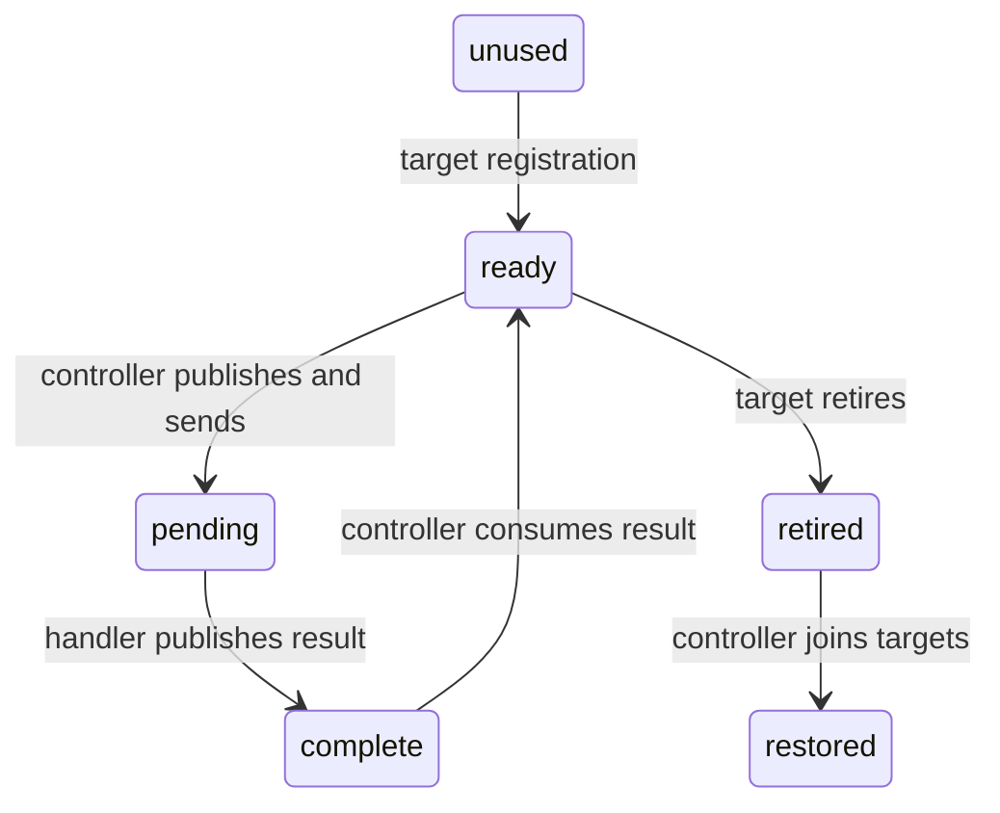

# Bounded signal experiment

The separate `native/signal` library implements a Linux x64 signal experiment without CLR startup profiling or IL rewriting.
`IBoundedInterventionBackend` separates the shared workload from native delivery, registration, mapping, and teardown.
Other platforms require an implementation of that interface. The Linux factory rejects unsupported platforms before native loading.
The public causal engine does not use this backend.

The native library reserves `SIGRTMIN + 6` only when its disposition is default.
Two fixed slots retain native state for the process lifetime. Registration rejects a blocked signal.
The controller sends one queued request per slot with a monotonically increasing sequence.
The handler checks sender process, user, target thread, sequence, and the interrupted instruction pointer.
Only the warmed arithmetic method range permits a wait. Other addresses produce deferred acknowledgments.
The range comes from a unique, nonoverlapping runtime perf-map entry with tiering and ReadyToRun disabled.

The handler uses Linux x64 direct syscalls and lock-free atomics. It makes no managed callbacks or libc sleep calls.
Its absolute sleep deadline permits at most 50 microseconds of requested delay. Interrupted waits return without retry.
The recorded handler interval excludes entry checks, publication, and return. It is not a complete signal residence measurement.
Acknowledgment publishes the result. It does not prove that the handler has returned to managed execution.
The controller stops sending before target-side retirement and thread join. Retirement blocks delivery and checks the target's pending queue.
Only then does the controller restore the disposition.
An acknowledgment timeout abandons normal teardown. Static state and code remain loaded until the bounded child process exits.
Slots cannot be reused. This experiment has no cancellation or general signal-chaining API.

`LinuxSignalVerify` runs baseline, zero-delay, and 50-microsecond cases, each with and without forced blocking GC.
It preserves request results, GC call duration, reported GC pauses, process exits, binary hashes, and disassembly.
The fixed bounds are 5 milliseconds of measured handler work, 100 milliseconds for acknowledgment, and 250 milliseconds per GC call.
An external watchdog limits each process to 30 seconds. Failed bounds remain failures.
GC call duration is not direct suspension latency. Signal instruction pointers do not generate CPU samples or causal credit.
The native contract cases check occupied signals, blocked registration, pending ownership, sequence mismatch, deferred service, and retirement.
The six managed cases and three native contract cases pass on the tested Linux x64 container.
These checks do not establish general CLR safety or causal prediction accuracy.
See [retained evidence](../../reliability/features/native-signal/README.md).

```powershell
dotnet run --project build/build.fsproj -- -t LinuxSignalVerify
```



See [signal research](../../docsSrc/Research/native-signal-intervention.md), [CPU events](linux-perf.md), and [the roadmap](../plans/roadmap.md).
