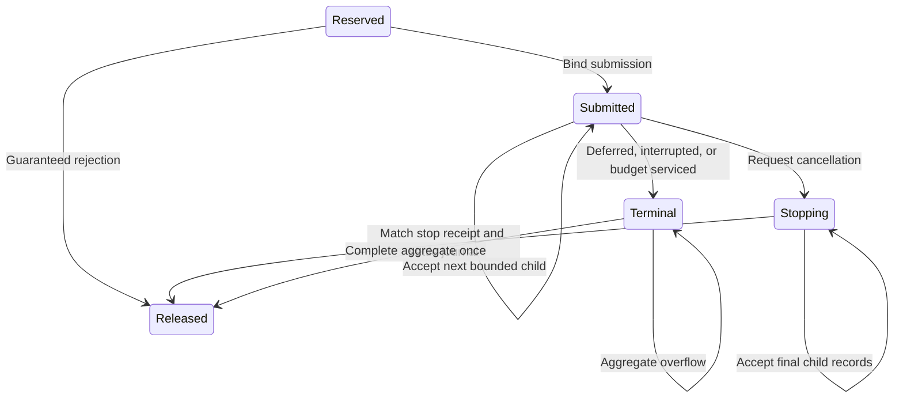

# Peer service accounting

`SignalService.fs` defines parsed lease and child values for the internal accounting model.
`SignalAccounting` reserves the unsampled peer while it accepts a bounded child journal.
The [native service owner](native-service-owner.md) has portable fake-transport checks.
Its [Linux transport](linux-service-transport.md) passes controlled native delivery and lifetime checks.
Its managed workload adapter is not implemented.
The current sampled workload still uses individual requests.

## Reservation and submission

`prepareService` reserves the peer's complete snapshot debt, up to 2,000,000 ns.
A settled peer returns no lease. A sampled thread or excess debt returns an error.
Each lease carries a new identity and the ledger's registration handle.
The ledger remains delaying until the journal terminates and aggregate completion succeeds.
Individual requests and retirement therefore fail while service owns the peer.

`sentService` binds submission once.
`rejectedServiceBeforeSend` releases an unsubmitted reservation with zero settlement.
It rejects submitted leases because submission can have delivered work.
`requestServiceCancellation` records cancellation intent after submission without releasing ownership.
Repeated requests are idempotent. The model still accepts child acknowledgments that arrive before the confirmed stop.
Ambiguous delivery must retain ownership.

```fsharp
let leaseOption, state = SignalAccounting.prepareService peer state |> Result.defaultWith failwith
let lease = Option.get leaseOption
let state = SignalAccounting.sentService lease state |> Result.defaultWith failwith
```

## Child journal

`SignalServiceChild.tryCreate` rejects empty identity, invalid ordinal, zero native sequence, and requests outside 1–50,000 ns.
It accepts ordinals up to the existing 100,000-record capture bound.
Measured wait must be nonnegative and no greater than the handler interval.
The handler interval must not exceed 5 ms. The observation interval must contain it and not exceed 100 ms.
A deferred outcome must carry zero wait. Measured and interrupted outcomes require an eligible address classification.
Native error outcomes cannot become accounting children.

The native adapter must establish those inputs from the actual acknowledgment.
It must validate native error codes, instruction addresses, clock relationships, and the first managed receipt time.
The parser cannot prove those external observations or native quiescence.
Raw native records must remain available beside the parsed journal.

`acceptServiceChild` requires a submitted lease and an exact identity match.
The ordinal must extend the accepted prefix by one. Native sequences must increase across the peer's operations.
The requested wait must equal the lesser of 50,000 ns and the remaining snapshot debt.
Rejected records leave the immutable state unchanged.
Each accepted child contributes its entire measured wait, including overshoot.
New selected credit does not increase the lease budget.

A deferred or interrupted child terminates the journal.
A measured child terminates it when the cumulative wait reaches the original debt snapshot.
A terminal journal cannot accept another child.
`confirmedServiceNanoseconds` reports only the accepted prefix for debt diagnostics.



## Completion and scope

`completeService` requires a terminal child and settles the complete measured sum once.
It returns that sum and the state with its reservation removed.
Duplicate and foreign completion fail. Arithmetic overflow retains the terminal reservation and its accepted journal sum.
Overshoot becomes global only at ordinary catch-up, as in individual request accounting.
The workload adapter must commit its wait counters and remove the diagnostic prefix without an intervening observation.

Eight service cases in `SignalAccountingTests.fs` exercise the real accounting functions.
They cover concurrent credit, ownership, journal rejection, partial outcomes, capacity, overshoot, parser bounds, and aggregate overflow.
Two `DelayLedgerTests.fs` cases separately compare aggregate and individual settlement for fixed journals.
These checks do not run a native pump, establish target lifetime, or prove service capacity or prediction accuracy.

## Cancellation receipt

`SignalServiceStopReceipt.tryCreate` requires a nonempty lease identity, bounded child count, nonnegative measured total, and zero outstanding children.
An empty journal must have zero sequence and measured wait. A nonempty journal needs a positive final native sequence.
`confirmServiceStopped` requires prior cancellation and exact agreement with the accepted child count, final sequence, and measured sum.
It rejects a receipt that skips a child which the managed owner has not accepted.
Successful confirmation settles the complete prefix once and removes the reservation.
An empty confirmed stop pays zero and preserves the original debt.
Foreign, duplicate, and inconsistent receipts leave the original state intact.

Four cancellation cases cover retained ownership, a late child, matching journal fields, and invalid stop receipts.
The native transport must stop new submissions and resolve every outstanding child before producing this receipt.
Parsing a reported zero cannot prove that native service has stopped.
The lifetime adapter must also preserve target registration until the native owner confirms that stop.

See [the service plan](../plans/native-debt-service.md), [signal accounting](signal-accounting.md), and [the delay ledger](delay-ledger.md).
