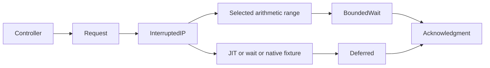

# Signal runtime transitions

`SignalTransitionWorkload` exercises JIT activity, a native wait, a managed wait, and repeated managed/native transitions.
Each case runs with and without forced GC. It uses the existing bounded signal backend and does not create causal credits.
`ISignalTransitionOperations` separates native workload operations and address classification from the shared harness.
The Linux implementation loads the separate `CozNet.SignalWorkload` fixture and captures executable library mappings from `/proc/self/maps`.
The evidence preserves mapped image names, permissions, device/inode identities, and SHA-256 hashes.
The signal handler does not call this fixture or read process maps.
The shared `SignalTargetLifetime` keeps registered targets alive until the controller stops sending, even after target failure.
Deterministic checks verify failed and completed target lifetimes, target-side retirement, and retained pending ownership.

The JIT workload creates fresh dynamic methods, prepares their delegates, and checks each result.
Success requires a saved interrupted instruction pointer inside an executable `libclrjit.so` mapping.
The handler must defer every JIT interruption without waiting.
The native-wait case holds the target inside a P/Invoke until controller release.
The managed-wait case requires an explicit entry marker and `WaitSleepJoin` before signal delivery.
Both wait cases must defer every request without applying delay.
The transition case alternates the selected arithmetic method with a native thread-ID syscall.
Success requires interruptions in both selected managed work and the native fixture.

The native `pending-shutdown` check rejects retirement while a signal remains queued.
It then permits delivery, consumes the acknowledgment, retires the target, joins it, and restores the disposition.
The `exit-with-pending` check terminates a blocked target with a queued signal.
The abandoned request retains ownership. New requests and signal restoration fail. The isolated process exits with native state still resident.
This is an explicit unsupported cleanup outcome, not a cancellation implementation.

`LinuxSignalTransitionsVerify` retains all cases and failures with a 30-second process watchdog.
The original handler, acknowledgment, and GC-call bounds remain unchanged.
All five native contract cases and eight managed transition cases pass on the tested Linux x64 container.
The JIT cases capture hundreds of interruptions inside executable compiler code. Both blocked-wait cases defer every request without delay.
The transition cases reach selected managed work and the native fixture. General CLR safety remains unverified.
See [the retained transition evidence](../../reliability/features/native-signal/transitions.md).

```powershell
dotnet run --project build/build.fsproj -- -t LinuxSignalTransitionsVerify
```



See [signal contracts](signal-intervention.md), [JIT reach research](../../docsSrc/Research/signal-jit-reach.md), and [the roadmap](../plans/roadmap.md).
