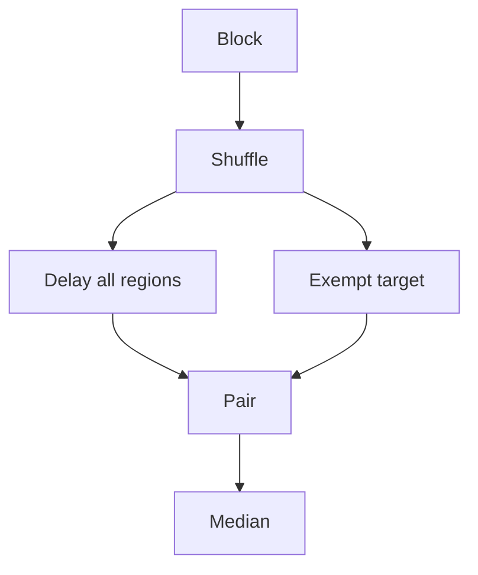

# Serial intervention model

For requested fractional speedup `s`, the engine adds delay `elapsed * s / (1 - s)`.
A control delays every marked region. A treatment exempts the selected region.
Each block shuffles all control/treatment conditions. The summary takes the median of paired elapsed reductions without removing outliers.

```fsharp
let elapsedReduction = 1.0 - treatmentSeconds / controlSeconds
```

Every measured run must execute the target and record equal positive progress.
Sessions belong to one thread. Nested regions and progress inside a region are invalid.
A rejected operation or failed region invalidates the session. Sessions close after success or failure.
Region timestamps measure wall time. Callers must keep waits, I/O, and concurrent work outside the supported workload.

This is a serial proportional-delay prototype. It does not implement Coz synchronization-aware delay credits.
Unmarked overhead, GC, scheduling, and spin-loop contention can bias predictions.
The sample must compare predictions with real reductions in work before any accuracy claim.



See [terminology](../terminology.md), [practices](../practices.md), and [roadmap](../plans/roadmap.md).
