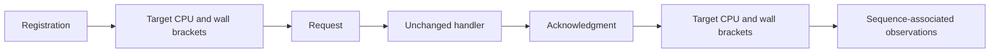

# Target CPU observations

The `--sampled-signal-target-cpu` route adds target CPU observations to the traced workload.
The ordinary and `--sampled-signal-trace` routes keep target CPU capture disabled.
`ITargetCpuObservationBackend` supplies parsed observations without exposing native clock IDs.
Only the Linux x64 backend implements this capability.

Registration captures `pthread_getcpuclockid(pthread_self())` and the clock resolution before publishing the slot.
The controller reads this clock before sending a request and after consuming its acknowledgment.
Both reads have native `CLOCK_MONOTONIC` brackets.
The handler does not read the CPU clock.
The 40-byte diagnostic record is separate from the existing result and phase records.

The registration identity is the slot index plus one within this installation.
Slots cannot be reused, and installation cannot restart within the process.
The clock ID does not retain the target thread or prevent TID reuse.
`SignalTargetLifetime` holds the target alive until delivery and clock reads stop.
Retirement and join follow that barrier.
Native queries reject unused and retired slots, callers other than the controller, and registrations without CPU capture.

Completed request records retain a missing end observation if the read fails.
The workload also retains the error and fails.
Clock errors never become zero CPU observations.
Clock resolution is metadata, not a claim about accuracy.
CPU deltas include execution after the last handler clock reading until acknowledgment observation.
They require interval bounds before they can describe execution before the first handler clock reading.
Low CPU time does not distinguish blocking from runnable descheduling.

The native `TargetCpuChecks` fixture compares remote observations with the target's own clock during a controlled CPU interval.
It checks disabled capture, caller ownership, request consumption, and retirement rejection.
`TargetCpuSnapshotPreservesBrackets` checks the managed parsing boundary.
The [native clock workload](../../reliability/features/native-signal/target-cpu-clock.md) measures query cost with busy and sleeping targets.
Its twelve cases pass consistency checks. Sleeping remote cases show zero target CPU advance.
Added controller CPU averages 282–343 ns per reading relative to the paired native baseline.
These short native runs do not establish clock accuracy, managed overhead, or sampled prediction accuracy.
The first four-case capture retains two treatment failures.
All 28,012 completed treatment requests have both observations.
Both zero-percent cases pass. The no-GC treatment fails the debt limit.
The GC treatment also fails the acknowledgment protocol check.
The target CPU analyzer rejects five GC-treatment records where CPU exceeds the enclosing wall interval.
It preserves raw anomalies and fails the complete analysis.
Its model bounds assume exact clock accounting. Reported resolution does not establish accuracy.
The no-GC comparison passes clock consistency and suspension correlation.
Its peak-debt service interval has no suspension overlap.
The preceding request records little controller CPU while target CPU advances.
The GC trace lacks required markers and fails correlation.
See [the retained comparison](../../reliability/features/native-signal/target-cpu.md).

The FAKE target collects three blocks by default.

```powershell
dotnet run --project build/build.fsproj -- -t LinuxTargetCpuCollect
```

The retained one-block capture used this command:

```powershell
pwsh -NoProfile -File native/CollectLinuxRuntimeTraces.ps1 -TargetCpu -Repetitions 1 -EvidenceDirectory artifacts/target-cpu
```



See [signal contracts](signal-intervention.md), [trace records](runtime-suspension-trace.md), and [the index](../lode-map.md).
