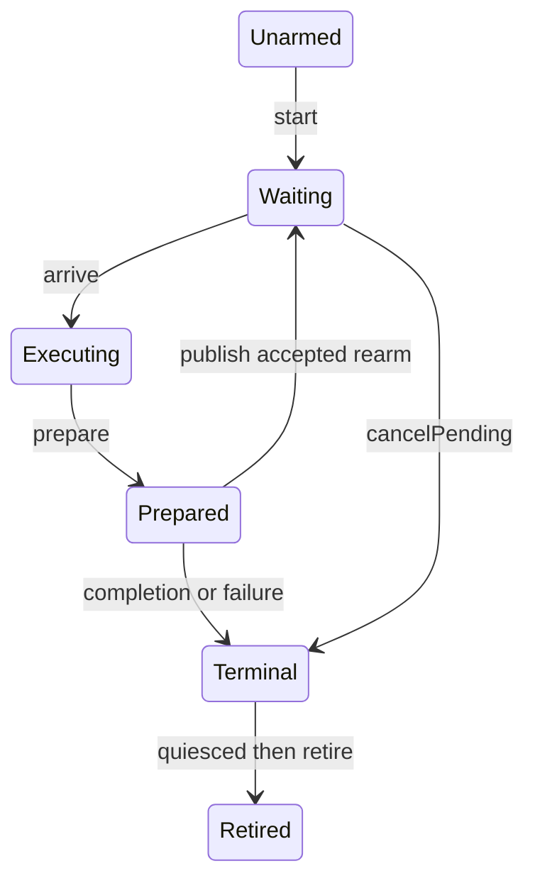
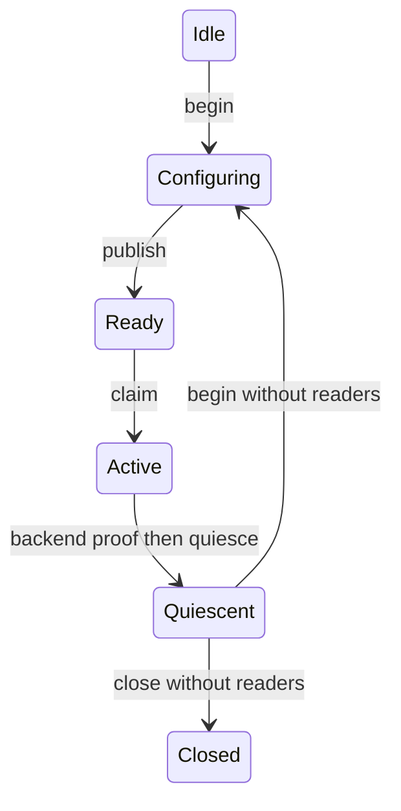

# Portable target-local lease

`TargetLeasePlan` parses a nonzero generation and command, a 1..2,000,000 ns budget, and a nonwrapping instruction range.
Its alternative `parseCooperative` accepts a parsed `CooperativePollSite` with nonzero worker, code-version, and site identities.
The plan stores eligibility as a variant. `arrive` cannot consume a cooperative plan.
`arriveAtPoll` cannot consume an interrupted-address plan.
Wrong kinds and generations leave state unchanged. A same-kind mismatch records deferred zero-payment service.
Cooperative child records retain the full site value and zero `ip`.
Timer children retain `ip` and no site.
The shared prepare/publish path keeps all existing duration, payment, cancellation, and snapshot rules.
Site parsing proves identity shape only. A transport must bind real thread ownership, code lifetime, and probe provenance.
The [portable cooperative transport](cooperative-target.md) consumes this path with owner-thread and code-lifetime guards.
The [managed cooperative boundary](cooperative-managed.md) supplies receipt parsing and ledger binding for manual polls.
Injected probe binding remains incomplete. The existing timer C ABI is unchanged.
The [admission evidence](../../reliability/features/native-signal/cooperative-admission.md) records portable checks and timer interop regression checks.
`TargetLease` has one target owner and caller-owned journal storage. It has no OS calls or allocation.
It is noncopyable, nonmovable, and single-use. Its address stays stable through retirement.

```cpp
auto plan = TargetLeasePlan::parse(1, 1, 110000, 100, 20);
std::array<TargetLeaseChild, 4> records;
TargetLease lease(*plan, records);
```

```cpp
auto site = CooperativePollSite::parse(1, 2, 3);
auto cooperative = TargetLeasePlan::parseCooperative(1, 1, 50000, *site);
```



Private admission and completion tokens bind the instance, generation, command, and child ordinal.
They reject stale events even when a later lease occupies the same storage address.
The model does not generate registration identities or prove global uniqueness.
The transport must prevent generation reuse while old delivery remains possible.

`prepare` records wait evidence and computes the bounded continuation before the backend rearms.
`publish` captures final handler timing after rearm and retains raw invalid records.
Valid completed wait survives rearm failure, cancellation, journal exhaustion, and measured overshoot.
Invalid wait or handler timing does not increase accepted measured time.
Accepted rearm ownership survives a later cancellation or validation failure.

`quiesced` records a backend proof. It cannot inspect native delivery itself.
The Linux fixture blocks delivery, deletes its one-shot timer, and drains pending signals before notification.
No model transition permits restart. New leases need a separate lifecycle owner and proven timer quiescence.

The timer fixture arms its first expiration on the target while delivery is blocked.
It publishes core state before unblocking. The initial interval is 1 ms. Later intervals are 10 µs.
This avoids publishing core state concurrently with an initial handler.

Portable checks cover bounded plans, overshoot, per-child eligibility, cancellation stages,
pending ownership, rearm failure, handler bounds, journal capacity, and stale tokens.
The portable suite passes on Windows and Linux. The timer fixture passes both native cases using this core.
`snapshot` copies release/acquire-published immutable prefixes for concurrent readers.
The active count excludes the terminal child. A separate immutable terminal header contains the complete count and accepted sum.
Readers acquire visibility before selecting either active count or terminal header.
A stale active visibility therefore selects an earlier valid prefix, not a partial terminal record.
Quiescence and retirement publish distinct visibility states without changing the sealed terminal header.
Copy destinations cannot overlap journal storage. All readers must finish before storage is released.

Portable checks force reads during preparation and after first publication, then race two readers with 200 child publications.
They check immutable prefixes, accepted sums, terminal visibility, quiescence, and retirement.
The `snapshot-chain` native mode copies prefixes while timer handlers continue independently.
Its first native receipt timestamp follows the first successful copy of each child.
`TargetLeaseReceipts` copies raw input before validation and caches each child's first managed receipt.
It rejects identity/count changes, mutable prefixes, backwards visibility/capture time, and mutations after terminal publication.
The first failed capture poisons the tracker. Later reads cannot repair its timing.
Returned accepted prefixes are immutable snapshots. Receipt parsing reuses `ServiceReceiptTiming`.
It does not replace wait accounting or eligibility validation.
Its deterministic checks run through `--verify-service-accounting`.
The [timer ABI](timer-interop.md) checks live first managed receipt and native lease reuse. CLR intervention remains incomplete.

`LeaseMailbox` now supplies portable generation and reader ownership for future transport integration.
One atomic word combines generation, phase, cancellation, and reader count, so a reader and reuse cannot both claim the same quiescent storage.
Private submission and execution tokens bind the mailbox address and generation.
Reader guards release once on destruction and prevent `begin` or `close` while held.
The mailbox must outlive every token and guard. Guards protect lifetime, not arbitrary concurrent journal access.
Generation exhaustion rejects further submissions. New generations clear old cancellation.
Backend proof remains external: `quiesce` requires disarm, drain, and the last old storage access before publication.
`abandonUndelivered` requires proof of no armed, pending, or executing delivery.
Mailbox closure does not establish handler return or registration retirement.

```cpp
LeaseMailbox mailbox;
auto submission = mailbox.begin();
mailbox.publish(*submission);
auto execution = mailbox.claim(submission->generation());
```



`LeaseMailboxChecks` includes held-reader exclusion across 200 generations and 100 read-versus-reuse races.
The Linux `TimerReuseChecks` fixture consumes this core across 16 generations of one timer and one lease storage slot.
Each generation pays one 50,000 ns child, disarms, drains, seals the child, and retires the core after lease quiescence.
Mailbox quiescence is the handler's final shared-state action for that lease.
The controller pins the journal while copying it, requires retired visibility, and verifies rejection of reuse while pinned.
The pinned native attempt does not isolate reader exclusion because mailbox quiescence can still be pending.
Portable mailbox checks separately verify that exclusion after mailbox quiescence.
After reader release and successful `begin`, the controller reconstructs the single-use lease before arming.
The first native receipt timestamp follows the first successful child copy and remains fixed.
The [timer ABI](timer-interop.md) consumes this core from a controlled managed receipt workload.
The cancellation and failure fixtures below cover specific ownership boundaries, not general CLR intervention.
The `cancel-before-delivery` mode cancels odd generations while configuring, before publication and timer arming.
Those generations must retain cancellation through native delivery and retire with zero measured wait.
Even generations must complete normally, proving the previous cancellation does not cross the generation boundary.
The mode does not exercise cancellation during an active handler.
The `cancel-active-handler` mode publishes an active generation after the measured wait while the core remains executing.
The controller cancels that generation. A bounded handler handshake observes cancellation before `prepare`.
Handshake time counts toward the 5 ms handler bound, not credited wait. The handshake limit is 1 ms.
The fixture requires credited wait to equal the recorded interval from `waitStarted` to `handshakeStarted`.
The cancelled child retains its measured wait. Following even generations must complete without inherited cancellation.
The controller's post-call clock can follow handler completion. The assertion uses interval ordering, not a false completion-before-receipt requirement.
This mode does not interrupt a physical wait or exercise cancellation during rearm.
Core retirement does not release storage or the target registration. Mailbox quiescence and reader release still gate storage reuse.
`LeaseMailbox::recover` atomically competes with target execution and returns a private controller recovery token.
The recovering phase excludes claim, cancellation, new readers, begin, close, and duplicate recovery.
Existing readers still prevent reuse after `quiesce(Recovery)`.
`TargetLease::rejectInitialArm` accepts only a positive transport error while waiting before any child admission.
It seals failed stop, arm_failed error, zero children, and zero wait. Possible delivery stays owned until backend quiescence.
The caller must own mailbox recovery and prove rejection before mutating the published core.
Core failure, cleanup, retirement, and final old-storage access precede recovery quiescence publication.
The direct `abandonUndelivered` operation does not authorize published-core mutation.
Portable checks cover exclusive recovery, 100 claim races, state/error boundaries, stale/foreign tokens, and reader retention.
The Linux `reject-initial-arm` mode consumes recovery tokens after exact `-EINVAL` from an invalid nanosecond field.
Prior target-side disarm and drain establish quiescence. No other producer can arm or send the reserved signal.
The no-mutation rejection argument relies on reviewed Linux v6.6 and Microsoft WSL2 `5.15.153.1` sources, not installed-binary verification.
The fixture records the kernel identity and inactive timer fields, but those fields alone do not prove an empty pending queue.
Odd generations require zero children, zero wait, original arm error, and retired failure visibility.
Each even generation must complete normally. Failed generations retain header capture time without claiming a child receipt.
Target-side deletion and drain outside the handler still gate registration retirement.
The `disarm-failure` and `drain-failure` modes complete one child, then reject cleanup through an invalid timer ID or signal-mask size.
They require exact `-EINVAL`, terminal core visibility, preserved wait, and rejected reuse/closure after releasing the reader guard.
Skipped drain calls have `drainAttempted` false, not a fabricated drain errno.
Target-side deletion and valid drain precede core retirement. The final snapshot must preserve the original child and accounting fields.
The mailbox remains unavailable after registration shutdown. These cases do not arm a deleted timer or claim a real pending-signal race.
Handler restoration now requires a successful final drain as well as deletion and target join.

The Linux fixture's `cancel-rearm` case injects cancellation after successful rearm in the first handler.
It observes the pending blocked expiration, disarms the timer, and drains one matching record followed by `EAGAIN`.
The completed child remains accepted. Cancellation work remains inside handler timing but outside intervention wait.
The case requires cancelled stop, one child, no additional retirement drain, timer deletion, and disposition restoration.
It does not implement concurrent cancellation, reusable storage, or a live timer C ABI.

See [the reference](../../docsSrc/Reference/target-local-lease.md),
[the delivery plan](../plans/target-local-lease.md), and [timer research](../../docsSrc/Research/target-local-timer-delivery.md).
