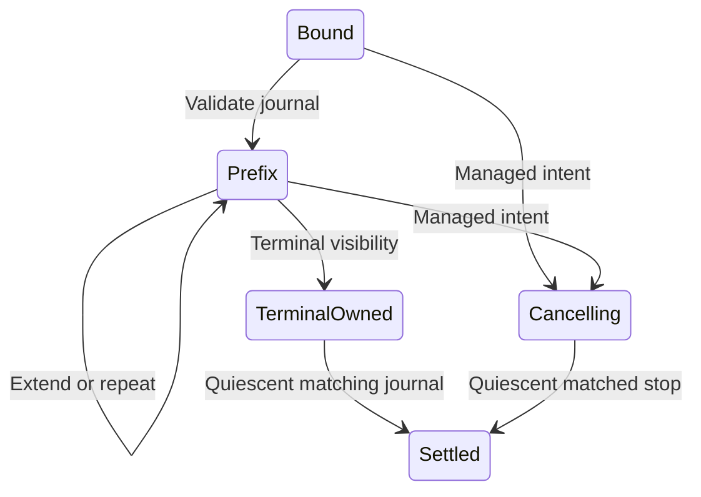

# Timer journal accounting

`TimerAccountingAdapter` connects target-local timer observations to `SignalAccounting` service leases.
`TimerAccountingBinding.Parse` binds a managed lease to a native generation, command, and nonwrapping instruction range.
Generation is limited to the native mailbox's nonzero 32-bit domain.
The sequence is `(generation << 32) | ordinal`, with ordinal from 1 through 100,000.
This preserves ordering across generations for one registered target. It is not a timestamp or CPU sample identity.
Each target registration must retain its own ledger thread. A new registration requires a new ledger thread.

```csharp
var binding = TimerAccountingBinding.Parse(lease, generation, command, begin, size);
var adapter = new TimerAccountingAdapter(binding);
var applied = adapter.Accept(observation, state);
```

The immutable adapter checks accounting progress, raw versus accepted records, first receipt bounds, continuation timing, eligibility, and native totals.
Repeated prefixes do not settle twice. A rejected suffix returns no partial adapter or accounting state.
Terminal visibility alone does not release the reservation. Quiesced or retired visibility must also exclude possible delivery.
Cancellation requires managed intent before a native cancelled stop can settle.
Native failure fields cannot become successful accounting completion.
The original budget excludes selected credit published while a lease runs.



Portable checks run through `TimerLayoutVerify` and the Linux interop layout process.
They exercise immutable prefixes, overshoot with concurrent credit, cancellation, generation reuse, outcome bounds, and atomic rejection.
The live receipt fixture reserves 50,000 ns from synthetic credit and consumes its actual deferred child.
It requires a settled reservation with all debt unpaid. Rejected receipt modes retain the reservation with zero confirmed wait.
Controlled native wait settlement and sampled integration remain unverified.
See [timer interop](timer-interop.md), [service accounting](signal-service.md), and [the index](../lode-map.md).
