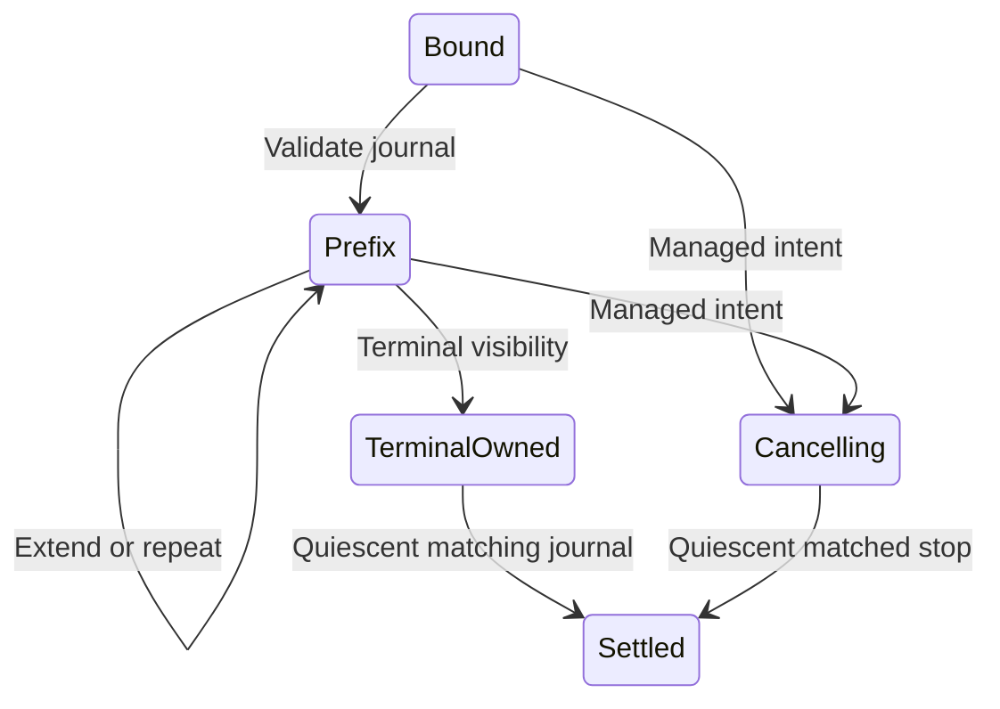

# Timer journal accounting

`TimerAccountingAdapter` connects target-local timer observations to `SignalAccounting` service leases.
`TimerAccountingBinding.Parse` binds a managed lease to a native generation, command, and nonwrapping instruction range.
Generation is limited to the native mailbox's nonzero 32-bit domain.
The sequence is `(generation << 32) | ordinal`, with ordinal from 1 through 100,000.
This preserves ordering across generations for one registered target. It is not a timestamp or CPU sample identity.
Each target registration must retain its own ledger thread. A new registration requires a new ledger thread.

```csharp
var binding = TimerAccountingBinding.Parse(lease, generation, command, begin, size);
var adapter = new TimerAccountingAdapter(binding);
var applied = adapter.Accept(observation, state);
```

The immutable adapter checks accounting progress, raw versus accepted records, first receipt bounds, continuation timing, eligibility, and native totals.
Repeated prefixes do not settle twice. A rejected suffix returns no partial adapter or accounting state.
Terminal visibility alone does not release the reservation. Quiesced or retired visibility must also exclude possible delivery.
Cancellation requires managed intent before a native cancelled stop can settle.
Native failure fields cannot become successful accounting completion.
The original budget excludes selected credit published while a lease runs.



Portable checks run through `TimerLayoutVerify` and the Linux interop layout process.
They exercise immutable prefixes, overshoot with concurrent credit, cancellation, generation reuse, outcome bounds, and atomic rejection.
The live receipt fixture reserves 50,000 ns from synthetic credit and consumes its actual deferred child.
It requires a settled reservation with all debt unpaid. Rejected receipt modes retain the reservation with zero confirmed wait.
The [managed payment workload](timer-managed.md) also settles actual paid journals during controlled arithmetic.
The managed payment workload also checks forced collection reach inside controller command intervals.
General CLR safety and prediction accuracy remain unverified.

`TimerServiceController` owns selected slot 0 and peer slot 1 through `ITimerTransport`.
It separates ledger settlement from native release and retains ownership after ambiguous failure.
Sixteen portable controller checks verify prefix payment, cancellation, failure evidence, release behavior, and unavailable-target accounting.
Cumulative wait checks release two generations in one slot and reject replacement of the first payment by the second.
An active empty journal earns no wait credit as selected samples increase global debt.
The shared `TimerDebtLimit` gate accepts 1,999,999 and 2,000,000 ns and rejects 2,000,001 ns for either slot.
Cancellation can release an empty retired journal but cannot clear that unpaid debt or authorize an oversized replacement lease.
A delayed first child credits only its measured wait, not its arm-to-handler interval.
Probe comparisons include every header field except a nondecreasing capture timestamp.
Retired receipts compare timing values rather than object identity.
Read failures cannot attach an earlier raw capture to a new attempt.
Failed phase closure preserves both the original operation error and the diagnostic error.
Cumulative released wait remains available even when phase closure throws after native release.
Archived journals retain that diagnostic failure. The workload reads released totals directly for debt and output snapshots.
Failed native cancellation remains explicitly unresolved on subsequent cancellation calls.

See the [controller reference](../../docsSrc/Reference/timer-service-controller.md) for the full contract.
See [sampled timer execution](timer-sampled.md) for live integration, initialization, diagnostics, and current limits.
See [timer interop](timer-interop.md), [service accounting](signal-service.md), and [the index](../lode-map.md).
